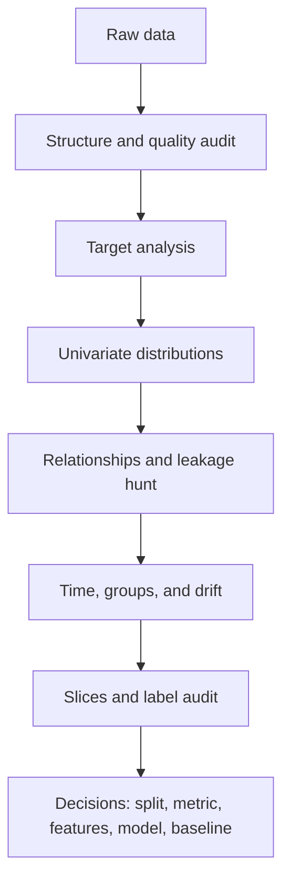
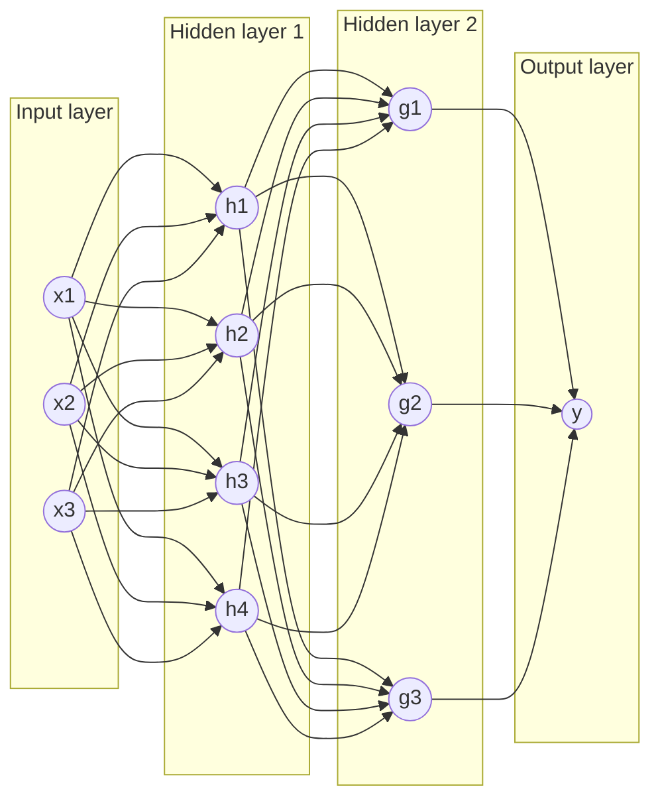
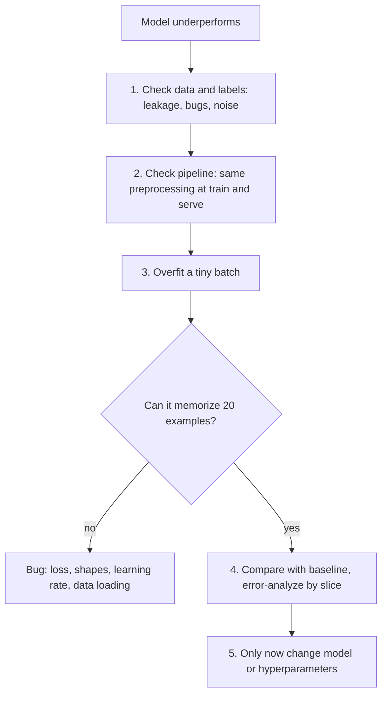
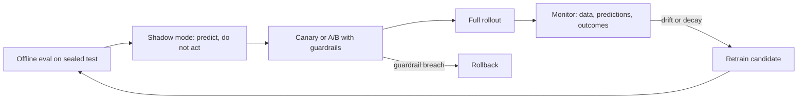

*Bonjour! Biplob here. Most machine learning advice lists techniques. In practice the hard part is choosing between them under constraints: data size, label quality, cost of errors, latency, and who has to maintain the result. This post walks the whole path, from framing and exploratory data analysis (EDA) through models, neural networks and CNNs, training, evaluation, and production, and says what each choice buys and costs. Shoutout to LLMs for helping me write it.*

**Contents**

* TOC
{:toc}

---

## How to make a modeling decision

Any "which model, metric or approach?" question goes better with the same skeleton:


The last step is the most valuable. "I would start with logistic regression" is a weak answer on its own. A strong one adds: *it gives a fast, calibrated, interpretable baseline; if a complex model beats it by one point of AUC the extra maintenance is not worth it; I would switch if error analysis shows strong interactions and I have enough data to support a flexible model.*

---

## Core concepts that drive decisions

### Bias, variance, and generalization

For squared loss, expected test error decomposes as

$$
\mathbb{E}\left[(y - \hat f(x))^2\right] = \underbrace{\text{Bias}^2}_{\text{wrong assumptions}} + \underbrace{\text{Variance}}_{\text{sensitivity to the sample}} + \underbrace{\sigma^2}_{\text{irreducible noise}}
$$

| Symptom | Diagnosis | Remedy |
| --- | --- | --- |
| Train error high, validation error high | High bias (underfitting) | More capacity, better features, train longer |
| Train error low, validation error high | High variance (overfitting) | More data or augmentation, regularize, simplify, early stop, ensemble |

More capacity lowers bias and raises variance. More data lowers variance. Regularization trades a little bias for less variance.

### Losses encode assumptions about noise

| Loss | Formula | Noise assumption | Behavior |
| --- | --- | --- | --- |
| Squared error | $$ (y-\hat y)^2 $$ | Gaussian | Sensitive to outliers; estimates the conditional mean |
| Absolute error | $$ \lvert y-\hat y \rvert $$ | Laplace | Robust; estimates the conditional median |
| Cross-entropy | $$ -\left[y\log p + (1-y)\log(1-p)\right] $$ | Bernoulli | Punishes confident mistakes |
| Hinge | $$ \max(0,\,1 - y f(x)) $$ | None (margin) | Only points near or beyond the margin matter |

**Why cross-entropy for classification instead of MSE?** With a sigmoid output $$ p = \sigma(z) $$, the cross-entropy gradient with respect to the logit is simply

$$
\frac{\partial L}{\partial z} = p - y
$$

so a confidently wrong prediction produces a large corrective gradient. With MSE the gradient carries an extra factor $$ p(1-p) $$ that vanishes when the unit saturates, so learning stalls exactly when the prediction is most wrong.

### Regularization is a prior

$$
\text{Ridge: } \min_w \lVert y - Xw \rVert_2^2 + \lambda \lVert w \rVert_2^2
\qquad
\text{Lasso: } \min_w \lVert y - Xw \rVert_2^2 + \lambda \lVert w \rVert_1
$$

| Penalty | Equals a prior | Effect | Pick when |
| --- | --- | --- | --- |
| L2 (ridge, weight decay) | Gaussian | Smooth shrinkage; shares weight across correlated features | Default |
| L1 (lasso) | Laplace | Exact zeros: sparsity and feature selection | You believe few features matter, or need a sparse model |
| Elastic net | Both | Sparsity plus stability | Sparse and correlated features |

L1's constraint region is a diamond with corners on the axes, so loss contours tend to touch it at a corner where some weights are exactly zero. The catch: L1 picks one feature arbitrarily from a correlated group, which makes it unstable.

### Optimization in one view

$$
\text{SGD: } w \leftarrow w - \eta\, g
\qquad
\text{Momentum: } v \leftarrow \beta v + g,\; w \leftarrow w - \eta\, v
$$

$$
\text{Adam: } m \leftarrow \beta_1 m + (1-\beta_1) g,\quad v \leftarrow \beta_2 v + (1-\beta_2) g^2,\quad w \leftarrow w - \eta \frac{\hat m}{\sqrt{\hat v} + \epsilon}
$$

Linear and logistic regression and SVMs are convex, so they have one global minimum. Neural networks are non-convex, but in practice good local minima are usually fine.

### Probabilistic ideas worth keeping

* **MLE versus MAP.** MAP is MLE plus a prior, and regularization is that prior.
* **Discriminative versus generative.** Discriminative models learn $$ p(y \mid x) $$ directly; generative models learn $$ p(x, y) $$. Generative can win with little data or missing features, discriminative usually wins on accuracy with ample data.
* **Calibration.** Whether a predicted 0.8 really happens about 80% of the time. Ranking quality (AUC) and calibration are separate properties.

---

## Exploratory data analysis: where decisions come from

EDA is not a ritual of plotting everything. Each look at the data should answer a question that changes a decision. Do it **on the training split only**, otherwise your insights leak the test set into your choices.



### What to look at and the decision it drives

| EDA step | What you check | Decision it informs |
| --- | --- | --- |
| Shape, types, duplicates | Row count, dtypes, exact and near duplicates, primary keys | Dedupe before splitting; whether CV is meaningful at this size |
| Missingness | Fraction missing per column, and whether missingness correlates with the target or other columns | Add an "is missing" flag, choose imputation, pick a model that handles NaN natively |
| Target distribution | Class balance (classification); skew and heavy tails (regression) | Metric (PR-AUC over accuracy), class weights, log-transform target, quantile loss |
| Univariate distributions | Skew, outliers, constant or near-constant columns, impossible values | Transform (log, winsorize), drop useless features, separate errors from rare real events |
| Cardinality of categoricals | Number of levels, rare levels | One-hot versus target encoding versus embeddings or hashing |
| Feature-target relationships | Binned target rate, correlation, mutual information | Which features carry signal; whether a linear baseline is plausible or interactions are needed |
| Feature-feature correlation | Correlation matrix, variance inflation factor | Drop or combine redundant features; prefer ridge or trees over plain OLS |
| Leakage hunt | Features that are suspiciously predictive, or only known after the outcome | Remove target-leaking features; define the prediction-time cutoff |
| Time structure | Trends, seasonality, regime changes, label delay | Time-based split, lag features, retraining cadence |
| Group structure | Rows per user, patient, device | Group-aware split to stop entity memorization |
| Train versus serving distribution | Compare feature distributions to what production will see | Expect covariate shift; choose robust features and monitoring |
| Slice analysis | Metric and data volume by segment | Where the model will fail; fairness risks; need for more data on a segment |
| Label audit | Sample and read examples; measure inter-annotator agreement | Whether label noise caps performance; cleaner labels versus more labels |

### Rules of thumb that EDA turns into choices

* A numeric feature with a long right tail suggests a log transform for linear and neural models. Trees do not care.
* Missingness that predicts the target means imputation alone discards signal, so keep an indicator.
* A feature with near-perfect predictive power on day one is a leakage suspect, not a gift.
* Rows-per-entity far above one means a random split will flatter you.
* If a simple baseline already hits the noise ceiling suggested by label disagreement, a bigger model will not help.

---

## Problem framing and data decisions

Most real failures happen before modeling. Establish the decision the model supports, the metric that reflects its business cost, a baseline, and how the data will be split.

### Match the split to deployment

| Situation | Split | Why |
| --- | --- | --- |
| i.i.d. rows | Random, stratified for classification | Matches the assumption; keeps rare-class proportions |
| Time-dependent (forecasting, churn, fraud) | Train on the past, validate on the future | Random splits leak the future and inflate scores |
| Several rows per entity | Group split by entity | Otherwise the model memorizes entities |
| Small data | k-fold CV, repeated if needed | One holdout is high-variance |
| Tuning plus an honest estimate | Train, validation, test, or nested CV | Tuning on the test set biases it; touch the test set once |

### Leakage: the most common hidden failure

* **Target leakage:** a feature that encodes the outcome or exists only after it (for example "refund issued" when predicting fraud).
* **Train-test contamination:** fitting scalers, imputers, encoders or feature selection on all data before splitting. Fit inside the training fold, ideally in a pipeline.
* **Duplicates and near-duplicates** across splits.

If accuracy looks suspiciously good, suspect leakage first and inspect feature importances for something that should not predict.

### Class imbalance

For fraud at 0.2% prevalence, accuracy is 99.8% for a model that never flags anything. The approach:

1. Use imbalance-aware metrics: PR-AUC, recall at a fixed precision, cost-weighted loss.
2. Keep the **evaluation set at the true class ratio**.
3. Start with class weights before resampling. SMOTE and oversampling can add noise or overfit duplicates; under-sampling discards information.
4. Tune the **threshold** to error costs, which is cheaper and more controllable than rebalancing.
5. Recalibrate afterward if probabilities matter, since reweighting distorts them.

### Missing values, outliers, scaling, encoding

* **Missing:** add an indicator, impute with the median or a model, or use trees that handle NaN natively.
* **Outliers:** decide if they are errors or real rare events. Use robust losses (Huber, MAE), winsorizing or log transforms. Deleting real extremes may remove the cases you care about.
* **Scaling:** needed for kNN, SVM, regularized linear models and neural nets; unnecessary for trees.
* **Categoricals:** one-hot at low cardinality; out-of-fold target encoding, hashing or learned embeddings at high cardinality.

---

## Choosing a model

| Family | Reach for it when | Why | Watch out for |
| --- | --- | --- | --- |
| Linear or logistic regression | Baseline; need interpretability, speed, calibrated probabilities | Convex, stable, coefficients explain themselves | No interactions or non-linearity without manual features |
| Decision tree | Need human-readable rules | Mixed types, no scaling | High variance |
| Random forest | Strong default with little tuning; noisy tabular data | Averaging decorrelated trees cuts variance | Large, slower inference, cannot extrapolate |
| Gradient boosting (XGBoost, LightGBM, CatBoost) | Tabular data where accuracy matters | Fits residuals sequentially, reducing bias | Needs tuning; overfits if too deep; cannot extrapolate |
| SVM | Small to medium, high-dimensional data | Max-margin, kernels | Poor scaling past roughly 100k samples |
| k-nearest neighbors | Quick baseline, local structure | No training | Slow inference; breaks in high dimensions |
| Naive Bayes | Tiny data, text baselines | Few parameters | Independence assumption, poor calibration |
| Neural networks | Images, text, audio, sequences, very large data | Learn features end to end | Data-hungry, costly, harder to debug |
| Clustering, dimensionality reduction | No labels, exploration | Reveal structure | Sensitive to scaling and the choice of k |

**Bagging versus boosting.** Bagging trains independent trees on bootstrap samples and averages them to reduce *variance*, so it is hard to break. Boosting adds trees that correct earlier errors to reduce *bias*, so it reaches higher accuracy but will fit noisy labels if unchecked. Learning rate, depth and early stopping matter.

**Neural net on 50,000 tabular rows?** Start with gradient boosting. On moderate tabular data boosted trees typically match or beat neural nets with far less tuning and handle missing values and mixed types natively. Move to a neural net for joint training with other modalities, embeddings for high-cardinality features, or online updates.

**Complexity is a cost.** When two models are within noise of each other, take the simpler one. A 0.3% gain inside the cross-validation standard error is not a real gain.

---

## How a neural network works

A neural network is a stack of layers, each applying a linear map followed by a non-linearity. Without the non-linearity, any number of layers collapses into one linear map.



### One layer

For layer $$ l $$, with weight matrix $$ W^{(l)} $$, bias $$ b^{(l)} $$, and activation $$ \phi $$:

$$
a^{(l)} = \phi\!\left(W^{(l)} a^{(l-1)} + b^{(l)}\right)
$$

Each neuron computes a weighted sum of the previous layer's outputs, adds a bias, and passes the result through the activation.

| Activation | Formula | Use |
| --- | --- | --- |
| ReLU | $$ \max(0, z) $$ | Default hidden activation; cheap, avoids saturation |
| GELU or SiLU | smooth ReLU variants | Common in transformers and modern networks |
| Sigmoid | $$ \frac{1}{1+e^{-z}} $$ | Binary output probability |
| Softmax | $$ \frac{e^{z_i}}{\sum_j e^{z_j}} $$ | Multi-class output distribution |
| Tanh | $$ \tanh(z) $$ | Bounded, zero-centred; older recurrent nets |

### Training: forward, loss, backward, update


Backpropagation applies the chain rule layer by layer. With the error signal $$ \delta^{(l)} = \partial L / \partial z^{(l)} $$:

$$
\delta^{(l)} = \left( W^{(l+1)\top} \delta^{(l+1)} \right) \odot \phi'\!\left(z^{(l)}\right),
\qquad
\frac{\partial L}{\partial W^{(l)}} = \delta^{(l)} \, a^{(l-1)\top}
$$

The repeated multiplication by $$ \phi' $$ and weight matrices is why gradients can **vanish** or **explode** in deep networks.

| Problem | Mitigation |
| --- | --- |
| Vanishing gradients | ReLU-family activations, residual connections, normalization, He or Xavier initialization |
| Exploding gradients | Gradient clipping, lower learning rate |
| Unstable activations | Batch norm (large batches), layer norm (small batches, sequences, transformers) |

---

## How a convolutional neural network works

Fully connected layers ignore image structure and need enormous parameter counts. A **CNN** exploits two facts: nearby pixels are related (locality), and the same pattern can appear anywhere (translation invariance). It does this by sliding small shared filters across the image.


### The convolution operation

A filter (kernel) $$ K $$ of size $$ k \times k $$ slides over the input $$ X $$. At each position it takes an element-wise product and sums:

$$
Y_{i,j} = \sum_{u=0}^{k-1} \sum_{v=0}^{k-1} K_{u,v}\, X_{i+u,\, j+v} + b
$$

Output size for input width $$ W $$, kernel $$ k $$, padding $$ p $$, and stride $$ s $$:

$$
W_{\text{out}} = \left\lfloor \frac{W - k + 2p}{s} \right\rfloor + 1
$$

A tiny worked example with a vertical-edge filter:

```text
Input patch        Filter K         Output (one position)
[1 1 0]            [ 1  0 -1]       1*1 + 1*0 + 0*(-1)
[1 1 0]     *      [ 1  0 -1]    +  1*1 + 1*0 + 0*(-1)   = 3
[1 1 0]            [ 1  0 -1]    +  1*1 + 1*0 + 0*(-1)
```

Early filters learn edges and colors, deeper filters combine them into textures, parts and objects. The filters are learned by backpropagation, not hand-designed.

### Why CNNs need far fewer parameters

| Layer type | Parameters for a 224x224x3 input to 64 feature maps |
| --- | --- |
| Fully connected (one hidden layer of equal size) | Billions |
| 3x3 convolution with 64 filters | $$ 3 \cdot 3 \cdot 3 \cdot 64 + 64 = 1{,}792 $$ |

Weight sharing is the reason. The same 1,792 numbers are reused at every position.

### The building blocks

| Component | What it does | Trade-off |
| --- | --- | --- |
| Convolution | Detects local patterns with shared filters | Receptive field grows slowly with depth |
| Stride and padding | Control downsampling and border handling | More stride is cheaper but loses detail |
| Pooling | Downsamples; adds small translation tolerance | Discards fine location information |
| Batch norm | Stabilizes activations, allows higher learning rates | Behaves differently at train and eval time |
| Residual connections | $$ y = F(x) + x $$ lets gradients skip layers | Enables very deep networks |
| Global average pooling | Replaces large dense layers before the classifier | Fewer parameters, less overfitting |
| Depthwise separable convolution | Splits spatial and channel mixing | Far cheaper, used in mobile models |

### CNN versus vision transformer, and small-data practice

| | CNN | Vision transformer |
| --- | --- | --- |
| Inductive bias | Strong (locality, translation) | Weak; learns from data |
| Data needed | Works well with less | Needs more data or pretraining |
| Cost | Efficient, mature for edge devices | Heavier, but scales well |

With only a couple thousand labeled images, **fine-tune a pretrained model** instead of training from scratch. Train the head first with early layers frozen, then unfreeze gradually at a lower learning rate. Use label-preserving augmentation, cross-validation for an honest estimate, and inspect misclassified images for label errors or shortcut cues such as backgrounds and watermarks.

---

## Training decisions

### Optimizer, learning rate, batch size

| Choice | Option A | Option B | Rule |
| --- | --- | --- | --- |
| Optimizer | Adam or AdamW: fast, forgiving | SGD with momentum: more tuning, often better generalization | AdamW by default; SGD when you have time to tune (common in vision) |
| Learning rate | Too high: diverges | Too low: stalls | Run a range test, pick just below divergence, use warmup plus decay |
| Batch size | Small: noisy, mildly regularizing | Large: efficient, may generalize worse | Largest that fits, scale the learning rate, check validation |

Plain L2 inside Adam does not regularize correctly; use decoupled weight decay (AdamW).

### Controlling overfitting

| Technique | What it does | Use when |
| --- | --- | --- |
| More data or augmentation | Cuts variance at the source | Always consider first; keep augmentations label-preserving |
| Weight decay | Smoother functions | Nearly always |
| Early stopping | Stops when validation loss turns up | Cheap and effective |
| Dropout | Randomly drops units; ensemble-like | Large dense layers (all units used at inference) |
| Simpler model | Lower capacity | Small data |
| Ensembling | Averages out variance | Accuracy matters and inference cost allows |

### Hyperparameter search

Random search by default, because usually only a few hyperparameters matter and a grid repeats the same values of the important ones. Use Bayesian optimization when each trial is expensive.

---

## Evaluation decisions

### Metrics start from the cost of mistakes

For a confusion matrix with true and false positives and negatives:

$$
\text{Precision} = \frac{TP}{TP + FP}, \quad
\text{Recall} = \frac{TP}{TP + FN}, \quad
F_\beta = \frac{(1+\beta^2)\,P R}{\beta^2 P + R}
$$

| Metric | Choose when | Catch |
| --- | --- | --- |
| Accuracy | Balanced classes, symmetric costs | Misleading under imbalance |
| Precision | False positives are expensive | Ignores missed cases |
| Recall | False negatives are expensive | Ignores false alarms |
| F1 or F-beta | One number balancing both | Ignores true negatives; threshold-dependent |
| ROC-AUC | Comparing ranking quality | Optimistic under heavy imbalance |
| PR-AUC | Rare positives | Depends on prevalence |
| Log loss, Brier | Probabilities feed decisions | Rewards calibration |
| RMSE | Large errors are disproportionately costly | Outlier-sensitive |
| MAE | Linear cost, outliers present | Robust |
| MAPE, sMAPE | Relative error matters | Breaks near zero |
| NDCG, MAP, recall@k | Ranking and recommendation | Reflects the top of the list |

For rare events prefer **PR-AUC plus the deployed operating point**, for example recall at 90% precision. With 1,000 negatives per positive, a tiny false positive *rate* still buries reviewers in false alarms.

### Thresholds are a business decision

With calibrated probabilities, flag when the expected cost of ignoring exceeds the expected cost of acting. The cost-optimal threshold is

$$
t^{*} = \frac{C_{FP}}{C_{FP} + C_{FN}}
$$

The default 0.5 is only optimal when error costs are equal and classes balanced, which is rare.

### Calibration

Check a reliability diagram and Brier score, then apply Platt scaling (parametric, little data) or isotonic regression (flexible, needs more data) on held-out data. Boosted trees, SVMs and modern neural networks often rank well but are over- or under-confident.

### Statistical honesty

* Report uncertainty: CV standard deviation or bootstrap intervals. A 0.5% difference with plus or minus 1% noise is not a difference.
* Keep the test set sealed until the end.
* Look at **slices** by region, device, new versus returning users. A good average can hide a failing subgroup.
* Offline metrics are proxies. Confirm with an A/B test with a preset sample size and guardrail metrics.

---

## Trade-offs to be fluent in

| Trade-off | How to reason about it |
| --- | --- |
| Bias versus variance | High train and validation error: add capacity. Only validation high: regularize or add data |
| Precision versus recall | Set by the relative cost of FP and FN; move the threshold before changing the model |
| Accuracy versus interpretability | Regulated or high-trust settings often prefer a slightly weaker explainable model. SHAP and partial dependence describe the model, not causality |
| Accuracy versus latency and cost | A 0.5% lift rarely justifies 10x inference cost; distill, prune, quantize, or cascade a cheap model before an expensive one |
| Exploration versus exploitation | Needed when the model's decisions shape future data; use bandits or randomization |
| Data quantity versus quality | Cleaner labels often beat more labels |
| Pretrained versus scratch | Fine-tune when labels are scarce; train from scratch when the domain differs strongly and data is plentiful |
| Fairness versus raw accuracy | Define the criterion with stakeholders; equalized odds, demographic parity and cross-group calibration cannot all hold when base rates differ |
| Simplicity versus flexibility | Prefer the simplest model that meets the requirement |

---

## Diagnosing a model that is not working

Follow an order, not a bag of tricks:



| Symptom | Likely cause | What to try |
| --- | --- | --- |
| Train and validation both poor | Underfitting, weak features, or a bug | Tiny-batch overfit; add capacity, better features, train longer |
| Train great, validation poor | Overfitting, or validation differs from train | Regularize, add data, verify the split matches deployment |
| Validation great, production poor | Leakage, train-serve skew, drift | Audit features available at prediction time; compare distributions |
| Loss NaN or exploding | Learning rate too high, bad inputs, log of zero | Lower the rate, clip gradients, check NaNs, add epsilon |
| Loss plateaus slowly | Learning rate too low, vanishing gradients, poor scaling | Range test, standardize, check initialization |
| Validation loss rises, accuracy flat | Overconfidence | Label smoothing, temperature scaling, more regularization |
| Good overall, bad for one group | Under-represented segment, proxy features | Slice metrics, collect data, review features |
| Degrades over weeks | Data or concept drift | Monitor distributions, schedule retraining, keep a recent holdout |
| Results swing between runs | High variance, small data, unseeded randomness | Fix seeds, repeat runs, report mean and spread |

---

## Worked cases

| Case | Framing and metric | Split | Model | Main risk |
| --- | --- | --- | --- | --- |
| Churn for a subscription product | Rank by churn probability times value; calibrated probabilities, lift at top k% | Time-based, features only from before the snapshot | Logistic baseline, then gradient boosting | Churn risk is not the same as responsiveness to an offer; consider an uplift model |
| Real-time fraud, 0.1% positives | PR-AUC for comparison; recall at fixed review capacity | Time-based | Boosted trees with velocity features plus a rules layer | Delayed chargeback labels, adversaries adapt, features must exist at decision time |
| Image classifier, 2,000 images | Per-class metrics, confusion matrix | Cross-validation | Fine-tune a pretrained CNN or ViT | Shortcut features (backgrounds, watermarks) |
| Weekly demand, 5,000 products | MAE or weighted MAPE; quantile forecasts for asymmetric stockout cost | Rolling-origin backtest, never random k-fold | One global boosting model with lag, calendar, price features; seasonal-naive baseline | Sparse products, promotions |
| Cold-start recommender | Offline recall@k and NDCG, then online CTR and retention | Time-based | Popularity and content-based first, then two-tower or matrix factorization, plus a bandit | Feedback loop from the system's own recommendations |
| Medical screening, 5% prevalence | Recall at an agreed cost ratio with clinicians | Patient-level, plus external-site validation | Calibrated model with explanations | Poor transfer across hospitals and equipment |

---

## Production: what separates a notebook from a system

This is where most of the effort, and most of the failures, live.

### Train-serve skew and the feature store

Features computed one way offline and another way online silently break models. Share feature code, or use a **feature store** that serves identical point-in-time-correct features to training and inference, and log served features for later comparison.

### Drift and monitoring

| Drift type | What changes | Detection |
| --- | --- | --- |
| Data (covariate) drift | $$ P(X) $$ | Statistical tests or the population stability index on inputs, no labels needed |
| Concept drift | $$ P(Y \mid X) $$ | Degrading performance on newly labeled data, proxy signals |
| Label or prior drift | $$ P(Y) $$ | Prediction distribution shifts, delayed label rates |

The population stability index compares a reference distribution to a current one across bins:

$$
\text{PSI} = \sum_i \left(a_i - e_i\right) \ln\frac{a_i}{e_i}
$$

where $$ e_i $$ and $$ a_i $$ are the expected and actual fractions in bin $$ i $$. A common rule of thumb treats values above 0.25 as a significant shift, but calibrate thresholds to your data. Since accuracy cannot be measured without labels, distribution monitoring is the early-warning system.

### Rollout and retraining



Retrain on a schedule, on drift triggers, or continually, driven by how fast the world changes and what stale predictions cost. Always compare a candidate to the current model on the same recent data before promoting.

### Feedback loops

If predictions influence the data you collect (who gets a loan, which item is shown), later training data is biased. Randomize or explore a slice of traffic, and be careful what you treat as ground truth.

---

## Practices that matter more in production than most guides admit

| Practice | Why it matters | What to do |
| --- | --- | --- |
| **Data validation and contracts** | Upstream schema and range changes are a leading cause of silent failures | Validate schema, ranges and null rates at ingestion and before serving; fail loudly |
| **Data-centric iteration** | Label and data quality often move metrics more than model changes | Audit labels, fix systematic errors, version datasets |
| **Experiment tracking and reproducibility** | You cannot debug or audit what you cannot rerun | Version code, data, config and seeds; log metrics and artifacts |
| **Uncertainty and abstention** | Wrong confident predictions are costlier than "I don't know" | Calibrate, use conformal prediction intervals, route low-confidence cases to humans or a fallback |
| **Slice-based and fairness monitoring** | Averages hide failing subgroups | Track metrics per segment continuously, not only at launch |
| **Delayed and biased labels** | Recent data looks cleaner than it is; logs reflect the previous system's choices | Use maturity windows, counterfactual or randomized evaluation |
| **Causal thinking** | Prediction is not intervention | Use uplift modeling or experiments when the model drives an action |
| **Cost and latency as first-class metrics** | Best model on paper may be unaffordable at scale | Distill, quantize, cascade models, track cost per prediction |
| **Robust fallbacks** | Models and their dependencies fail | Define a rule-based or last-good-model fallback and a kill switch |
| **Model documentation** | Handovers, audits and incident response need context | Keep a model card: intended use, data, metrics by slice, known limits |
| **Explainability with care** | Importance describes what the model uses, not what causes outcomes | Use SHAP or partial dependence as diagnostics, not as causal claims |
| **Pretrained and foundation-model components** | Embeddings and fine-tuned foundation models now replace many hand-built features, especially for text and images | Start from a pretrained encoder, evaluate against a simple baseline, watch inference cost and drift in the embedding space |
| **Privacy and security** | Training data can leak through models; inputs can be adversarial | Minimize and anonymize data, test for membership leakage, validate inputs |

---

## Quick answers to common conceptual questions

**What does cross-validation estimate?** How a training *procedure* generalizes to unseen data from the same distribution, with a variance estimate. It does not protect against leakage, distribution shift, or selection bias from repeatedly tuning on it.

**Why standardize features?** Large-scale features dominate distances and elongate the loss surface, slowing gradient methods, and regularization treats all weights equally so scale changes who is penalized. Trees are invariant to monotonic scaling.

**What does the kernel trick do?** It computes inner products in a high-dimensional feature space through a kernel function without mapping the data there, so linear methods like SVM learn non-linear boundaries.

**Curse of dimensionality?** As dimensions grow, data becomes sparse and distances concentrate, so nearest neighbors lose meaning and the sample size needed grows exponentially. Remedies: dimensionality reduction, feature selection, regularization, stronger inductive bias.

**How does dropout work?** During training each unit is dropped with probability $$ p $$, preventing co-adaptation and approximating an ensemble. At inference all units are used, with activations scaled (or scaled during training in the "inverted" form).

**Why softmax with cross-entropy?** Softmax produces a distribution and cross-entropy is the negative log-likelihood of the correct class. The gradient with respect to logits is $$ p - y $$, simple and numerically stable as a fused log-softmax.

**Why is a more complex model sometimes worse even with lots of data?** With noisy labels or weak features, flexible models fit noise, and complexity adds optimization difficulty, latency and monitoring burden.

**Multicollinearity?** Correlated features make linear coefficients unstable and hard to interpret even when predictions are fine. Ridge or elastic net stabilize them; trees predict fine but split importance gets divided.

**Explaining precision and recall to a stakeholder.** Precision: when the system raises an alert, how often it is right. Recall: of all real problems, how many it catches. Raising the bar improves the first and hurts the second, so we choose the balance by comparing the cost of a false alarm with the cost of a miss.

---

## Common traps

* Tuning on the test set, or reporting the best of many experiments without a fresh holdout.
* Fitting preprocessing on all data before splitting.
* Random splits on time series or grouped data.
* Celebrating accuracy on imbalanced data.
* Rebalancing the test set and then claiming production performance.
* Treating feature importance as causation.
* Skipping baselines.
* Ignoring training cost, inference latency and maintenance as part of "best model".
* Over-claiming from small differences without confidence intervals.
* Ignoring how the prediction will be used and what happens on a wrong one.

## Cheat sheet

```text
Precision = TP / (TP + FP)       Recall = TP / (TP + FN)       Specificity = TN / (TN + FP)
F1 = 2PR / (P + R)               Log loss = -(1/N) sum[ y log p + (1-y) log(1-p) ]
Bias-variance:  E[err] = bias^2 + variance + noise
Threshold (calibrated p):  C_FP / (C_FP + C_FN)
Conv output size:  floor((W - k + 2p) / s) + 1

Metric:  balanced -> accuracy/F1 | rare positives -> PR-AUC, recall@precision
         probabilities -> log loss, Brier, calibration | outliers -> MAE/Huber
         ranking -> NDCG, MAP, recall@k
Model:   baseline/interpretable -> linear | tabular accuracy -> boosting
         robust, low tuning -> random forest | images/text/audio -> fine-tune pretrained NN
         few labels -> pretrained features, regularization, careful CV
Order:   data and labels -> pipeline -> tiny-batch overfit -> baseline and slices -> model
```

## Closing thoughts

Good machine learning is a chain of justified decisions: frame the problem around the cost of errors, let EDA settle the split, metric and features, start simple, change one thing at a time, and treat production monitoring and data quality as part of the model. The reasoning patterns outlast any particular library.

*Techniques and library names evolve quickly; the underlying reasoning is the durable part. Numeric thresholds such as PSI cutoffs are rules of thumb, so calibrate them on your own data.*
