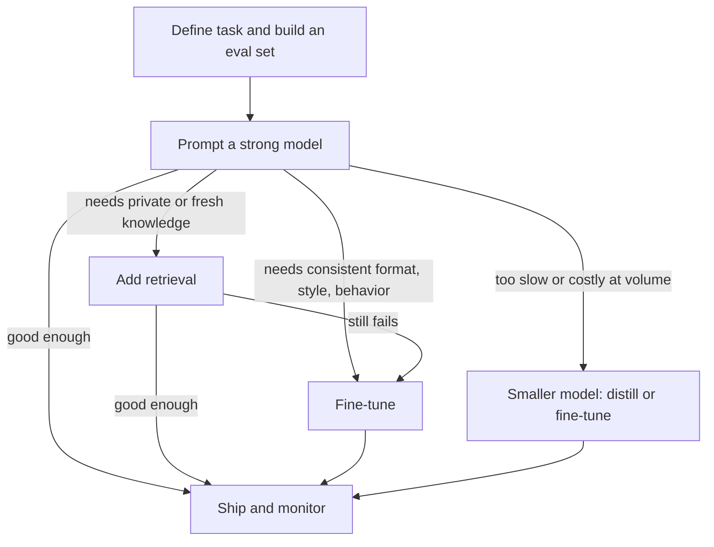

konnichiwa! Biplob here. This article is a short(!) summary about how LLMs are Built, Adapted, and Served. Shoutout to LLMs for putting this together for me.


**Contents**

- **Foundations**
  - [1. The building blocks](#basics)
  - [2. Designing a model](#design)
  - [3. The classic training pipeline](#training)
- **The frontier**
  - [4. How frontier models are trained](#frontier-train)
  - [5. Reasoning and test-time compute](#reasoning)
  - [6. How frontier models are served](#frontier-infer)
- **Applying LLMs**
  - [7. Prompt, retrieve, or fine-tune](#adapt)
  - [8. Choosing by data type](#data)
  - [9. Retrieval design](#rag)
  - [10. Keeping a system current](#continual)
- **Trust and operations**
  - [11. Evaluation](#eval)
  - [12. Trade-offs and risks](#risks)
  - [13. Diagnosing problems](#debug)
  - [14. Case studies](#cases)
- **Reference**
  - [15. FAQ](#faq)
  - [16. Common mistakes](#mistakes)
  - [17. Cheat sheet](#cheat)
  - [18. Closing thoughts](#close)

Practical guide

# How LLMs Are Built, Adapted, and Served

Core concepts, model design, training, evaluation, and the trade-offs behind each choice, plus a look at the training and inference techniques used in recent frontier model development.

Updated November 2026 · about 45 minutes to read · works as a reference you can return to

**Who this is for.** Engineers, data scientists, and technical leads who need to make real decisions about language models: which one to use, how big, whether to fine-tune, how to keep it current, and how to know it works. I explain the fundamentals, then how today’s frontier models are trained and served, then how to apply all of it to your own data and constraints.

**The thread running through everything:** there is almost never a single best answer. Each choice buys something and costs something. For every major decision I give a **Choice**, a **Because** (the reasoning), and a **Flip if** (what would change my mind).

### The short version

- A language model predicts the next token. Almost everything else (knowledge, reasoning, instruction following) is built on top of that by scale, data, and post-training.
- Frontier progress now comes from three compounding levers: bigger and better **pretraining**, **reinforcement learning** after pretraining, and more computation spent at **inference time** on reasoning.
- For your own application, start with the cheapest thing that could work (prompting), add retrieval for knowledge, fine-tune for behavior, and only then consider heavier options. Build an evaluation set before you do any of it.
- Match the tool to the data: LLMs for free-form language, boosted trees for structured tables, small encoders for high-volume classification.
- Keep knowledge outside the weights where you can, and update weights only through gated, evaluated releases.

## 1. The building blocks
{: #basics}

Before talking about frontier techniques, it helps to have a precise mental model of what a language model is and which properties drive cost and behavior.

### Tokens and tokenization

Text is split into subword **tokens** (byte-pair encoding or a similar scheme). Each token maps to an ID and then to an embedding vector. Subwords balance two extremes: characters give very long sequences, while whole words create huge vocabularies and out-of-vocabulary problems.

Tokenization matters for decisions because you pay and wait per token. Languages other than English, source code, numbers, and unusual formats can tokenize into many more tokens than plain English prose, which shrinks effective context and raises cost. Models also see tokens, not characters, which explains their weakness at spelling, character counting, and long arithmetic. For a new language or specialized domain with poor token efficiency, a model with a better tokenizer or an extended vocabulary can matter.

### The transformer in essentials

- **Self-attention:** each token forms a query, key, and value. Attention weights are softmax(QKᵀ/√d) and the output is a weighted sum of values. Every token can draw on every other token, and training can process all positions in parallel.
- **Cost:** attention is quadratic in sequence length for compute and, in a naive implementation, memory. This is the root of most context-length trade-offs.
- **Positional information:** attention is order-blind, so position is injected. Rotary position embeddings (RoPE) and related relative schemes are the common choice and strongly affect how well a model extends to longer contexts.
- **Blocks:** attention, then a feed-forward network, each wrapped in residual connections and normalization. Most parameters live in the feed-forward layers and the embeddings.

### Architecture families

| Family | Typical uses | Choose when | Why |
| --- | --- | --- | --- |
| Decoder-only (causal) | Chat, generation, code, general assistants | Open-ended generation; one model for many tasks via prompting | A simple objective (predict the next token) scales well and supports in-context learning |
| Encoder-only (bidirectional) | Classification, embeddings, retrieval, entity recognition | High-volume understanding tasks at low latency | Sees context in both directions; small encoders are cheap and strong once fine-tuned |
| Encoder-decoder | Translation, summarization, structured transduction | Input-to-output mapping where the input is fully known | Separates reading from writing; efficient for fixed-input tasks |

The field has largely consolidated on decoder-only models for general-purpose use. Encoders remain the efficient choice for embeddings and classification at scale.

### The pretraining objective, and what “knowing” means

Pretraining minimizes next-token cross-entropy over a huge corpus. The model compresses the statistical structure of language, facts, and code. That gives broad capability but no built-in notion of truth, which is why fluent text can still be false. Everything later in the pipeline (instruction tuning, preference optimization, reinforcement learning) shapes how that raw capability is expressed and sharpened.

### Scaling laws and the compute-optimal question

Loss falls predictably, as a power law, with parameters N, training tokens D, and compute C. Training compute is roughly `6·N·D` floating-point operations. The compute-optimal result commonly attributed to the Chinchilla work is on the order of **\~20 training tokens per parameter** for a fixed training budget.

Bigger model on fewer tokens, or smaller model on more tokens?

**Choice**If the model will serve high inference volume, train a smaller model on far more data than the compute-optimal point (“over-training”).

**Because**The compute-optimal rule minimizes loss for a fixed *training* budget. But a model is trained once and served many times, so lifetime cost is dominated by inference. A smaller model trained longer costs more to train but much less to serve at the same quality. This is why many recent models are trained on hundreds of tokens per parameter or more, well past 20.

**Flip if**The model will be served rarely or training compute is the binding constraint; then the compute-optimal point is the right target.

### Sampling and decoding

- **Greedy / temperature 0:** the most deterministic option; use for extraction, classification, and code where there is one right answer.
- **Temperature, top-p, top-k:** increase diversity; use for creative tasks and when sampling several candidates to vote or rank.
- **Beam search:** more common in translation-style tasks than in chat.
- **Constrained decoding** (grammar- or schema-guided) guarantees valid structure such as JSON.

Set randomness by task, not by habit: it helps exploration but hurts reproducibility and correctness on deterministic tasks. Even temperature zero is not always bit-for-bit reproducible across hardware and batching.

### Context window and the KV cache

During generation, the keys and values of previous tokens are cached so they are not recomputed. This makes generation fast but memory-hungry: the cache grows linearly with context length and batch size, and it often becomes the serving bottleneck before the weights do. Several of the frontier techniques later in this guide exist specifically to shrink it.

**Key takeaways, Part 1**

- Cost and latency scale with tokens; know your token budget.
- Decoder-only for generation; small encoders for cheap, high-volume understanding.
- Scaling laws guide the training budget, but inference volume changes what “optimal” means.
- Fluency is not truth: the pretraining objective never rewarded factuality directly.

## 2. Designing a model: size and architecture choices
{: #design}

### How to pick a model size

| Size class (rough) | Strengths | Choose when | Limits |
| --- | --- | --- | --- |
| Small, under \~3B parameters | Runs on laptops and phones; very low latency and cost; easy to fine-tune | Narrow, well-defined task; on-device or strict privacy; very high volume | Weak at broad reasoning and long-tail knowledge; needs task-specific tuning |
| Mid, \~7B to 30B | Good balance; fits one or a few GPUs; strong after fine-tuning | Domain assistant or extraction with a moderate quality bar and self-hosting | Behind frontier models on hard reasoning |
| Large open, \~70B and above | Strong general capability; self-hostable with multiple GPUs | Near-frontier quality plus control over data and deployment | Serving cost and complexity |
| Frontier hosted via API | Highest capability; no infrastructure; fastest to start | Prototypes, low-to-moderate volume, hard reasoning, fast iteration | Per-token cost; data-governance limits; vendor dependency; less control |

Which size should you pick?

**Choice**Prototype with the strongest model available to find the quality ceiling, then test progressively smaller models (or a distilled or fine-tuned one) on the same evaluation set and pick the smallest that clears the bar.

**Because**It separates “can this task be done?” from “can it be done cheaply?” Starting small risks blaming the task for what is merely a capacity limit; starting large risks shipping an expensive model when a small tuned one would do. The evaluation set makes the cost-quality curve visible.

**Flip if**Volume is so high that even the prototype’s cost is untenable. Then test small models earlier.

### Dense versus mixture-of-experts (MoE)

In an MoE model, a learned router activates only a few “expert” feed-forward networks per token. Total parameters are large, but **active parameters** per token are small, so you get the capacity of a big model at roughly the per-token compute of a smaller one.

Dense or MoE?

**Choice**MoE at large scale with high throughput; dense for smaller deployments and simpler operations.

**Because**MoE decouples knowledge capacity from per-token compute, which is powerful for training efficiency and serving throughput. The costs: all expert weights must still fit in memory, routing and load balancing complicate training, and serving needs expert-aware parallelism. At small scale, those costs outweigh the benefit.

**Flip if**You are memory-constrained (MoE weights are large even if compute is small) or your traffic is too low to keep experts busy.

### Attention variants and long context

- **Multi-query and grouped-query attention** share key-value heads across query heads, shrinking the KV cache and speeding decoding with little quality loss. They target the serving-memory constraint, not training.
- **Multi-head latent attention** and similar designs compress keys and values into a low-rank latent representation, cutting cache size much further.
- **FlashAttention-style kernels** compute exact attention with far less memory traffic. They change speed and memory, not results.
- **Sliding-window and sparse attention** trade full global context for near-linear cost; many recent models interleave local-window layers with a few global layers.
- **Context extension** (position interpolation or rescaling, then continued training on long documents) works, but quality at the far end of a long context often degrades. Always test with your own long-context tasks.

### Long context versus retrieval

Put everything in the context window, or retrieve?

**Choice**Long context for a bounded, known set of documents where the whole thing matters; retrieval for large or changing corpora and when cost and latency matter.

**Because**Stuffing the context makes every request pay for every token, raises latency, and models can lose details in the middle of very long inputs. Retrieval sends only relevant pieces, scales beyond any window, and allows citations and access control, but can miss relevant material if retrieval fails. Prompt caching can make repeated long contexts much cheaper, which shifts the balance for static corpora.

**Key takeaways, Part 2**

- Choose the smallest model that clears your quality bar on your own evaluation set.
- MoE buys capacity per unit of compute at the price of memory and operational complexity.
- Many architecture choices (grouped-query attention, latent attention, local windows) are really about shrinking the KV cache for serving.

## 3. The classic training pipeline
{: #training}

Most modern models, frontier or not, pass through the same broad stages. Part 4 shows how the frontier has extended each one.

1. **Pretraining** on trillions of tokens: broad knowledge and language ability.
2. **Continued or domain pretraining** (optional): more next-token training on domain text.
3. **Supervised fine-tuning (SFT)** on instruction-response pairs: teaches format, style, and instruction following.
4. **Preference optimization:** align outputs with human or automated preferences (RLHF with a reward model, or direct methods such as DPO).
5. **Reinforcement learning with verifiable rewards** on tasks with checkable answers (math, code).
6. **Distillation** into smaller models.

### Data decisions in pretraining

- **Quality over raw quantity.** Filtering, deduplication, and curation often beat adding more noisy data. Duplicates cause memorization and waste compute; low-quality text teaches low-quality behavior.
- **Data mixture.** The proportions of web, books, code, math, and multilingual text shape capabilities. Code and math data tend to help reasoning broadly.
- **Decontamination.** Remove benchmark and test data from training, or evaluation numbers become meaningless.
- **Synthetic data.** Useful for reasoning traces, instruction diversity, and rare cases, but it can narrow diversity and amplify the generator’s errors if overused (the “model collapse” risk). Mix with real data and verify.
- **Privacy and licensing.** Remove personal data; respect licenses and opt-outs.

### SFT, RLHF, DPO, and verifiable-reward RL

| Method | Needs | Choose when | Why and the catch |
| --- | --- | --- | --- |
| SFT | High-quality demonstrations | Teaching format, tone, tool use, domain style | Simple and stable. Example quality matters far more than count; poor examples teach poor habits. |
| RLHF (reward model + RL) | Preference comparisons, reward model, RL infrastructure | Fine-grained alignment at large scale | Powerful but complex, with risks of reward hacking and instability. |
| DPO and relatives | Pairs of preferred and rejected responses | Preference tuning without an RL loop | Simpler and stable; depends heavily on preference-data quality and distribution. |
| RL with verifiable rewards | A programmatic checker (unit tests, exact-answer match) | Reasoning, code, math: tasks with ground truth | Hard to game when verification is robust; weak verifiers get exploited. |

### Compute and memory facts worth knowing

- **Inference weight memory** ≈ parameters × bytes per parameter: about 2 bytes in 16-bit, 1 in 8-bit, 0.5 in 4-bit. A 7B model is roughly 14 GB in 16-bit.
- **Full training memory** with Adam in mixed precision is on the order of \~16 bytes per parameter before activations, so a 7B model needs on the order of \~110 GB. This is why memory-efficient fine-tuning matters.
- **Parallelism:** data parallel (replicate the model, split batches), tensor and pipeline parallel (split the model), and sharded optimizers (ZeRO, FSDP) for models larger than one GPU.
- **Precision:** bf16 became the default for training because its wide exponent range avoids the loss-scaling problems of fp16.

**Do not pretrain unless you must.** Pretraining costs millions of dollars at scale and needs rare expertise. For almost any company-specific need, adapt an existing model. Reserve pretraining for new languages, new modalities, or genuinely distinct domains with massive data and strong strategic reasons.

**Key takeaways, Part 3**

- Pretraining gives capability; post-training shapes behavior.
- Data quality, mixture, and decontamination matter as much as scale.
- Rewards you can verify programmatically are the most reliable training signal for reasoning.

## 4. How frontier models are trained today
{: #frontier-train}

**A note on sources.** Leading labs disclose little about their newest systems. What follows reflects publicly documented practice, mostly from technical reports of open-weight models and from published research, plus informed generalization. Treat specifics as representative of the field’s direction, not as a description of any one lab’s recipe, and expect details to keep changing.

The recent history of the field can be summarized as **three scaling axes** that now compound:

1. **Pretraining compute** (more and better data, more parameters).
2. **Post-training compute**, especially reinforcement learning on verifiable tasks.
3. **Test-time compute**: letting the model “think” longer before answering (Part 5).


### 4.1 Pretraining data: curation, synthesis, and staging

- **Aggressive filtering.** Model-based quality classifiers, large-scale deduplication, and domain-specific filters (for code, math, and scientific text) are standard. Quality filters are often trained from small sets of examples judged “educational” or “high-signal.”
- **Synthetic data at scale.** Models rewrite web text into cleaner forms, generate worked reasoning and textbook-style explanations, and produce code with verified execution. It fills gaps where natural data is scarce, particularly reasoning.
- **Data-constrained regimes.** As high-quality text runs short, teams repeat the best data for multiple epochs, upweight code and math, and add multimodal data. Moderate repetition of high-quality data tends to beat adding low-quality tokens.
- **Staged training.** Training is no longer one flat run. A typical sequence is a long main phase on a broad mixture, then **long-context extension** on long documents, then a final **annealing or “mid-training”** phase in which the learning rate decays while the mixture shifts toward high-quality, reasoning-rich, and instruction-like data. Mid-training makes later reinforcement learning much more effective by giving the model a stronger starting point.

How much synthetic data should go into pretraining?

**Choice**Use it deliberately for gaps (reasoning, code, rare domains) and rephrasing, in a controlled share of the mixture, always alongside diverse real data and with verification where possible.

**Because**Synthetic data is cheap, controllable, and can raise quality, especially for reasoning. But the generator’s errors and stylistic narrowness get baked in, and training repeatedly on model outputs can reduce diversity. Verification (code execution, answer checking) turns synthetic data from “plausible” into “correct.”

**Flip if**Diversity metrics or held-out real-data performance start to fall: reduce the synthetic share or diversify the generators.

### 4.2 Architecture trends

| Trend | What it does | Trade-off |
| --- | --- | --- |
| Fine-grained MoE with shared experts | Many small experts, a few always-on shared ones; each token uses a small fraction of total parameters | Better capacity per FLOP; harder load balancing, more communication, larger memory footprint. Newer balancing methods avoid auxiliary losses that can hurt quality. |
| Compressed KV caches (grouped-query, latent attention) | Much smaller cache per token | Cheaper long-context serving; slightly more complex attention and, occasionally, minor quality cost |
| Hybrid local/global attention | Most layers attend to a window; a few attend globally | Near-linear cost for long inputs; risk of missing far-away dependencies unless global layers are well placed |
| Hybrid attention and state-space or linear-attention layers | Constant-memory recurrent-style layers mixed with attention | Efficient long sequences; still an active research area, with weaker exact recall in the recurrent parts |
| Multi-token prediction | Auxiliary objective predicting several future tokens | Denser training signal and a ready-made drafter for speculative decoding; slight training overhead |
| Native multimodality | One model trained jointly on text, images, audio, sometimes video | Better cross-modal reasoning; far more data engineering and compute than bolting on an encoder |

### 4.3 Numerics and optimizers

- **Lower-precision training.** bf16 is the baseline; 8-bit floating point (FP8) training with careful scaling has been reported for large runs, and 4-bit formats are emerging. Lower precision raises throughput and cuts memory and communication, but needs fine-grained scaling and monitoring for instability.
- **Optimizers.** AdamW remains the workhorse. Some recent open models report using newer matrix-aware optimizers that improve token efficiency, at the cost of more engineering and less tooling maturity.
- **Stability engineering.** Loss-spike monitoring, careful initialization, normalization placement, learning-rate warmup and decay schedules, and frequent checkpointing are not glamorous but decide whether a multi-month run succeeds.

Train in FP8 (or lower)?

**Choice**Yes for very large runs where throughput and memory savings are worth the engineering; stay with bf16 where simplicity and stability matter more.

**Because**At frontier scale, even a modest throughput gain is worth millions of dollars. But low-precision training introduces numerical risk (overflow, underflow, divergence) that requires scaling strategies, hardware support, and ablations to trust.

**Flip if**Your hardware lacks efficient low-precision kernels, or the run is small enough that the savings do not justify the added risk.

### 4.4 Distributed training

Frontier runs combine several forms of parallelism at once: data parallelism (often with sharded optimizer states, as in FSDP or ZeRO), tensor parallelism within a node, pipeline parallelism across nodes, **expert parallelism** for MoE layers, and **context (sequence) parallelism** for very long sequences. The art is overlapping communication with computation and keeping thousands of accelerators busy. The trade-off is always between memory per device, communication volume, and idle “bubbles”, and the best split depends on model shape and cluster network topology.

### 4.5 The post-training stack

This is where much of the recent capability gain, especially in reasoning and agentic behavior, comes from.

1. **SFT on curated demonstrations**, including long reasoning traces and tool-use transcripts. Quality and diversity beat volume.
2. **Rejection-sampling fine-tuning:** sample many answers, keep the ones that pass a verifier or a reward model, and train on them. A cheap, stable way to bootstrap improvement.
3. **Preference optimization** (RLHF-style or direct methods such as DPO) for helpfulness, tone, and safety, increasingly using AI-generated feedback guided by written principles in addition to human labels.
4. **Reinforcement learning with verifiable rewards (RLVR)** on math, code, logic, and other checkable tasks. Methods such as group-relative policy optimization (GRPO) sample a group of answers per prompt and use each answer’s reward relative to the group average as its advantage, which removes the need for a separate learned value model and cuts memory and complexity.
5. **Agentic and tool-use RL:** train in sandboxed environments (code execution, browsers, software tasks) where the reward is task success over many steps. This teaches planning, tool selection, recovery from errors, and long-horizon persistence.
6. **Safety training and red-teaming** to reduce harmful outputs and resist jailbreaks, balanced against over-refusal.
7. **Distillation** of the large teacher into smaller, cheaper models that serve most traffic.

| Technique | Strength | Risk or cost |
| --- | --- | --- |
| Learned reward model (RLHF) | Captures subjective preferences such as helpfulness and style | Reward hacking: the policy exploits quirks of the reward model; needs fresh preference data to stay aligned |
| Verifiable rewards (RLVR) | Objective, hard to game when checkers are strong; scales with compute | Only works where correctness is checkable; weak or leaky verifiers get exploited; narrow domains may not transfer |
| Outcome rewards | Simple: reward the final answer | Sparse signal for long reasoning; credit assignment is hard |
| Process rewards (step-level) | Denser guidance for multi-step reasoning | Step labels are expensive and error-prone; process reward models can be exploited |
| Preference pairs (DPO-style) | No RL loop; stable and cheap | Offline, limited by the coverage and quality of the pairs |

Learned reward model, or verifiable rewards?

**Choice**Verifiable rewards wherever correctness can be checked, learned reward models for the subjective remainder, and both in the same overall pipeline.

**Because**A checkable reward is an unambiguous, scalable signal that cannot be talked around; that is why reasoning improved fastest in math and code. Subjective qualities (clarity, tone, judgment under ambiguity) have no checker, so they need learned or human feedback, with all its noise and gaming risk.

**Flip if**You can build a trustworthy programmatic or rubric-based checker for a subjective-looking task; that usually beats a learned model.

How should you allocate compute between pretraining and RL?

**Choice**A strong pretrained and mid-trained base first, then substantial RL on top; neither alone is enough.

**Because**RL mainly elicits and sharpens capabilities already latent in the base model. A weak base gives RL little to amplify, while a strong base with little RL leaves reasoning and agentic skill unrealized. The balance shifts toward RL as verifiers and environments improve.

**Key takeaways, Part 4**

- Training is staged: broad pretraining, long-context extension, then high-quality annealing, then layered post-training.
- Architecture choices increasingly optimize for serving cost (small KV caches, sparse activation).
- Reinforcement learning on verifiable rewards, and in agentic environments, drives recent reasoning and tool-use gains.
- Every technique trades signal quality against cost, gameability, or domain coverage.

## 5. Reasoning models and test-time compute
{: #reasoning}

The most visible recent shift is the rise of **reasoning models**: models trained, mostly with reinforcement learning, to produce an extended internal chain of thought before the final answer. Instead of one fast forward pass per token with a short answer, the model may spend thousands of tokens exploring, checking, and revising. Accuracy on hard problems rises with the amount of thinking, giving a new scaling axis that is independent of model size.

### Ways to spend compute at inference time

| Technique | How it works | Strength | Cost and limits |
| --- | --- | --- | --- |
| Chain-of-thought prompting | Ask for step-by-step reasoning | Simple, works on many tasks | Longer outputs; reasoning can be unfaithful or wrong while sounding convincing |
| Trained long reasoning | RL teaches the model to think at length, self-check, and backtrack | Large gains on math, code, planning | High token cost and latency; can “overthink” easy problems |
| Self-consistency / majority vote | Sample many answers, pick the most common | Reliable gains on tasks with discrete answers | Cost multiplies with samples; no benefit for open-ended outputs |
| Best-of-N with a verifier or reward model | Sample N candidates, score them, keep the best | Works well when verification is cheaper than generation (tests, checkers) | Quality capped by the verifier; N times the cost |
| Search over reasoning steps | Tree or beam search guided by a value or process model | Can solve harder problems | Complex, expensive, and dependent on a good step evaluator |
| Iterative refinement with tools | Generate, run, observe, fix | Grounded in execution results | Needs a sandbox and tests; more latency |

### The central trade-off: accuracy versus latency and cost

Thinking tokens are billed and take time. A reasoning model can be dramatically more accurate on hard tasks and wasteful on easy ones. Providers expose controls such as a **thinking budget** or effort level to manage this.

Use a reasoning model, or a standard fast model?

**Choice**Route by difficulty: a fast model for simple, high-volume, latency-sensitive requests; a reasoning model, with a bounded thinking budget, for multi-step problems where correctness matters.

**Because**Reasoning compute helps in proportion to task difficulty and checkability. On a simple lookup it adds cost and delay with no accuracy gain. On a hard multi-step problem it may be the only way to get a correct answer. A router or a user-selectable effort level captures most of the value.

**Flip if**Your measurements show the fast model plus retrieval or tools already meets the bar, or if latency limits make long thinking unusable.

**Caveats to remember.** The visible reasoning text is not guaranteed to reflect the true computation behind an answer, so treat it as an aid rather than proof. More thinking does not fix missing knowledge (that is a retrieval problem) and can increase the chance of elaborate but wrong justifications. Always evaluate end-to-end accuracy and cost, not just the benchmark score of a reasoning mode.

**Key takeaways, Part 5**

- Test-time compute is a third scaling axis: more thinking can substitute for a bigger model on hard problems.
- It pays off most where answers are verifiable and the task is genuinely multi-step.
- Budget and route it: reasoning everywhere is the fastest way to a surprising bill.

## 6. How frontier models are served
{: #frontier-infer}

Serving a large model well is an engineering problem as demanding as training it. The goals are to maximize throughput (requests per GPU-hour), keep latency within targets, and control cost.

### Two phases with different bottlenecks

**Prefill** processes the entire prompt in parallel and is **compute-bound**; it determines time to first token. **Decode** generates one token at a time and is **memory-bandwidth-bound**, because each step must read all the weights and the KV cache; it determines tokens per second. Many optimizations target one phase or the other.

### The serving toolbox

| Technique | What it does | Trade-off |
| --- | --- | --- |
| Continuous batching | Adds and removes requests from a running batch each step, keeping GPUs busy | Large throughput gain; can raise individual request latency under load |
| Paged KV cache | Stores the cache in fixed-size blocks to avoid fragmentation and enable sharing | More concurrent requests per GPU; implementation complexity |
| Prefix / prompt caching | Reuses computed KV for repeated prompt prefixes (system prompts, shared documents) | Big savings on repeated context; needs stable prefixes with static content first |
| Chunked prefill | Splits long prompts so decode steps are not starved | Smoother latency for ongoing generations; slightly lower prefill efficiency |
| Prefill-decode disaggregation | Runs the two phases on separate GPU pools tuned for each | Better utilization and latency control; needs fast KV transfer and more orchestration |
| Quantization (FP8, INT8, 4-bit) | Shrinks weights, sometimes activations and the KV cache | Less memory and faster decoding; some quality loss, larger on small models and reasoning-heavy tasks |
| KV cache quantization and compression | Stores cache in fewer bits or evicts less useful entries | Longer contexts and bigger batches; risk of losing details |
| Speculative decoding | A cheap drafter proposes several tokens; the large model verifies them in one pass | 2x or more faster decoding with unchanged output distribution; gain depends on acceptance rate, and adds a drafter to maintain |
| Multi-token prediction heads | The model itself drafts future tokens for verification | No separate drafter model; requires training support |
| Expert and tensor parallel serving | Splits experts or layers across GPUs | Fits huge models and raises throughput; communication overhead and complex scheduling |
| Model routing and cascades | Send easy requests to small models, hard ones to big ones | Saves most when traffic is mostly easy; needs a reliable router and fallback |
| Structured (constrained) decoding | Masks invalid tokens to guarantee schema-valid output | Eliminates parse failures; small per-token overhead; can slightly constrain quality |

### Decisions that come up repeatedly

Quantize, and how far?

**Choice**8-bit as the safe default; 4-bit weights when memory or cost demands it; always re-evaluate on your task.

**Because**Decoding is memory-bound, so fewer bytes per weight directly raises speed and lets a model fit on fewer GPUs. Quality loss is usually small at 8-bit and grows at 4-bit, particularly for small models, long reasoning chains, and tasks needing numeric precision.

**Flip if**Your evaluation shows regressions on reasoning or long outputs: raise precision for sensitive layers or keep a higher-precision model for hard requests.

Is speculative decoding worth it?

**Choice**Yes for latency-sensitive, lightly batched workloads with predictable text (code, structured output); less so for heavily batched, throughput-bound serving.

**Because**Decoding leaves compute idle while waiting on memory; verifying several drafted tokens at once uses that idle compute. At high batch sizes the GPU is already busy, so the benefit shrinks. The gain also depends on how often the drafter is right.

Self-host an open model or use a hosted API?

**Choice**Start with a hosted API; self-host when volume, data control, latency, or customization justify the operations burden.

**Because**APIs remove infrastructure work and offer the strongest models immediately, and at low or spiky volume they cost less than idle GPUs. Self-hosting wins with steady high volume (high GPU utilization), strict data residency, custom fine-tuned weights, or tight latency control. Count the hidden costs: capacity planning, on-call, upgrades, and the engineering needed to match managed reliability.

**Hybrid**Hosted frontier model for hard cases, a self-hosted small model for high-volume simple cases.

### Cost and latency levers you control as an application builder

- Trim prompts and cap output length: output tokens are usually the most expensive and slowest.
- Put static content first and use prompt caching.
- Route by difficulty, and give reasoning models a bounded budget.
- Stream responses so perceived latency is time to first token.
- Batch offline work; cache repeated or similar queries (watch staleness and personalization).
- Measure cost per *successful* task, not per call.

**Key takeaways, Part 6**

- Prefill is compute-bound, decode is memory-bound; optimize the phase that is hurting you.
- The KV cache and memory bandwidth, not raw FLOPs, shape most serving decisions.
- Quantization, caching, speculation, and routing each trade a little quality or complexity for large cost and latency gains; verify each with your own evals.

## 7. Prompt, retrieve, or fine-tune?
{: #adapt}

Everything so far describes how models are made. Now to the practical question: given a problem, how do you get a model to solve it well and cheaply? There is a ladder of options, and the discipline is to climb it only on evidence.

### First question: should this be an LLM at all?

Is an LLM the right tool?

**Choice**Use an LLM only if the task needs language understanding, flexible generation, or reasoning over unstructured input that a cheaper model cannot handle. Otherwise use a classical model, rules, or a small specialized model.

**Because**An LLM costs orders of magnitude more per prediction than a gradient-boosted model or small encoder, is slower and non-deterministic, and is harder to test. On a fixed-schema tabular problem with labels, boosted trees are usually more accurate, cheaper, and easier to monitor. The LLM earns its place where inputs are free-form, the label set is open or changes, or labeled data is scarce.

**Flip if**Error analysis shows the cheaper model fails on language nuance, or the label set changes faster than you can retrain.

### The ladder



### Knowledge versus behavior

Fine-tune or retrieve to teach the model your company’s information?

**Choice**Retrieval for knowledge; fine-tuning for behavior.

**Because**Facts learned through fine-tuning are stored diffusely, are hard to update or delete, can be hallucinated with confidence, and cannot cite sources. Retrieval puts facts in context where they can be updated instantly, cited, and access-controlled. Fine-tuning shines where retrieval cannot: consistent tone, output schema, domain-specific reasoning patterns, tool-calling reliability, and shorter prompts.

**Combine**Fine-tune for format and style, retrieve for facts. They complement each other.

### Fine-tuning methods

- **Full fine-tuning** updates every weight: highest capacity and cost, large memory needs, and a separate full copy per task. Warranted with large, high-quality data and a need for deep change.
- **LoRA** freezes the base model and trains small low-rank update matrices (W + (α/r)·BA). It trains well under 1% of parameters, sharply cuts memory, yields small swappable adapters, and often approaches full fine-tuning quality on typical tasks.
- **QLoRA** applies LoRA to a 4-bit-quantized base so a model that would not fit can be tuned on a single GPU, at the cost of some complexity and a small quality hit.
- **Prompt or prefix tuning** learns soft prompts: the lightest option, usually weaker on hard tasks.

### How data size changes the answer

| Labeled examples | Default approach | Why |
| --- | --- | --- |
| None | Zero-shot prompting with a strong model; write clear instructions and a rubric | No data to learn from; rely on the model’s priors. The eval set you build becomes your first labeled data. |
| Tens | Few-shot prompting with carefully chosen examples, possibly selected dynamically | Too few to fine-tune reliably, enough to steer in context |
| Hundreds to \~1,000 | Strong prompting plus retrieval; consider LoRA on a small or mid model if prompts are long, costly, or inconsistent | Small high-quality sets can teach format and style (quality over quantity); verify against the prompted baseline |
| Thousands to tens of thousands | LoRA or full fine-tuning of a small or mid model; often matches a prompted large model on the narrow task at far lower cost | Enough signal to specialize; cost savings at volume justify it |
| Hundreds of thousands or more | Full fine-tuning, continued pretraining if the domain is distinct, or a purpose-built model | Data supports deeper changes; also consider classical or small-encoder models for classification |

### How model size changes the answer

| Base model | Adaptation guidance | Why |
| --- | --- | --- |
| Small (under 3B) | Fine-tune; rely less on prompting; keep tasks narrow; consider distilling from a larger teacher | Little in-context ability or broad knowledge, so tuning supplies the competence |
| Mid (7B to 30B) | LoRA or QLoRA; combine with retrieval | A strong enough base that small adapters suffice |
| Large open (70B+) | Prompt and retrieve first; LoRA only when needed | High in-context ability; tuning and serving costs are high |
| Hosted frontier | Prompting, retrieval, tool use, structured outputs; vendor fine-tuning only if available and justified | You cannot freely change weights; context and tools are the cheapest levers |

### Distillation

When should you distill a large model into a small one?

**Choice**When a large model meets the quality bar on a narrow task but is too slow or expensive for production volume.

**Because**You use the large model to generate high-quality labels or reasoning traces (checked by filters or humans), then train the small model on them. It inherits much of the narrow-task skill at a fraction of the serving cost. Frontier labs do the same at scale to ship smaller flagship-derived models.

**Watch for**The student will not match the teacher outside the distilled distribution, and you must check the teacher’s license for permitted uses of its outputs.

### Fine-tuning pitfalls

- **Catastrophic forgetting:** specializing can erode general abilities. Use lower learning rates, LoRA, mixed-in general data, and evaluate on a general benchmark as well as your task.
- **Overfitting small sets:** keep epochs few (often 1 to 3), monitor validation loss and task metrics, and hold out a real test set.
- **Data quality:** inconsistent or wrong labels are learned faithfully. Audit and clean first.
- **Chat-template mismatch:** training with a different prompt format than inference silently hurts results.
- **Loss masking:** compute loss only on response tokens for SFT unless there is a reason not to.

**Key takeaways, Part 7**

- Build the eval first; climb the ladder (prompt, retrieve, fine-tune) only when measurements demand it.
- Knowledge goes in retrieval, behavior goes in weights.
- Data size and model size jointly decide how much adaptation you need and which method fits.

## 8. Choosing the approach by type of data
{: #data}

The same model family behaves very differently across data types. This table summarizes the first choice for each.

| Data type | Typical task | First choice | Why |
| --- | --- | --- | --- |
| Free text, documents | Q&A, summarization, drafting | Prompted LLM, plus retrieval for private or large corpora | Language understanding is the LLM’s core strength |
| Free text, high-volume labels | Classification, routing, sentiment, tagging | Embeddings plus a linear classifier, or a fine-tuned small encoder; use an LLM to bootstrap labels | Orders of magnitude cheaper and faster per item, and often as accurate once labels exist |
| Semi-structured (invoices, forms, emails, logs) | Field extraction | LLM with a JSON schema or constrained decoding; vision-capable model for scans | Layout and wording vary too much for rigid rules; schema enforcement guarantees valid output |
| Tabular (numeric, categorical) | Prediction, scoring | Gradient-boosted trees | Usually more accurate, cheaper, faster, and more interpretable than an LLM on structured features |
| Tabular with text columns | Prediction using notes or descriptions | Extract features from the text with an LLM or encoder; feed them into boosted trees with the other columns | Uses each tool where it is strongest |
| Tabular, very small data | Prediction with few rows | Regularized linear models or tree ensembles; try an LLM or tabular foundation model with in-context rows as an experiment | Pretrained priors can help when data is scarce, but verify against a simple baseline |
| Databases | Natural-language questions over data | LLM generates SQL from schema context, run read-only, then explain results | Let the database compute; do not ask the LLM to do arithmetic over rows in its context |
| Code | Generation, review, repair | Code-specialized or strong general model with tool access to run tests | Execution gives a verifiable signal that text alone lacks |
| Images, audio, video | Understanding, extraction, captioning | Multimodal model, or a specialized encoder or speech model feeding an LLM | Cross-modal reasoning needs joint representations; specialized models are cheaper for single-modality tasks |
| Time series, sensors | Forecasting, anomaly detection | Statistical or gradient-boosted forecasting; LLM to explain results or interpret logs | LLMs are not generally better at numeric forecasting than purpose-built methods |

### Tabular data: the question that comes up most

You have a customer table with 200 numeric and categorical columns. Use an LLM?

**Choice**Not as the predictor. Use gradient-boosted trees, and use LLMs only for unstructured pieces, such as turning free-text support notes into features, or for the natural-language interface and explanations.

**Because**Tabular data has heterogeneous scales, missing values, and non-smooth feature interactions that trees handle well. Serializing rows into text wastes tokens, loses numeric precision, and costs far more per prediction. Boosted trees are fast, calibrate easily, and are simple to monitor.

**Flip if**There are very few labeled rows, the columns include rich text, or the schema changes constantly.

If you do feed tabular data to an LLM: serialize rows with clear column names and units, round numbers sensibly, give few-shot examples, keep the context short, and have the model call tools (SQL, Python) for calculations rather than computing in its head.

### Unstructured text at scale

Classify 5 million support tickets into 40 categories.

**Choice**Use an LLM to label a few thousand tickets (with human review of a sample), then train a small encoder or an embedding-plus-logistic-regression classifier on those labels and run that across all five million.

**Because**Running a large model on every ticket is slow and costly for a closed label set. The LLM’s value is creating labels cheaply and handling the long tail; a small model trained on those labels reaches similar accuracy at a tiny fraction of the cost and latency, with stable, testable behavior.

**Add**Route low-confidence tickets to the LLM or a human, and re-label periodically to catch drift or new categories.

### Multimodal choices

- **Documents with layout (invoices, forms):** a vision-language model reading the page image often beats OCR followed by text-only extraction, because layout carries meaning. At high volume or tight latency, a layout-aware OCR pipeline with a small extraction model may be cheaper.
- **Speech:** a dedicated speech-recognition model feeding an LLM is usually cheaper and easier to debug than an end-to-end speech model, unless prosody and interruption handling matter.
- **Images:** high-resolution inputs cost many tokens; downscale or crop to the region of interest when fine detail is not needed.

**Key takeaways, Part 8**

- LLMs for free-form language; boosted trees for structured tables; small encoders for high-volume classification.
- Combine tools: an LLM to read text and create labels, a cheaper model to run at scale.
- Delegate computation to tools (SQL, code) rather than asking the model to calculate.

## 9. Retrieval-augmented generation: the design choices
{: #rag}

Since retrieval is the right answer for most knowledge needs, it is worth knowing its design space. Each decision below trades quality against cost, latency, or complexity.

| Decision | Options | Guidance and why |
| --- | --- | --- |
| Chunking | Fixed size, by structure (headings, paragraphs), semantic, with overlap | Chunk by document structure so each chunk is self-contained. Too small loses context; too large dilutes relevance and wastes tokens. Tune on retrieval metrics. |
| Embedding model | General vs domain-tuned; dimension size | Start with a strong general model; fine-tune only if domain vocabulary hurts recall. Larger dimensions cost more storage and search time. |
| Search method | Dense vectors, keyword (BM25), hybrid | Hybrid is a strong default: dense handles meaning, keyword handles exact terms, IDs, and rare words. |
| Reranking | Cross-encoder on top-k results | Retrieve broadly for recall, then rerank for precision. Often the cheapest large quality gain, at some added latency. |
| Query handling | Rewrite, decompose, multi-query | User questions are often vague or multi-part; rewriting improves recall at the cost of an extra call. |
| Metadata and filters | Date, source, permissions | Filtering enforces access control and freshness. Never rely on the prompt alone for permissions. |
| Agentic retrieval | The model decides when and what to search, and iterates | Better for multi-hop questions; costs more calls and latency, so use it only for complex queries. |

Your RAG answers are wrong. Where do you look first?

**Choice**Separate retrieval from generation. Check whether the right passage was in the retrieved set at all.

**Because**The fix is completely different. If the passage was missing, work on chunking, embeddings, hybrid search, or reranking. If it was present but the answer was still wrong, work on the prompt, context ordering and size, or model choice, and ask the model to quote evidence or say when the context lacks the answer.

### Evaluating RAG

- **Retrieval:** recall@k, precision@k, MRR, and NDCG on labeled question-to-passage pairs.
- **Generation:** faithfulness (is every claim supported by retrieved text?), answer correctness, completeness, and citation accuracy.
- **End to end:** a golden question set that includes unanswerable questions, so you measure whether the system correctly abstains.

## 10. Continuous learning: keeping a system current
{: #continual}

Model weights are frozen at a point in time, so models go stale while the world keeps changing. The first step is to decide what kind of change you are dealing with, because different changes call for different levers.

| What is changing? | Best lever | Why |
| --- | --- | --- |
| Facts, documents, prices, policies (daily or weekly) | Retrieval over an updated index; tool calls to live systems | Updating an index is instant, cheap, auditable, and reversible; retraining is none of those |
| Style, format, tool-use habits, domain reasoning | Periodic fine-tuning (LoRA adapters), versioned | These are behaviors, which weights learn well |
| Vocabulary and language of a new domain | Continued pretraining on domain text, then SFT | Needed when the base model genuinely lacks the underlying knowledge or tokens |
| User preferences and satisfaction | Collect feedback, then preference-tune on a schedule | Turns production signal into improvement through a gated release process |
| Individual user context | A memory store retrieved into context | Per-user weight updates do not scale and raise privacy risk |

How do you keep an LLM system up to date as knowledge changes?

**Choice**Keep knowledge outside the weights: maintain a retrieval index with ingestion pipelines, timestamps, and deletion support. Reserve fine-tuning for behavior, on a scheduled, evaluated cadence.

**Because**Continually updating weights invites catastrophic forgetting, makes it hard to remove outdated or sensitive facts, complicates audits, and demands re-validation of the whole system each time. An index update has none of those costs and takes effect immediately.

**Flip if**Retrieval cannot express the change (for example, a shift in how the model should reason across a domain), or latency rules out retrieval.

### If you must update weights, limit forgetting

- **Replay:** mix a sample of earlier data (general and prior-task) into each new run so the model keeps seeing what you do not want it to lose.
- **Parameter-efficient adapters:** keep the base frozen and train per-task or per-period LoRA adapters; swap or merge them. Rollback is trivial and interference is limited.
- **Low learning rates and short runs:** smaller updates drift less from the original solution.
- **Continued pretraining recipe:** re-warm the learning rate modestly, blend new domain data with a portion of original-style data, and watch general benchmarks.
- **Regularization toward the original weights** (penalizing distance, or averaging with the earlier checkpoint) keeps changes conservative.
- **Model merging:** combine specialized models by weight arithmetic; useful but needs validation because merges can interact unexpectedly.
- **Knowledge editing** of individual facts exists but is fragile at scale; treat it as research, not a production plan.

### A production continual-improvement loop

1. **Log** inputs, outputs, retrieved context, and user feedback (with privacy controls and consent).
2. **Mine failures:** thumbs-down, escalations, low-confidence cases, judge-flagged outputs.
3. **Curate:** human-review and correct a sample into new eval cases and training data. Add every real failure to the regression set.
4. **Train candidates** (an adapter, a prompt, or a retrieval change) on a schedule or when metrics trigger it.
5. **Gate the release:** the candidate must pass the regression suite, general-capability checks, and safety evals, then ship through shadow mode or a canary with rollback.
6. **Monitor drift:** input topics, retrieval hit rates, refusal rates, cost, and quality scores over time.

Why not fine-tune on production data automatically every night?

**Choice**Use gated, batch updates, not unattended online learning.

**Because**Production data contains errors and adversarial inputs, and creates feedback loops where the model learns from its own outputs. Without evaluation gates, quality can regress quietly, and a poisoned or biased batch propagates directly into the model. Human-reviewed or verified data plus regression tests keeps improvement real.

**Also pin versions.** When a provider updates a hosted model, or you swap base models, behavior can shift. Pin versions, keep a regression suite, and re-run it before every upgrade, because prompts tuned for one model can degrade on another.

## 11. Evaluation
{: #eval}

Evaluation deserves a section of its own because every decision in this guide depends on it. Without a trustworthy evaluation you cannot tell whether a change helped.

### Levels of evaluation

- **Pretraining:** perplexity or loss on held-out text, plus broad capability benchmarks. Perplexity is not comparable across different tokenizers.
- **General benchmarks** (knowledge, reasoning, code, math) give orientation but suffer from **contamination** (test data leaked into training), saturation, and weak relevance to your task. As frontier models saturate older benchmarks, harder and fresher evaluations keep replacing them.
- **Task-specific evals** on your own data drive decisions. Build them first.
- **Online evaluation:** user outcomes, task completion, escalation rate, cost, and latency, with A/B tests where possible.

### Building a task evaluation

1. Collect 50 to 200 real, diverse inputs, including hard, ambiguous, and adversarial ones, and cases where the right answer is “I do not know.”
2. Define success concretely: exact match or code-checkable where possible; a rubric where not.
3. Version it, add every production failure to it, and never tune prompts against the sealed final test portion.
4. Run each case multiple times if sampling is on, and report variance.

### Choosing the method

| Task | Method | Why |
| --- | --- | --- |
| Classification, extraction with ground truth | Standard metrics (accuracy, precision/recall, F1, field-level match) | Objective and cheap |
| Code | Execute unit tests (pass@k) | Verifiable correctness |
| Summarization, open generation | Rubric-based LLM judge plus human spot checks; pairwise comparison | No single right answer; overlap metrics like ROUGE correlate weakly with quality |
| RAG | Retrieval metrics plus faithfulness and correctness judging | Isolates the failing component |
| Agents and multi-step tasks | End-state checks plus trajectory review, repeated runs for consistency | Outcomes matter, but so do efficiency and safety of the path |
| Safety | Red-team sets, refusal and over-refusal measures, injection tests | Both too-harmful and too-restrictive outputs are failures |

### Using an LLM as judge

- **Known biases:** preference for longer answers, for the judge’s own style or model family, for the first-presented option, and sensitivity to rubric wording.
- **Mitigations:** randomize or swap answer order, use clear rubrics with examples, use a stronger judge than the model being judged, and calibrate against human labels on a sample.
- A judge that disagrees with humans gives precise-looking but wrong signal. Always measure judge-human agreement before trusting it for decisions.

### Measuring hallucination

Evaluate whether claims are supported by provided sources (groundedness), whether the model abstains appropriately, and factuality against a trusted reference. Reduce hallucination with retrieval, citations, instructions to abstain, lower temperature, verification passes, and tools for anything computable.

## 12. Trade-offs and risks at a glance
{: #risks}

| Trade-off | How to reason about it |
| --- | --- |
| Quality vs cost vs latency | Pick the point on the curve your product needs; use routing so only hard requests pay for the big model or long reasoning. |
| Prompting vs fine-tuning | Prompting iterates in minutes with no training. Fine-tuning shortens prompts, locks in behavior, and cuts per-call cost at volume, but adds data, training, and maintenance burden. |
| Open vs closed models | Open: control, privacy, customization, cost at scale. Closed: top capability, no infrastructure, quick start. Check license terms for open weights. |
| Long context vs retrieval | Bounded corpora favor long context; large or changing ones favor retrieval. |
| Reasoning depth vs responsiveness | More thinking raises accuracy on hard tasks and cost and latency everywhere; budget it by difficulty. |
| Capability vs safety and control | Guardrails, refusals, and filters cost some helpfulness; measure both over-refusal and harmful output. |
| Determinism vs creativity | Low temperature and schemas for pipelines; higher temperature for ideation. |
| Generalist vs specialist | A small specialist can beat a large generalist on a narrow task at much lower cost, but is brittle outside it. |
| Freshness vs stability | Frequent updates keep knowledge current but risk regressions; version and gate. |
| Training cost vs inference cost | Over-train smaller models, distill, and quantize when serving volume dominates lifetime cost. |

### Risks to design for from day one

- **Hallucination:** mitigate with grounding, citations, abstention, verification, and human review where stakes are high.
- **Prompt injection:** untrusted text (web pages, emails, documents) can carry instructions. Treat retrieved and tool content as data, restrict tools by least privilege, and enforce permissions in code, not in the prompt.
- **Privacy and leakage:** avoid sending sensitive data to third parties without agreements; remove personal data from training sets; models can memorize and regurgitate training text; enforce document-level access in retrieval.
- **Bias and fairness:** evaluate by subgroup; do not assume a general model is neutral for your population.
- **Reward hacking and over-optimization:** in your own RL or preference tuning, a model can exploit the reward rather than do the task; use robust verifiers and held-out checks.
- **Cost blowups:** unbounded context growth, long reasoning, agent loops, and retries. Set token budgets and rate limits.
- **Vendor and model drift:** pin versions and keep regression tests.

## 13. Diagnosing problems
{: #debug}

When something is wrong, resist the urge to change the model first. The default order is:

1. Look at **actual failing examples**, not aggregate metrics.
2. Check the **prompt actually sent** (templates, truncation, missing context).
3. Check **retrieval** if there is any.
4. Check **decoding settings** and output parsing.
5. Only then change the **model or training**.

| Symptom | Likely cause | What to try, and why |
| --- | --- | --- |
| Confident wrong facts | Knowledge gap or unsupported generation | Add retrieval with citations and abstention; fine-tuning will not reliably fix missing knowledge. |
| Answer ignores provided context | Context too long or noisy, weak instruction, conflicting prior knowledge | Shorten and rerank context, put key passages where the model attends, instruct it to answer only from context. |
| Inconsistent output format | Weak specification, high temperature | Use schema-constrained decoding, examples, lower temperature; fine-tune if still unreliable at scale. |
| Good on tests, bad in production | Eval not representative, contamination, drift | Rebuild the eval from real traffic and add production failures to it. |
| Fine-tuned model worse on general tasks | Catastrophic forgetting | Lower learning rate, use LoRA, mix in general data, evaluate on general benchmarks. |
| Fine-tuned model no better than prompting | Low-quality or too little data, or the gap is about knowledge rather than behavior | Audit data quality, check what kind of gap it is, compare against a strong few-shot baseline. |
| Training loss falls, task metric does not | Overfitting, or loss not aligned with the task | Fewer epochs, more diverse data, evaluate on task metrics, check loss masking and chat template. |
| Repetitive or degenerate text | Greedy decoding, poor sampling settings | Adjust temperature and repetition penalties; check for repetition in training data. |
| Latency too high | Long prompt or output, large model, long reasoning, no batching | Trim prompt, cap output, cache prefixes, quantize, route to a smaller model, bound the thinking budget. |
| Reasoning model slow and costly on easy tasks | Overthinking on simple requests | Route by difficulty or lower the effort level. |
| Quality regressed after a provider update | Hosted model version change | Pin versions; run the regression suite; adjust prompts per version. |
| Arithmetic or counting errors | Token-based processing is poor at precise computation | Give the model a calculator or code tool. |

## 14. Case studies: the decisions in practice
{: #cases}

Each case follows the same pattern: framing, choice, reasoning, risks. Try deciding before you open it.

Case A. A support assistant over 20,000 help articles that change weekly

**Framing.** A knowledge problem with changing content. A wrong answer erodes trust or causes bad advice, so grounded answers with citations matter.

**Choice.** RAG with hybrid search, a reranker, structure-aware chunking, and a strong hosted model prompted to answer only from retrieved context and to say when it does not know. Escalate to a human when confidence is low.

**Because** content changes weekly, facts belong in an index updated by an ingestion pipeline, not in weights. Citations let agents verify answers.

**Evaluate** with a question-to-passage set for retrieval; groundedness and correctness for answers; unanswerable questions for abstention.

**Later.** If tone and escalation behavior are inconsistent, add a small LoRA fine-tune for style; if volume makes cost high, route easy questions to a smaller model.

Case B. Classify 1 million legal clauses into 25 types; 3,000 are labeled

**Choice.** Fine-tune a small encoder (or train an embedding-plus-classifier) on the 3,000 labels, using an LLM to label additional examples and flag disagreements, with human review on a sample.

**Because** a closed label set at high volume rewards a cheap, fast, stable model, and 3,000 labels plus LLM-assisted labels are enough to specialize an encoder. A large LLM per clause would cost far more with no accuracy advantage once the small model is trained.

**Risks.** Rare clause types and ambiguous boundaries; route low-confidence clauses to the LLM or a lawyer, and re-evaluate when new clause types appear.

Case C. Predict churn from a usage table plus free-text support notes

**Choice.** Gradient-boosted trees as the predictor. Convert the notes into features: reduced-dimension embeddings, or LLM-extracted structured fields (complaint category, sentiment, competitor mentions), and feed them in with the numeric columns.

**Because** trees are best on the structured part, and the LLM only does what trees cannot: read text. This keeps cost per prediction low and the model monitorable. Evaluate the text features by ablation; if they do not improve a time-based validation, drop them. Extract text features once per note, not per prediction, to control cost.

Case D. A hospital wants clinical-summary drafting; data cannot leave its network

**Choice.** Self-host a mid-size or large open model inside the hospital’s environment; fine-tune with LoRA on de-identified, clinician-approved summaries for format and style; ground content by retrieving the patient’s own record.

**Because** privacy rules rule out external APIs; grounding in the record reduces hallucination; fine-tuning on approved examples teaches the institution’s format. Quantization may be needed to fit hardware, so test quality after quantizing.

**Safeguards.** Clinician review before anything enters the record, per-claim source links, evaluation by specialty and demographic subgroup, and a process for reporting errors.

Case E. On-device text rewriting with no network

**Choice.** A small model (roughly 1B to 3B parameters), quantized to 4-bit, fine-tuned (LoRA, then merged) for the narrow rewriting task, possibly distilled from a larger teacher.

**Because** memory and battery budgets exclude large models; narrowing the task lets a small model reach acceptable quality, and distillation transfers the teacher’s skill on exactly this task.

**Check** quality after quantization, latency on target devices, thermal and battery behavior, and a graceful fallback for inputs outside the supported scope.

Case F. A news summarizer that must reflect events from the last few hours

**Choice.** Retrieval over a continuously updated index with freshness-aware ranking, and a general model for summarization. No weight updates for facts.

**Because** the training cutoff makes the model blind to recent events, and retraining cannot keep up with hourly changes. Timestamps and sources in the prompt let the model attribute claims and avoid mixing old and new information.

**Risks.** Prompt injection from scraped pages, conflicting reports, and misinformation; use source allow-lists, ask the model to surface disagreement, and avoid presenting unverified claims as fact.

Case G. Extract fields from 100,000 scanned invoices in many layouts

**Choice.** Prototype with a vision-capable model and a JSON schema, compare against OCR plus a text model, and measure field-level accuracy on a labeled sample. If volume makes cost high, fine-tune a smaller model or use a layout-aware pipeline for common templates and escalate odd layouts.

**Because** layout carries meaning and varied formats defeat rigid rules; constrained decoding guarantees valid structure; cascades keep cost down by reserving the large model for hard documents. Business-rule checks (line items sum to the total, dates are valid) catch errors without human review of everything.

Case H. A hard analytical assistant where correctness matters more than speed

**Choice.** A reasoning model with a bounded thinking budget, tool access (code execution, database queries), and a verification step that re-computes key numbers with code. Route simple questions to a fast model.

**Because** multi-step analysis benefits from test-time compute, and verifiable computation removes a whole class of arithmetic errors. Routing keeps cost proportionate to difficulty.

**Risks.** Long reasoning that sounds right but is not; evaluate end-to-end correctness on a held-out set with repeated runs, and cap spend per request.

Case I. Quality slips six months after launch

**Diagnose first.** Compare current traffic with the eval set: has the topic mix shifted, did the provider update a base model, are documents stale, did a prompt change slip in? Check retrieval hit rates and refusal rates over time.

**Then act.** Refresh the index if facts are stale; add recent failures to the eval set; retrain the adapter with replay on a reviewed batch if behavior drifted; pin versions and gate releases with regression tests.

**Because** degradation has several different causes with different fixes, and retraining blindly can make things worse.

## 15. Frequently asked questions
{: #faq}

Why is attention quadratic, and how is it mitigated?

Every token attends to every other, so compute and naive memory scale with sequence length squared. Mitigations include FlashAttention-style kernels (less memory traffic, same result), sparse or sliding-window attention, grouped-query or latent attention for the KV cache, hybrid recurrent layers, and retrieval to avoid long inputs.

What is the KV cache and why does it matter?

It stores each past token’s keys and values so they are not recomputed during generation. It speeds decoding, but its memory grows with context length and batch size and often limits concurrency. Approximate size per token is 2 × layers × KV heads × head dimension × bytes per value.

What is the difference between prefill and decode?

Prefill processes the whole prompt in parallel and is compute-bound; it drives time to first token. Decode generates one token at a time and is memory-bandwidth-bound; it drives per-token speed. Different optimizations apply to each.

How does LoRA work and why does it save memory?

It freezes the pretrained weight W and learns a low-rank update ΔW = (α/r)·B·A with rank r much smaller than the layer dimensions. Only A and B receive gradients and optimizer states, so trainable parameters and optimizer memory drop dramatically, and adapters are small enough to store per task and swap at serving time.

What is QLoRA?

LoRA training on a base model held in 4-bit quantized form, with higher-precision adapters. It lets large models be fine-tuned on a single GPU, with some added complexity and a small quality trade-off.

RLHF, DPO, and RLVR: how do they differ?

RLHF trains a reward model from preferences and optimizes the policy with reinforcement learning under a penalty for straying from the reference model. DPO optimizes directly on preference pairs with a classification-style loss, avoiding the reward model and RL loop, which is simpler but depends on pair quality. RLVR uses programmatic checkers as the reward (tests pass, answer matches), which is objective and scalable but limited to checkable tasks.

What is GRPO, in one paragraph?

Group-relative policy optimization samples several answers for each prompt, scores them, and uses each answer’s reward relative to the group’s average as its advantage. This removes the need for a separate learned value model, reducing memory and complexity, and pairs naturally with verifiable rewards.

What is temperature?

A scaling of logits before softmax. Lower values sharpen the distribution toward the most likely tokens; higher values flatten it for more diversity. At zero it becomes greedy decoding.

Why do LLMs hallucinate?

The training objective rewards plausible continuations, not truth; knowledge is compressed and incomplete; and the model has no built-in way to say “I do not know” unless trained for it. Mitigate with grounding, citations, abstention training and prompts, verification, and tools.

What is in-context learning, and what are its limits?

The model adapts to a task from examples or instructions in the prompt without weight updates. Limits: it consumes context and tokens each call, is sensitive to example choice and order, and typically underperforms fine-tuning on narrow tasks given enough labeled data.

What is catastrophic forgetting and how do you limit it?

Fine-tuning on new data overwrites parameters important to earlier capabilities. Limit it with lower learning rates, parameter-efficient methods like LoRA, replay of earlier data, regularization toward the original weights, and evaluating general capabilities after every update.

Why is perplexity not enough to judge a chat model?

It measures how well the model predicts held-out text, not whether answers are helpful, correct, safe, or well formatted. It is also not comparable across tokenizers. Use task-specific and preference-based evaluation.

What is benchmark contamination?

Test questions or answers appearing in the training data, inflating scores. Detect it with overlap checks and held-out private evaluations, and prefer fresh or private test sets for decisions.

How do embeddings support semantic search, and what are their limits?

Texts are mapped to vectors where similar meaning is close, and nearest-neighbor search finds relevant passages. Limits: weak on exact identifiers and rare terms (hence hybrid search), sensitivity to domain vocabulary, and the fact that similarity is not the same as relevance to a specific question (hence reranking).

What is quantization and what are its risks?

Representing weights (and sometimes activations or the KV cache) in fewer bits to reduce memory and speed up inference. Risks are accuracy loss, especially for smaller models, outlier-sensitive layers, and tasks requiring precise multi-step reasoning. Always re-evaluate on your task.

What are “emergent abilities,” and what is the caveat?

Capabilities that appear to arise abruptly as scale grows. The caveat: some apparent abruptness comes from discontinuous metrics, and with smoother metrics many abilities improve gradually. Do not plan around emergence you have not measured.

When would you choose an encoder over a decoder LLM?

For high-volume classification, embedding, or extraction with a fixed label set and latency or cost limits, when you have or can generate labeled data. A small bidirectional encoder is far cheaper and faster per prediction and fine-tunes well.

How would you cut LLM cost by half without losing quality?

Measure where tokens go first. Then trim prompts and cap outputs, cache static prefixes and repeated responses, route easy requests to a smaller model, batch offline work, bound reasoning budgets, and distill or fine-tune a small model for the dominant narrow task. Verify with the eval set after each change.

## 16. Common mistakes
{: #mistakes}

- **Fine-tuning to add knowledge.** Retrieval is usually the right tool; fine-tuning is for behavior.
- **Using an LLM for tabular prediction** without trying boosted trees first.
- **No evaluation set,** so “it seems better” is the only evidence.
- **Trusting public benchmarks** for a product decision, ignoring contamination and task mismatch.
- **Trusting an LLM judge** without checking its agreement with humans.
- **Ignoring token economics:** cost and latency per request at real volume, including hidden reasoning tokens.
- **Enforcing permissions or safety only in the prompt.** Enforce in code and infrastructure.
- **Auto-updating weights from production data** without gates.
- **Chat-template mismatches** between training and inference.
- **Assuming a bigger model fixes everything.** Often better data, retrieval, or a tool is the fix.
- **Using reasoning mode everywhere,** paying for long thinking on trivial requests.
- **Forgetting versioning.** Hosted models change; pin and regression-test.
- **Skipping the human in the loop** for high-stakes decisions.

## 17. Cheat sheet
{: #cheat}

### Formulas and rules of thumb

```
Attention:           softmax(Q K^T / sqrt(d_k)) V
Transformer params:  ~ 12 * n_layers * d_model^2   (+ embeddings)
Training FLOPs:      ~ 6 * N_params * D_tokens
Compute-optimal:     ~ 20 tokens per parameter (training-budget optimal);
                     inference-heavy models are trained on far more

Inference weight memory:  params * bytes   (16-bit: 2, 8-bit: 1, 4-bit: 0.5)
   e.g. 7B params at 16-bit ~ 14 GB
Training memory (Adam, mixed precision): ~ 16 bytes/param + activations
KV cache per token:  2 * n_layers * n_kv_heads * head_dim * bytes
KV cache total:      per-token size * context_length * batch_size

LoRA:  W' = W + (alpha / r) * B A     trainable params = r * (d_in + d_out)
Cross-entropy loss:  -(1/T) sum log p(token_t | tokens before t)
Perplexity:          exp(cross-entropy)
Cost:                (input_tokens * in_price + output_tokens * out_price) * requests
                     (reasoning models: count thinking tokens as output)
```

### Which adaptation, in one line

- No data, general task: prompt a strong model.
- Private or changing knowledge: retrieval.
- Consistent format, tone, or behavior; shorter prompts; lower cost at volume: fine-tune (LoRA first).
- Narrow task at high volume: distill or fine-tune a small model.
- New language or domain the base lacks: continued pretraining, then SFT.
- Facts changing hourly: retrieval and tools, never retraining.
- Hard multi-step problem where correctness matters: reasoning model with a bounded budget plus tools.

### Which model for which data, in one line

- Free-form text, reasoning, generation: LLM.
- High-volume text classification: small encoder, or embeddings plus a classifier.
- Structured numeric and categorical: gradient-boosted trees.
- Tabular plus text: trees, with text features from an LLM or encoder.
- Documents and images: multimodal model, with a cheaper pipeline at volume.
- Numbers and databases: tools (SQL, Python), not mental arithmetic.

### Frontier techniques at a glance

| Stage | Technique | Main benefit | Main cost or risk |
| --- | --- | --- | --- |
| Pretraining data | Quality filtering, synthetic data, staged mixtures | More capability per token | Narrowing diversity, contamination |
| Architecture | Fine-grained MoE, latent or grouped attention, local-global hybrids | Capacity per FLOP, smaller KV cache | Memory footprint, routing and systems complexity |
| Numerics | FP8 and lower-precision training | Throughput and memory | Instability, needs careful scaling |
| Post-training | SFT, rejection sampling, preference tuning, RLVR (for example GRPO), agentic RL | Reasoning, tool use, alignment | Reward hacking, narrow transfer, environment engineering |
| Test time | Long reasoning, best-of-N, verifiers | Accuracy on hard tasks | Cost, latency, overthinking |
| Serving | Continuous batching, paged and cached KV, speculative decoding, quantization, disaggregation, routing | Throughput, latency, cost | Quality loss, complexity, operational burden |
| Distillation | Teacher-to-student training | Cheap narrow-task performance | Out-of-distribution gap, license limits |

## 18. Closing thoughts
{: #close}

If there is one lesson across pretraining, post-training, serving, and application design, it is that the field’s progress comes from well-chosen trade-offs under constraints, not from a single magic technique. Frontier labs trade training compute against inference cost, model capacity against memory, reasoning depth against latency, and signal quality against gameability. You face the same shapes of decision at a smaller scale: prompt versus retrieve versus fine-tune, large versus small, fresh versus stable, accurate versus cheap.

The habits that serve you well at any scale:

1. Build an evaluation set from real data before you choose anything.
2. Start with the cheapest approach that could work, and climb only on evidence.
3. Match the tool to the data type; an LLM is not always the answer.
4. Keep knowledge in retrieval and behavior in weights; update weights through gated releases.
5. Measure cost per successful task, including hidden reasoning tokens.
6. Design for failure: hallucination, injection, drift, and cost blowups.
7. For every decision, know what would make you change your mind.

**Where to go next.** Build a 100-example evaluation set for a task you care about, then score a prompted model, a few-shot version, and a retrieval version. Fine-tune a small open model with LoRA and compare quality, cost, and latency. Try a fast model against a reasoning model on the same set. Those three exercises will teach you more than any amount of reading.

Written November 2026. Model names, prices, and tooling change quickly, and the numbers here are rules of thumb; the reasoning patterns are the durable part. Frontier-lab practices are described from public reports and research and may not match any specific lab’s current recipe. Concepts such as scaling laws (Chinchilla), LoRA and QLoRA, DPO, GRPO, speculative decoding, FP8 training, and mixture-of-experts variants are named from memory without source lookup, so confirm details in the original papers and current documentation before quoting them.