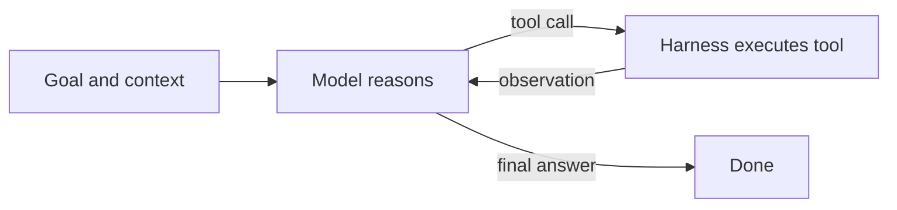
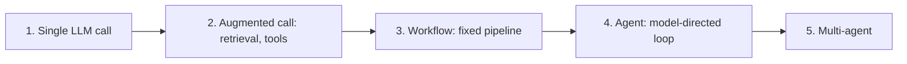
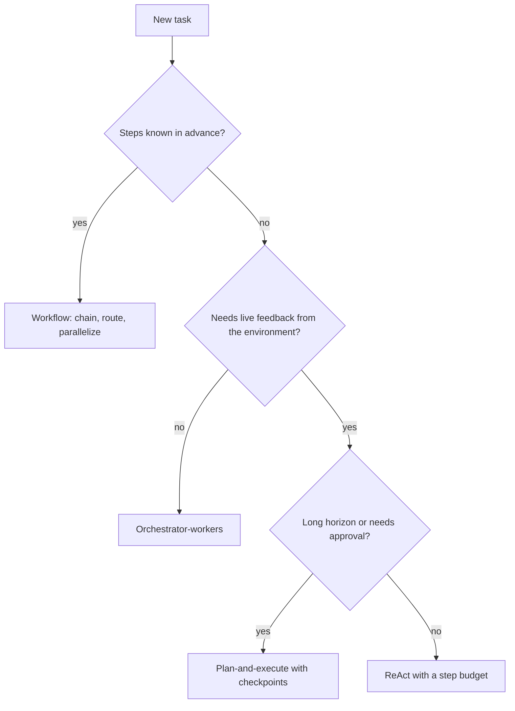
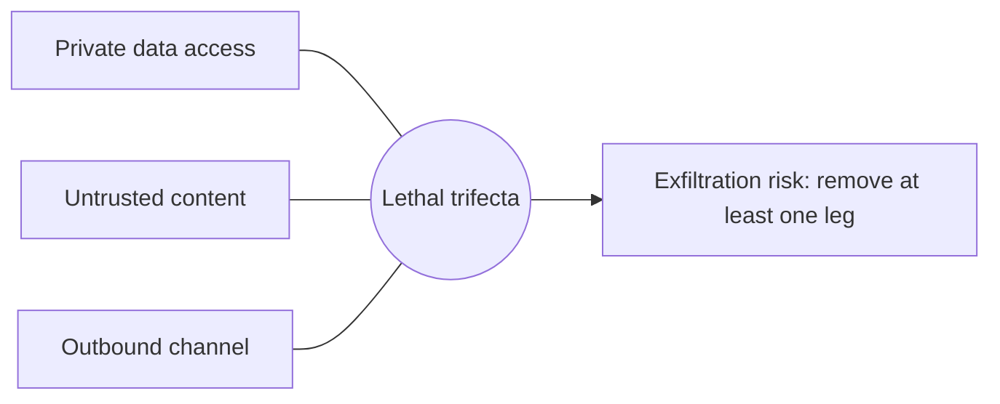

*Hi again, Biplob here. This post is about building agents that survive contact with production: which architecture to pick, where the real trade-offs are, and which emerging practices are worth adopting. Shoutout to LLMs for helping me put it together.*

**Contents**

* TOC
{:toc}

---

## What is an agent, really?

An **agent** is a system where a language model decides, at runtime, what to do next: which tools to call, in what order, and when to stop. A **workflow** is the opposite: code fixes the sequence and the model only fills in individual steps.

| | Workflow | Agent |
| --- | --- | --- |
| Control flow | Fixed in code | Chosen by the model |
| Predictability | High | Lower |
| Cost and latency | Bounded | Variable, can grow |
| Best for | Repeatable, well-understood tasks | Open-ended tasks where steps are unknowable upfront |
| Typical failure | Brittle on unexpected input | Drift, loops, compounding errors |

Nearly every agent is the same loop. Frameworks, memory and multi-agent setups are all elaborations of it.



### Autonomy is a dial, not a switch



The rule that saves the most pain: **use the simplest rung that solves the problem**, and climb only when an evaluation shows the lower rung falls short. Each rung buys flexibility and pays for it in cost, latency and debuggability.

---

## Architecture patterns and when to use them

Real systems combine several of these.

| Pattern | What it does | Use when | Watch out for |
| --- | --- | --- | --- |
| Prompt chaining | Sequential calls with programmatic gates between them | The task decomposes cleanly (outline, draft, translate) | Errors propagate down the chain |
| Routing | A classifier sends input to a specialised handler or cheaper model | Distinct input categories, or mixed easy and hard traffic | Misrouting is silent |
| Parallelization | Sectioning (split work) or voting (repeat and aggregate) | Speed, or confidence on high-stakes calls | Cost multiplies with votes |
| Orchestrator-workers | A lead model decomposes dynamically, workers execute, lead synthesises | Subtasks are unknown until runtime (coding, research) | Lead becomes a bottleneck |
| Evaluator-optimizer | One call generates, another critiques, loop | Clear criteria and measurable gain from iteration | Self-judgment is weak without external signal |
| ReAct | Reason, act, observe, repeat | Open-ended tasks needing live feedback | Can wander without a plan |
| Plan-and-execute | Explicit plan first, replan on failure | Long tasks, human approval checkpoints | Stale plans if the environment shifts |
| Code as action | The agent writes and runs code instead of calling many tools | Data-heavy or composable work | Needs a real sandbox |

A quick decision aid:



---

## Multi-agent: powerful, but not free

Multi-agent systems split work across several model instances, each with its own prompt, tools and context window.

| Topology | How it works | Trade-off |
| --- | --- | --- |
| Supervisor and subagents | A lead delegates to specialists and merges results | Easy to reason about; the lead is a single point of failure |
| Hierarchical | Supervisors of supervisors | Scales, but each layer loses information |
| Handoff | One agent transfers the conversation to a better-suited one | Natural for customer flows; control flow harder to trace |
| Debate or critic panels | Several agents argue or vote | Can cut errors; multiplies cost |
| Shared workspace | Agents read and write common state | Flexible; needs conflict handling |

**Why do it:** context isolation (a subagent burns tens of thousands of tokens exploring and returns a short summary), parallelism, and specialisation with small tool sets.

**Why not:** total token cost is typically several times a single agent, coordination failures (duplicate work, conflicting edits, context lost at handoff) and harder debugging.

**Rule of thumb:** multi-agent pays off on breadth-first, parallelizable work such as research and wide search. It pays off least when agents share lots of state and decisions are tightly coupled, as in many coding tasks. Start with one agent and split only when context limits or parallelism force it.

---

## Tools are an interface for a model

Function calling works like this: you describe each tool (name, description, JSON Schema), the model *requests* a call, your code validates and runs it, and the result goes back as a message. The model never executes anything itself. Independent calls can be issued in one turn, so run them concurrently.

Treat tools as an **agent-computer interface**. The model is a user with no memory of your codebase and limited patience.

| Design choice | Prefer | Avoid |
| --- | --- | --- |
| Granularity | Few, higher-level tools | One thin wrapper per API endpoint |
| Description | Docstring for a new hire: what, when, when not, example | One-line label |
| Arguments | Enums, required fields, absolute paths | Free-form strings that invite misuse |
| Output | Compact, readable names, pagination, truncation | Raw dumps that flood the context |
| Errors | "Date must be YYYY-MM-DD; got 'next week'" | Stack traces |

Test tools the way you test prompts: run many tasks, read transcripts, and rename or reword wherever the model stumbles.

### MCP and the cost of connecting everything

The **Model Context Protocol (MCP)** standardises how hosts expose tools, resources and prompts, so one server works across many agents. The trade-off is twofold. Every connected server enlarges the tool list the model must choose from, and every server is a trust boundary: its tool descriptions and outputs are untrusted input.

Two emerging practices address the first problem:

* **Progressive tool loading.** Keep only tool names in context and load full schemas on demand (tool search), instead of paying for hundreds of definitions on every call.
* **Code execution against tools.** Expose MCP tools as code APIs inside a sandbox. The agent writes a small script, and bulky intermediate data never enters the context window.

Computer and browser use fill the gap where no API exists. They are flexible but slower and less reliable than APIs, so prefer an API whenever one exists.

---

## Context engineering

The context window is the agent's working memory: finite and noisy. **Context engineering** is deciding what goes into it at each step. It has largely replaced "prompt engineering" as the main skill.

| Memory kind | What it is | Typical implementation |
| --- | --- | --- |
| Working | Current conversation and tool results | The message list |
| Episodic | Records of past runs | Logged trajectories, retrieved by similarity |
| Semantic | Facts and knowledge | RAG over documents |
| Procedural | How to do things | System prompts, skills, instruction files |

Techniques that consistently pay off:

| Technique | Idea | Trade-off |
| --- | --- | --- |
| Just-in-time retrieval | Keep references (paths, IDs) and load details on demand | Extra tool calls, but a lean context |
| Compaction | Summarise history near the limit and continue | A summary can drop a detail you later need |
| Tool-result clearing | Drop stale bulky outputs once used | Harder to revisit old evidence |
| Structured notes | Agent writes progress to a file and rereads it | Survives resets; notes can go stale |
| Subagent delegation | Explore in isolation, return a distilled result | More tokens overall |
| Prompt caching | Keep the prefix (system prompt, tools) byte-identical | Constrains how often you edit the prefix |

**Failure modes to recognise:** *poisoning* (a wrong fact keeps getting reused), *distraction* (irrelevant content pulls attention), *confusion* (too many tools or documents) and *clash* (contradictory instructions).

---

## Build the loop yourself once

Before adopting any framework, write the loop. It makes every framework easier to judge and debug. Here is the provider-neutral skeleton:

```python
def run_agent(goal, tools, llm, max_steps=10):
    messages = [{"role": "user", "content": goal}]
    for step in range(max_steps):
        reply = llm(messages, tools=tool_schemas(tools))
        messages.append(reply.as_message())
        if not reply.tool_calls:              # model chose to answer
            return reply.text
        for call in reply.tool_calls:         # run concurrently if independent
            try:
                args = validate(tools[call.name].schema, call.args)
                result = tools[call.name].run(**args)
            except Exception as e:
                result = f"Error: {e}"        # let the model recover
            messages.append({"role": "tool", "tool_call_id": call.id,
                             "content": truncate(result, 4000)})
    raise TimeoutError("step budget exceeded")
```

Then harden it in this order: step and token budgets, loop detection, a permission gate for write or delete tools, JSONL tracing with cost, compaction, and finally an approvable plan step.

### Choosing a framework

Pick by the control you need, not by popularity, and treat this landscape as fast-moving.

| You need | Lean toward |
| --- | --- |
| Explicit, auditable control flow and durable state | Graph-style frameworks |
| A capable general agent fast | A harness SDK that already handles tools, permissions and context |
| Minimal abstraction and tracing | Small primitive-based SDKs |
| Lock-in protection | Tools behind MCP or your own thin interface |

If a framework hides the actual prompts and tool calls, you cannot debug it. Prefer ones that expose traces.

---

## Evaluation and observability

Agents are non-deterministic, so build evaluations before features.

| Dimension | Question | How to measure |
| --- | --- | --- |
| Outcome | Is the end state correct (file changed, record exists, tests pass)? | Code-based graders on state, not just the final message |
| Trajectory | Were steps sensible, efficient, safe? | Transcript review, LLM judge with a rubric |
| Cost and latency | Tokens, tool calls, wall-clock per task | Traces; cost per *successful* task |
| Reliability | Does it work every time? | Run each task k times and track pass^k, not best-of-k |

A task solved 1 time in 5 is not a solved task. Start with 20 to 50 realistic tasks drawn from real usage, validate any LLM judge against human labels, rerun the suite on every prompt, tool or model change, and read traces regularly. That last habit is the highest-value debugging activity there is.

---

## Safety and control

An agent that can act can act wrongly. The principal risks are prompt injection through any untrusted content the agent reads, excessive agency, data exfiltration, irreversible actions and compromised tool servers.

The **lethal trifecta** is the pattern to design against: an agent with (1) access to private data, (2) exposure to untrusted content and (3) an outbound communication channel can be tricked into leaking data. Remove at least one leg.



Layer your defenses:

1. **Least privilege:** scoped credentials, read-only by default.
2. **Sandboxing:** isolate code and browsers with restricted network and filesystem.
3. **Human approval** for irreversible, costly or external actions.
4. **Trust separation:** treat tool output and retrieved content as data, never as instructions.
5. **Guardrails:** useful classifiers, but never sufficient alone.
6. **Hard limits** on steps, time and spend, enforced in code.
7. **Audit logs** and reversible operations (soft delete, dry runs, version control).

> Never rely on the prompt alone to enforce a security boundary. Enforce it in code, permissions and infrastructure.

---

## Production trade-offs you will actually face

| Concern | The problem | What to do |
| --- | --- | --- |
| Error compounding | At 95% per step, a 20-step run succeeds about 36% of the time | Shorten trajectories, add verification, make steps retryable |
| Durability | Long runs crash | Checkpoint state; make tools idempotent or use idempotency keys |
| Cost | Cost grows with steps and context | Route easy work to small models, cache prefixes, cap steps, track cost per success |
| Latency | Sequential loops are slow | Parallelize tool calls, stream output, run long tasks in the background |
| Determinism | Models vary run to run | Use structured outputs and code for anything code can do |
| Versioning | Silent model or prompt changes break behavior | Version prompts, tools and model; rerun evals before upgrading |
| Failure behavior | Stuck agents burn money | Define stop conditions: ask, hand off, or stop with a report |

---

## Emerging practices worth watching

* **Skills and instruction files.** Procedural knowledge packaged as files the agent loads only when relevant, which keeps the base context small.
* **Agents-as-tools and subagent isolation.** Specialised subagents invoked like functions, returning only a distilled result.
* **Long-running and background agents.** Work that spans hours, with checkpointing, notifications and human approval at defined gates.
* **Spec-driven and test-driven agent work.** Give the agent an executable definition of done (tests, linters, schemas) so it can verify itself against external signal instead of judging itself.
* **Agent-to-agent protocols.** Standards such as A2A aim to let separately built agents discover and delegate to each other, and I use them in my [automatic agent evaluation post]({{ site.baseurl }}/2026/08/05/Automatic-Agent-Evaluation/).
* **Trace-driven development.** Production traces feed directly back into eval suites, so every real failure becomes a regression test.

---

## Closing thoughts

Agentic engineering is less about clever prompting and more about disciplined systems work: a simple loop, well-designed tools, a curated context, hard limits, and evaluations you trust. Climb the autonomy ladder only as far as measurements justify, and spend the saved complexity budget on evals and safety.

*Details in this field move quickly. Framework names and APIs change every few months, so verify against current documentation before committing.*
