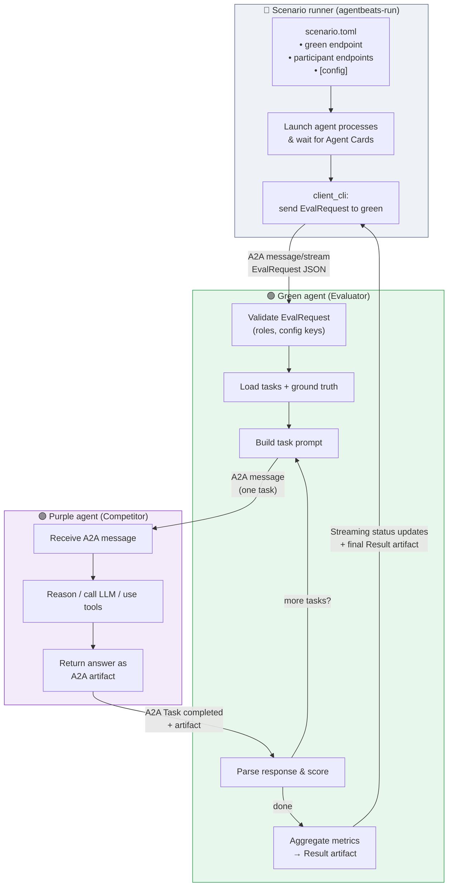
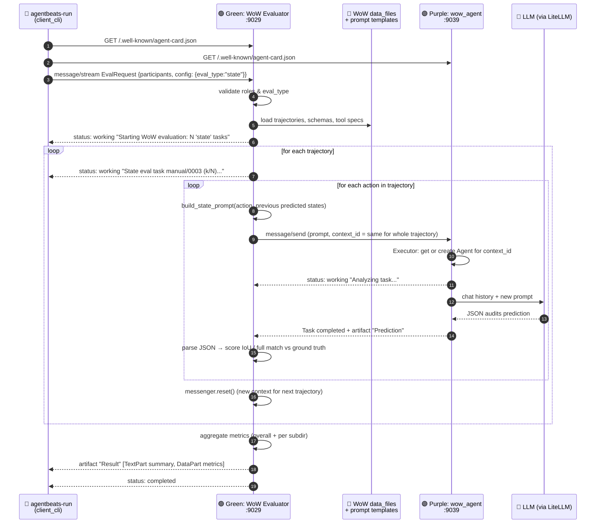
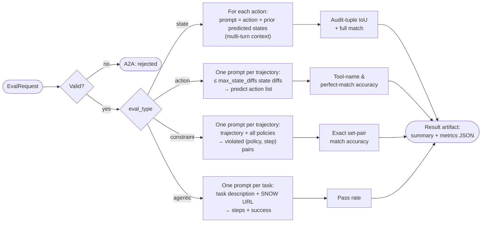

# Automatic Agent Evaluation: When the Benchmark Becomes an Agent

*Namaste, Biplob again! This article is about how to automate evaluation of an agent on a benchmark (e.g. the World of Workflows (WoW) enterprise benchmark) into AgentBeats with a 🟢 green evaluator and a 🟣 purple competitor that talk to each other over A2A.*

---

## The problem with benchmarks today

If you've ever tried to evaluate an AI agent on more than one benchmark, you know how it goes. Each benchmark ships with its own harness, its own input format and its own idea of what an "agent" is: a Python class with a `predict()` method, a CLI that reads stdin, or a model name passed to someone else's wrapper. So you end up writing glue code for every benchmark, and the agent you actually test is a slightly different thing each time.

**AgentBeats** takes a different route, which it calls **Agentified Agent Assessment (AAA)**:

> Instead of adapting your agent to fit a rigid benchmark, **the benchmark itself becomes an agent.**

AAA has two roles:

| Role | What it is | What it does |
|---|---|---|
| 🟢 **Green agent** | The evaluator | Owns the tasks, the environment, the ground truth and the scoring |
| 🟣 **Purple agent** | The competitor | The AI agent under test. It gets tasks and sends back answers |

The two never import each other's code. They talk only through the **[A2A (Agent-to-Agent) protocol](https://a2a-protocol.org/)**, an open standard for agents to discover each other, exchange messages and track long-running tasks over HTTP. In practice, you **build your purple agent once and it works with every green agent on the platform**.

This post walks through a working implementation of that idea, using the **World of Workflows (WoW)** benchmark as the example.

---

## The general evaluation flow

Before looking at WoW, here is the shape of every AgentBeats evaluation:



In words:

1. **The scenario runner** reads a `scenario.toml`, starts the green and purple agents as separate HTTP servers, and waits until both publish their **Agent Card**, the A2A discovery document served at `/.well-known/agent-card.json`.
2. **The client** sends the green agent one message: an `EvalRequest` saying *who the participants are* (role → URL) and *how to run the evaluation* (`config`).
3. **The green agent** loads the benchmark tasks and, for each one, sends the purple agent a plain A2A message holding the task prompt.
4. **The purple agent** solves the task however it likes (a single LLM call, a ReAct loop, tool use, a fine-tuned model) and replies with an A2A **artifact**.
5. **The green agent** scores each reply against ground truth, streams progress updates back to the client, and finally publishes a **Result artifact** with a human-readable summary and machine-readable metrics.

The purple agent never sees the ground truth or the scoring code, and the green agent never sees how the purple agent works. A2A is the only contract between them.

---

## Meet the benchmark: World of Workflows

[World of Workflows](https://github.com/Skyfall-Research/world-of-workflows) is a realistic enterprise environment built on a ServiceNow-based mock system with **6,000+ interlinked tables and 93 workflows**. The hard part of enterprise work is not single API calls. It is that one action, such as *"create a user"*, sets off a cascade of side effects across many tables. WoW records those side effects as **table audits**, the database state changes caused by each action:

```json
// Action
{ "tool_name": "create_user",
  "parameters": { "user_name": "Darius.Kashyap.13", "first_name": "Darius",
                  "last_name": "Kashyap", "email": "Darius.Kashyap.13@example.com" } }

// Resulting audits (ground-truth state change), truncated
[ { "tablename": "cmn_notif_device", "fieldname": "email_address",
    "oldvalue": "", "newvalue": "Darius.Kashyap.13@example.com" },
  { "tablename": "sys_user", "fieldname": "active",
    "oldvalue": "", "newvalue": "1" } ]
```

*(This is the first step of `wow-bench/src/wow/data_files/trajectories/constraint/0001.json`.)*

The benchmark asks whether an agent has a working **world model** of the enterprise system. It does this through four evaluation types, all of which this repo supports:

| `eval_type` | Question asked of the purple agent | Data source |
|---|---|---|
| `state` | *"Given this action, what audits will it produce?"* | 67 trajectories (`manual` 37, `dep_graph` 20, `constraint` 10) |
| `action` | *"Given these state changes, which actions caused them?"* | Same 67 trajectories, read in reverse |
| `constraint` | *"Which policy does this trajectory violate, and at which step?"* | `constraint_violation_data/` (original + combined trajectories) |
| `agentic` | *"Complete this enterprise task."* | `task_completion_data/` (10 tasks) |

---

## Repository tour

```
wow/
├── scenario.toml              # Which agents to launch + eval config
├── setup.sh                   # Sparse-clones WoW data & prompt templates into wow-bench/
├── src/agentbeats/
│   ├── run_scenario.py        # `agentbeats-run`: launches agents, waits, runs client
│   ├── client_cli.py          # Sends EvalRequest to green, prints streamed events
│   ├── client.py              # Thin A2A client helper
│   └── models.py              # EvalRequest / EvalResult schemas
├── green/src/                 # 🟢 Evaluator
│   ├── server.py              # Agent Card + A2A Starlette app on :9029
│   ├── executor.py            # A2A AgentExecutor → Agent.run()
│   ├── agent.py               # Task loading, prompt building, scoring
│   └── messenger.py           # A2A client used to talk to purple
├── purple/src/                # 🟣 Competitor
│   ├── server.py              # Agent Card + A2A Starlette app on :9039
│   ├── executor.py            # A2A AgentExecutor → Agent.run()
│   └── agent.py               # LiteLLM call with conversation memory
└── wow-bench/                 # WoW data_files + prompts (from setup.sh)
```

The green and purple sides are built the same way: **server → executor → agent**. That is the A2A Python SDK (`a2a-sdk`) pattern, and it is why a new purple agent can be swapped in without touching the evaluator.

---

## Step 1: Describe the scenario

Everything starts with [scenario.toml](scenario.toml):

```toml
[green_agent]
endpoint = "http://127.0.0.1:9029"
cmd = "python green/src/server.py --host 127.0.0.1 --port 9029"

[[participants]]
role = "agent"
endpoint = "http://127.0.0.1:9039"
cmd = "python purple/src/server.py --host 127.0.0.1 --port 9039"

[config]
eval_type = "action"
num_tasks = 2
custom_schema = false
```

Three things to notice:

- **Participants are addressed by role.** The WoW green agent requires one role named `agent` (`required_roles = ["agent"]` in [green/src/agent.py](green/src/agent.py#L576)). A multi-agent benchmark could just as easily ask for `attacker` and `defender`.
- **`cmd` is optional.** If you leave it out, the runner assumes the agent is already running somewhere, such as a remote server, a Docker container or a teammate's laptop, and simply connects to `endpoint`. That is what lets AgentBeats evaluate agents it didn't launch.
- **`[config]` is opaque to the runner.** It is passed straight through to the green agent, which decides what the keys mean (`eval_type`, `num_tasks`, `max_state_diffs`, `constraint_with_audits`, …).

## Step 2: Launch and discover

`uv run agentbeats-run scenario.toml` runs [src/agentbeats/run_scenario.py](src/agentbeats/run_scenario.py), which:

1. Checks that the ports are free.
2. Starts the purple agent and then the green agent as subprocesses.
3. Polls each endpoint with `A2ACardResolver.get_agent_card()` until both answer (30 s timeout).
4. Runs `agentbeats.client_cli` to start the evaluation.

Each agent describes itself with an **Agent Card**. Here is the purple one, from [purple/src/server.py](purple/src/server.py):

```python
skill = AgentSkill(
    id="wow_task_fulfillment",
    name="WoW Task Fulfillment",
    description="Solves World of Workflows benchmark tasks: state prediction, "
                "action prediction, constraint violation detection, and agentic task completion.",
    tags=["benchmark", "wow", "servicenow", "enterprise"],
)

agent_card = AgentCard(
    name="wow_agent",
    url=f"http://{args.host}:{args.port}/",
    default_input_modes=["text"],
    default_output_modes=["text"],
    capabilities=AgentCapabilities(streaming=True),
    skills=[skill],
)
```

The card is the A2A "business card": who the agent is, what it can do, and which input and output modes it accepts. Clients fetch it before they send anything.

## Step 3: Kick off the evaluation

[src/agentbeats/client_cli.py](src/agentbeats/client_cli.py) turns the TOML into an `EvalRequest`:

```python
class EvalRequest(BaseModel):
    participants: dict[str, HttpUrl]   # role → endpoint
    config: dict[str, Any]
```

It serialises the request to JSON and sends it to the green agent as a **streaming** A2A message:

```json
{
  "participants": { "agent": "http://127.0.0.1:9039/" },
  "config": { "eval_type": "action", "num_tasks": 2, "custom_schema": false }
}
```

Because the call streams, the client receives every `TaskStatusUpdateEvent` the green agent emits, such as *"Action eval task constraint/0001 (1/2)…"*, so you can watch the run live. At the end it receives the final artifacts.

## Step 4: The green agent runs the benchmark

[green/src/agent.py](green/src/agent.py) holds the WoW-specific logic. Its `run()` method:

```python
request = EvalRequest.model_validate_json(input_text)
ok, msg = self.validate_request(request)          # roles + eval_type check
if not ok:
    await updater.reject(new_agent_text_message(msg))   # A2A "rejected" state
    return

tasks, policies = self._load_tasks(eval_type, num_tasks, max_state_diffs)
...
if eval_type == "state":       result = await self._run_state_eval(...)
elif eval_type == "action":    result = await self._run_action_eval(...)
elif eval_type == "constraint":result = await self._run_constraint_eval(...)
else:                          result = await self._run_agentic_eval(...)
```

The green agent reproduces the **official WoW evaluation logic**. It builds prompts from WoW's own prompt templates (`state_prediction_prompt.txt`, `action_prediction_prompt.txt`, `constraint_violation_prompt.txt`) and uses the official compressed table schemas and tool specs. To keep prompts manageable, each prompt includes only the schemas for tables the trajectory actually touches, not all 6,000.

To reach the purple agent, the green agent acts as an **A2A client** through [green/src/messenger.py](green/src/messenger.py):

```python
response = await self.messenger.talk_to_agent(
    message=prompt,
    url=agent_url,
    new_conversation=(step_idx == 0),   # keep or reset the A2A context_id
)
```

`Messenger` remembers the A2A `context_id` for each purple URL. That small detail is how the green agent controls **conversation memory** on the purple side:

- **State prediction** is *multi-turn*. The first action of a trajectory starts a new context, and later actions reuse it, so the purple agent builds up its own picture of the system as the trajectory unfolds. The green agent also sends the previously *predicted* states in each prompt, as the official benchmark does.
- **Action, constraint and agentic** are *single-turn*: each task gets a new context.

## Step 5: The purple agent answers

The purple agent in this repo is deliberately minimal. That is the point: the evaluation plumbing should not care how smart the competitor is. [purple/src/agent.py](purple/src/agent.py):

```python
SYSTEM_PROMPT = ("You are a ServiceNow enterprise world model. "
                 "Respond with raw JSON exactly as instructed in each prompt — "
                 "no markdown code blocks, no explanation, no extra text.")

class Agent:
    def __init__(self):
        self.model = os.getenv("WOW_AGENT_LLM", "ollama/qwen3:14b")
        self.messages = [{"role": "system", "content": SYSTEM_PROMPT}]

    async def run(self, message, updater):
        await updater.update_status(TaskState.working, new_agent_text_message("Analyzing task..."))
        self.messages.append({"role": "user", "content": get_message_text(message)})

        completion = litellm.completion(model=self.model, messages=self.messages, temperature=0.7)
        answer = completion.choices[0].message.content or ""
        self.messages.append({"role": "assistant", "content": answer})

        await updater.add_artifact(parts=[Part(root=TextPart(text=answer))], name="Prediction")
```

On the purple side, [purple/src/executor.py](purple/src/executor.py) keeps **one `Agent` instance per A2A `context_id`**. When the green agent reuses a context, the purple agent's `self.messages` history continues. When the green agent starts a new conversation, a new `Agent` is created with empty memory. Memory is managed entirely through the protocol, so neither side needs any custom session API.

Because the model is chosen through LiteLLM (`WOW_AGENT_LLM`), you can switch between `openai/gpt-4.1`, `anthropic/...`, `openrouter/...` or a local `ollama/qwen3:14b` without changing any code. To test a completely different agent, such as a LangGraph planner or a tool-using ServiceNow agent, replace `purple/` with any A2A server that accepts text and returns a text artifact. The green agent will never know the difference.

## Step 6: Scoring and results

The green agent pulls JSON out of the purple agent's raw text with a lenient regex (`\{.*\}` or `\[.*\]`), then applies the official WoW metric for the eval type:

| `eval_type` | Metric(s) | How it's computed ([green/src/agent.py](green/src/agent.py#L507-L568)) |
|---|---|---|
| `state` | **Full-match rate**, **avg partial IoU** | Each audit becomes a `(table, field, old, new)` tuple. IoU = \|pred ∩ gt\| / \|pred ∪ gt\| per step. A full match means every ground-truth tuple was predicted |
| `action` | **Tool-name accuracy**, **perfect-match accuracy** | Pairwise comparison of predicted and true actions. Perfect means the tool name matches *and* every ground-truth parameter value matches |
| `constraint` | **Accuracy** | 1 if the set of predicted `(policy_idx, action_idx)` pairs equals the ground truth exactly, otherwise 0 |
| `agentic` | **Pass rate** | Fraction of tasks where the purple agent reports `success: true` *(see caveats below)* |

State and action results are also broken down by trajectory subset (`manual`, `dep_graph`, `constraint`). Everything comes back as **one A2A artifact with two parts**:

- a `TextPart` with the readable summary,
- a `DataPart` with the full metrics JSON, ready for leaderboards.

```
World of Workflows Benchmark Results
Eval type: action
Time:      ...s

Total actions:       ...
Tool name accuracy:  ...
Perfect match acc:   ...
  constraint: perfect=...  (... actions)
```

---

## The full WoW conversation, end to end

Here is one `state`-prediction trajectory as an A2A message exchange:



And the same process as an evaluation-type decision flow inside the green agent:



---

## Running it yourself

```bash
# 1. Install the base deps plus the green and purple extras
uv sync --extra wow-purple --extra wow-green

# 2. Fetch WoW data + prompt templates (sparse clone into wow-bench/)
./setup.sh

# 3. Configure the purple agent's LLM
cp sample.env .env
#   WOW_AGENT_LLM=openai/gpt-4.1        (or ollama/qwen3:14b, anthropic/..., etc.)
#   OPENAI_API_KEY=... / OPENROUTER_API_KEY=...

# 4. Pick an eval type in scenario.toml ([config] eval_type = state|action|constraint)

# 5. Run
uv run agentbeats-run scenario.toml              # full evaluation
uv run agentbeats-run scenario.toml --show-logs  # include agent stdout/stderr
uv run agentbeats-run scenario.toml --serve-only # just start agents, e.g. to debug
```

Detailed logs end up in `green/src/wow_evaluator.log` (including each raw purple response) and `purple/src/purple_agent.log`.

---

## Lessons from the logs

Running `eval_type = "action"` on the first two trajectories with a local model showed why it helps to keep the evaluator and the competitor separate. The raw purple responses in `wow_evaluator.log` included:

```json
[{"tool_name": "Create User", "parameters": {"first_name": "Darius", "last_name": "Vasquez", ...}},
 {"tool_name": "Assign Role", ...}]
```

The ground truth is `create_user`, with last name `Kashyap`. The model *understood the intent* but **invented tool names and parameter values**. Under the official metric, that scores zero tool-name accuracy. In an earlier run, the response could not be parsed as JSON, so the green agent recorded an empty prediction for the whole trajectory.

Neither failure needed any change to the green agent. The evaluator stayed fixed while we iterated on the purple side: a different model, a lower temperature, or a better system prompt that tells the agent to use only tool names from the supplied spec. That **separation of concerns** is the main benefit of the green/purple split.

---

## Caveats and where to go next

To be clear about the current state of this implementation:

- **The agentic eval is a placeholder.** Today the green agent asks the purple agent to *describe* its steps and scores the purple agent's own `success` flag. A real implementation would have the green agent host the ServiceNow environment, for example by exposing WoW's MCP tools, and check the resulting database state against `answer.json`.
- **`custom_schema` is accepted in config but not yet used** by the green agent.
- **JSON extraction is lenient but brittle.** A greedy regex can grab the wrong span if the model adds extra text. Structured output or an A2A `DataPart` reply would be sturdier.
- **The README's scoring table is out of date.** It mentions "token-level F1", but the code implements the official WoW metrics (audit IoU, exact action match, set-pair match) described above.

Natural next steps:

1. Publish the green agent to the AgentBeats platform so any registered purple agent can be scored on WoW.
2. Build stronger purple agents (tool-grounded, retrieval over schemas, self-verification) and compare them on the same green agent.
3. Run purple agents remotely by dropping `cmd` from the participant entry and pointing `endpoint` at a hosted URL.

---

## TL;DR

- **AAA flips the usual setup:** the benchmark is an agent (🟢 green), and the system under test is an agent (🟣 purple).
- **A2A is the only contract between them:** Agent Cards for discovery, messages for tasks, `context_id` for memory, status updates for progress, and artifacts for answers and results.
- **WoW fits this pattern well:** the green agent wraps 67 ServiceNow trajectories, the official prompts and the official metrics, while the purple agent is about 90 lines of LiteLLM code that can be replaced with any A2A-speaking agent.
- **Build your agent once and evaluate it on any benchmark on the platform.**
