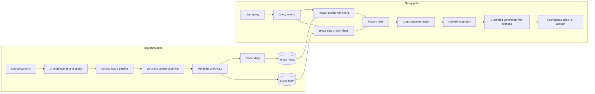
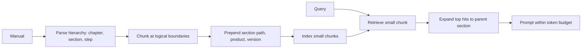
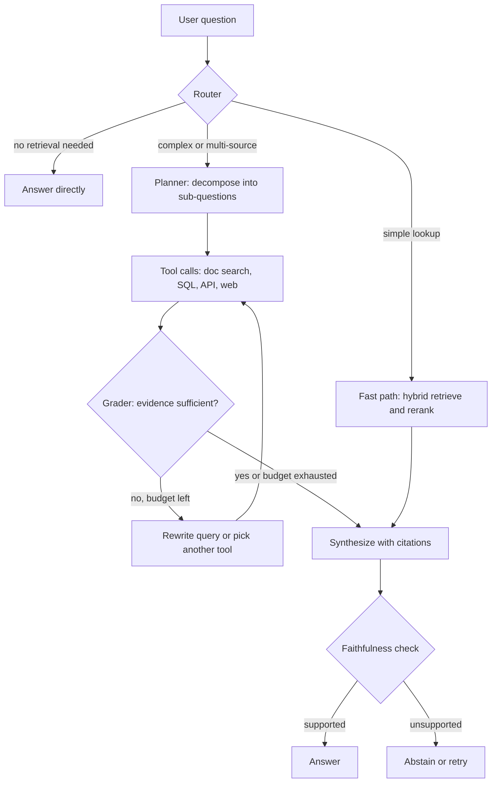

*Biplob here. Retrieval-augmented generation looks simple in a tutorial and gets subtle in production. This post walks through four design problems (enterprise search, chunking, embeddings and indexes, agentic RAG) and, for each choice, states what it buys, what it costs, and what would make me change it. Shoutout to LLMs for helping me write it.*

**Contents**

* TOC
{:toc}

---

## A way to reason about every RAG decision

There is rarely one correct design. Every choice buys something and costs something, so I use the same four steps each time:

1. **Name the dimension** in tension (latency versus recall, say).
2. **Compare two real options** and what each is good at.
3. **Pick one for the stated context** and say why.
4. **Name the signal that would flip the choice**, usually a measurement.

For example: dense-only retrieval is simple and fast but misses exact identifiers like part numbers. Hybrid with BM25 fixes that for roughly one extra index lookup. On a corpus full of product codes I would go hybrid, and drop back to dense-only if an ablation showed no recall gain, since it would be a component maintained for nothing.

### Questions to ask before designing anything

| Question | Why it changes the design |
| --- | --- |
| Scale and growth (documents, chunks) | Decides index type and sharding |
| Freshness (seconds, minutes, daily) | Streaming versus batch ingestion |
| Latency target (interactive or async) | How many stages you can afford |
| Cost of a wrong answer | Abstention strictness, verification passes |
| Per-user permissions | ACL filtering inside retrieval |
| Content mix (PDFs, scans, tables, code) | Parser and chunking strategy |
| Hosting constraints | API models versus self-hosted |

Numbers below are typical ballparks to anchor intuition. Measure on your own data before quoting them.

---

## Problem 1: A robust pipeline for real-time enterprise search

**The requirement:** real-time freshness, minimal hallucination, interactive latency.

The design splits into an ingestion path and a query path, and the eval set comes before either.



### Stage by stage

| Stage | Choice | Because | Trade-off |
| --- | --- | --- | --- |
| Parsing | Layout-aware, preserving headings, tables, reading order; OCR for scans | Everything downstream inherits parsing errors, and no reranker repairs a scrambled table | Heavier parsers cost more per page; use them where structure matters |
| Chunking | Structure-aware, a few hundred tokens, section path prepended, parent-child links | Small chunks retrieve precisely; the parent restores context for generation | More bookkeeping (see Problem 2) |
| Retrieval | Dense plus BM25, fused with reciprocal rank fusion (RRF), filters inside both | Dense catches paraphrase; BM25 catches codes, SKUs, acronyms; failure modes are complementary | A second index to operate; tuned weighted fusion can beat RRF but is brittle |
| Reranking | Retrieve 50 to 100, cross-encoder rerank, keep 5 to 10 | First stage is fast but coarse; the cross-encoder reads query and passage together | Adds tens to a few hundred ms; pick the candidate count where recall@k plateaus |
| Generation | Answer only from context, cite chunk IDs, define the abstention reply, low temperature | Hallucination comes from missing evidence or ignored evidence; these address both | Strict abstention raises refusals |

### Making it real time

* **Change data capture or webhooks** feed a queue; workers parse, chunk, embed and upsert.
* **Idempotent upserts** keyed by document and chunk ID with a version field, so retries and reordered events do not create duplicates.
* **Deletes and permission changes** propagate as tombstones or metadata updates, with security changes prioritised.
* **Re-embed only changed chunks** by comparing content hashes.

| Freshness approach | Pros | Cons | Choose when |
| --- | --- | --- | --- |
| Streaming per-document upsert | Searchable in seconds | Frequent small writes fragment HNSW graphs; needs periodic compaction | Tickets, collaboration tools |
| Micro-batch (minutes) | Efficient writes, simple ops | Minutes of staleness | Most wikis and document stores |
| Nightly rebuild | Cleanest index, easy re-embedding | Hours of staleness | Slow-changing reference content |
| Fresh delta index plus main index | Real-time tail without rebuilding the big index | Two indexes to merge and compact | Large corpora with a hot recent tail |

### Permissions are non-negotiable

Store ACL metadata with each chunk and apply it as a **filter inside the retrieval query**, based on the authenticated user's groups, before anything reaches the model. If restricted text ever enters the prompt, you cannot reliably stop the model from revealing it. Post-filtering can silently return too few results; pre-filtering avoids that, though filtered ANN search needs care (Problem 3).

### The latency budget

| Stage | Ballpark | Lever when over budget |
| --- | --- | --- |
| Query embedding | 10 to 50 ms | Smaller model, cache frequent queries |
| Dense plus BM25 (parallel) | 20 to 100 ms | Lower efSearch, fewer shards |
| Fusion | under 5 ms | Negligible |
| Rerank (top 50 to 100) | 50 to 400 ms | Fewer candidates, shorter chunks, distilled reranker, GPU |
| Generation, first token | 300 to 1500 ms | Fewer context tokens, smaller model, prompt caching, streaming |
| Faithfulness check | 0.5 to 2 s extra | Run only on high-risk or low-confidence answers |

Retrieval is rarely the bottleneck. Generation and optional LLM calls dominate, so stream tokens and optimise the time to first token.

### Latency versus accuracy, stated plainly

| Design | Latency | Accuracy | Right when |
| --- | --- | --- | --- |
| Dense-only, top 5 | Lowest | Misses exact terms | Prototype, simple FAQ corpora |
| Hybrid, top 5 | Low | Better recall on identifiers | Default starting point |
| Hybrid plus rerank | Moderate | Notably better precision at the top | Most production systems |
| Plus query rewrite and verification | High | Highest | Legal, medical, compliance, async work |
| Agentic multi-step | Highest, variable | Best on multi-hop questions | Complex questions only (Problem 4) |

The senior move is to make this a **dial, not a fixed point**: a router sends simple lookups down the fast path and complex or high-risk queries down the heavy one.

### Defense in depth against hallucination

1. **Retrieve the right evidence** (parsing, chunking, hybrid, rerank).
2. **Ground the prompt**: answer only from sources, cite, say so when the answer is absent.
3. **Abstain on weak evidence** when the top reranker score falls below a calibrated threshold.
4. **Verify** that each claim maps to a cited chunk, selectively.
5. **Constrain output** with structured citations so unsupported claims are detectable.
6. **Monitor** groundedness, citation accuracy and abstention rate.

The abstention threshold is itself a trade-off: strict lowers hallucination but refuses answerable questions. Set it from a labeled set that includes unanswerable questions, and decide which error costs more for your use case.

**What would change the design:** under a few thousand short documents, skip heavy infrastructure; a small static corpus that fits in a cached long context may not need retrieval; strict on-premises rules mean self-hosting every model; mostly structured data should route to SQL or APIs rather than embedding rows.

---

## Problem 2: Context windows and chunking for large technical manuals

Manuals are structured even when the files are not, so chunking should preserve that structure instead of cutting every N tokens.

### Why manuals are hard

| Content | Why it breaks naive chunking |
| --- | --- |
| Procedures | Step 4 without the warning in step 1 is dangerous |
| Tables | Meaning lives in headers and rows together |
| Code and commands | Must stay exact; prose splitters break them |
| Warnings | Safety callouts must travel with their steps |
| Cross-references | "See section 4.2" points elsewhere |
| Versions | The same procedure differs by firmware or model |
| Figures | Diagrams carry information absent from the text |

### Chunking strategies compared

| Strategy | Pros | Cons | Use when |
| --- | --- | --- | --- |
| Fixed-size with overlap | Trivial, predictable | Cuts mid-step and mid-table | Quick baseline |
| Recursive (paragraph, sentence) | Cheap, respects boundaries | Blind to hierarchy | Prose without structure markers |
| Structure-aware | Coherent units, free metadata | Depends on parser quality | Manuals, specs, wikis (my default) |
| Semantic | Boundaries follow topic shifts | Extra ingest cost, threshold-sensitive | Transcripts, long headingless prose |
| Parent-child | Precise retrieval plus rich context | More bookkeeping, bigger prompts | Long sections needing surrounding explanation |
| Contextualized chunks | An LLM-written blurb restores lost context | Ingest cost scales with corpus | Ambiguous fragments, available budget |
| Late chunking | Chunk embeddings informed by the whole document | Needs a long-context embedder | When cross-chunk context matters |



### Chunk size and overlap

Start around **200 to 500 tokens** for the retrieval unit and tune it as a hyperparameter against retrieval metrics. Small chunks (100 to 200) retrieve precise facts like a spec value but lack context. Large ones (800 or more) keep reasoning context but dilute the embedding and burn budget. Lookup questions favor small chunks; "how do I configure X" favors procedure-sized chunks.

Use modest overlap (10 to 15 percent) only for fixed or recursive splitting. With structure-aware chunking it mostly inflates the index and creates near-duplicate hits. Always respect the embedder's maximum input length, because text beyond it is silently truncated.

### Handling specific content

| Content | Approach |
| --- | --- |
| Procedures | Keep whole if it fits; otherwise split on step groups, repeating title and prerequisites |
| Tables | Chunk by row groups with the header repeated; add a natural-language summary for retrieval but keep the exact table for the prompt |
| Code | Keep blocks intact with the explanatory sentence before them |
| Warnings | Attach to related steps or duplicate into adjacent chunks; flag in metadata |
| Figures | Caption with a vision model and index the description with a link to the image |
| Cross-references | Store as metadata; optionally follow as a second retrieval hop |
| Versions | Filter on product and version, defaulting to what the user specifies or the latest |

### Budgeting the context window

```text
available_for_context = window
                        - system_prompt
                        - conversation_history (trimmed or summarized)
                        - user_question
                        - reserved_output_tokens

Fill with reranked chunks, best first, de-duplicated; stop at the
budget or when relevance drops below a floor.
```

* **More context is not free.** Cost and latency grow with tokens, and models attend less reliably to the middle of long inputs. Put the strongest chunks first.
* **Deduplicate** near-identical chunks and **expand selectively**: parent expansion for the top one or two hits, not all.
* **Compress only when the budget binds**, since extractive trimming risks dropping a needed detail.
* **Rewrite follow-ups** into standalone queries and summarise old turns.
* **Keep the static prefix first** to benefit from prompt caching.

**Why not just paste the whole manual into a long-context model?** For one bounded manual that rarely changes and has low traffic, it can be the simplest option, especially with caching. For a library it does not scale: every request pays for every token, many manuals exceed any window, details degrade in very long inputs, and you lose chunk-level citations and permission filtering.

**Validate empirically.** Build a question set from real support tickets with the correct source section labeled, compare chunking variants on recall@k and nDCG, then on answer correctness. Failures usually reveal a table or procedure being split badly.

---

## Problem 3: Embeddings, HNSW, and sparse versus dense

### Choosing an embedding model

Test candidates on your own data, not by leaderboard rank.

| Criterion | Why it matters | Trade-off |
| --- | --- | --- |
| Quality on your data | Benchmark rank may not transfer to your jargon | Building an eval set takes effort but is the only reliable signal |
| Max input tokens | Caps chunk size before truncation | Long-input models are slower and may embed less sharply |
| Dimension | Memory and search time scale with it | Higher often retrieves slightly better, with diminishing returns |
| Latency and cost | Query embedding sits on the critical path | Small is fast and cheap; large is more accurate |
| API versus self-hosted | API: no ops but fees, data egress, lock-in. Self-hosted: control, but GPUs | Decide by volume, privacy, team capacity |
| Multilingual and domain | Specialised vocabulary needs matching training | Multilingual models may trail on English-only tasks |
| Asymmetric prefixes | Many models expect different prefixes for queries and documents | Forgetting them silently degrades quality |
| Flexible dimensions | Matryoshka-style truncation saves memory | Test the truncation point on your data |
| Versioning | A model change forces full re-embedding | Plan a dual-index migration |

**Selection process:** build 100 to 300 real labeled queries, shortlist three to five candidates, measure recall@k, MRR or nDCG plus latency and cost, test end to end with your reranker (it can mask first-stage differences), prefer the smaller model when the gap is within noise, and record the model version in index metadata.

**Large model or small?** The smallest model that meets the recall target. A bigger model raises latency, ingest cost, dimension and index memory permanently, and a reranker often shrinks first-stage differences. Go larger only when first-stage recall is the proven bottleneck.

**Migrating without downtime:** build a new index alongside the old, backfill, evaluate offline, shadow-test queries against both, cut over, and keep the old one briefly for rollback. Never mix vectors from different models in one index.

### Index types

| Index | How it works | Strengths | Weaknesses | Choose when |
| --- | --- | --- | --- | --- |
| Flat | Compare against every vector | Exact, no tuning | Linear cost | Up to hundreds of thousands of vectors |
| HNSW | Layered proximity graph | High recall at low latency | High memory, slower build, updates fragment the graph | Latency-sensitive search with RAM available |
| IVF | Cluster, then search nearest clusters | Lower memory, fast build | Needs training; recall sensitive to nprobe | Large, stable corpora |
| IVF-PQ | Compressed vector codes | Order-of-magnitude memory savings | Lossy, usually needs rescoring | Hundreds of millions of vectors |
| Disk-based graph | Graph on SSD | Billion scale on modest RAM | Slower than in-memory HNSW | RAM is the constraint |

### HNSW parameters

| Parameter | Meaning | Raise it for | It costs | Typical range |
| --- | --- | --- | --- | --- |
| **M** | Max connections per node | Better recall | Memory, build time | 16 to 32 |
| **efConstruction** | Build-time candidate list | Higher-quality graph | Build time only | 100 to 400 |
| **efSearch** | Query-time candidate list | Higher recall | Query latency | 50 to 200, at least k |

**How to tune:** fix M and efConstruction at reasonable values (they are baked in at build time), then sweep efSearch against ground truth from exact flat search, plotting recall versus latency. Choose the smallest efSearch that meets the recall target within budget. Going from 95 to 99 percent recall can multiply latency, so ask whether the reranker recovers the difference. If memory binds, lower M, quantize, or move to IVF-PQ or a disk index.

### A quick memory estimate

```text
raw vectors  = N * d * bytes_per_dim
10M * 1024 dims * 4 bytes (float32)  ~ 41 GB
HNSW graph   ~ N * M * 2 * ~4 bytes  (about 1 GB per 10M at M=16)

float32 -> int8   : ~4x smaller
binary            : ~32x smaller
product quant.    : ~10-60x smaller
1024 -> 256 dims  : 4x smaller
```

Vector memory dominates graph overhead, so the biggest levers are dimension, precision and quantization. Quantized search typically retrieves a larger candidate set and rescores with full-precision vectors.

### Filtering with ANN indexes

* **Post-filtering** is simple but can return too few results when filters are selective.
* **Pre-filtering** guarantees result count, but selective filters can disconnect a graph unless the engine supports filter-aware traversal.
* **Mitigations:** integrated filtered search, partitioning by tenant or ACL group, and exact search over the filtered subset for very selective filters.

### Choosing a vector store

| Option | Strengths | Weaknesses | Choose when |
| --- | --- | --- | --- |
| Extension in your existing database (pgvector style) | One system, transactional, SQL filters | Fewer ANN features, contention | Up to low millions of vectors |
| Search engine with vectors (Elasticsearch, OpenSearch) | Mature BM25 and hybrid in one place | Vector features may trail specialised engines | You already run it |
| Dedicated vector database | Purpose-built scaling, filtering, quantization | Another system to operate; feature churn | Large scale, high QPS |
| In-process library (FAISS style) | Maximum control and speed | You build persistence, sharding, filtering | Research, embedded, custom |

Talk in properties (hybrid, filtering, update behavior, scale, hosting, cost) rather than pitching a product, and benchmark with your own data and filters.

### Sparse versus dense

| | Sparse (BM25, SPLADE) | Dense (embeddings) |
| --- | --- | --- |
| Matches on | Exact and expanded terms | Meaning |
| Strong at | Identifiers, error codes, names, rare words; explainable | Paraphrase, vocabulary mismatch, cross-lingual |
| Weak at | Synonyms (plain BM25) | Exact strings, numbers, rare terms |
| Cost | Cheap inverted index | Embedding compute plus vector memory |

**Hybrid by default** for enterprise technical content; dense-only if the corpus is plain natural language and simplicity matters; sparse-only if queries are mostly exact lookups. The honest test is an ablation: if hybrid does not beat dense on real queries, do not carry the complexity.

| Fusion method | Pros | Cons |
| --- | --- | --- |
| Reciprocal rank fusion, score = sum of 1/(k + rank), k near 60 | No normalization, robust, little tuning | Ignores score magnitude |
| Weighted scores | Tunable, can beat RRF | Needs normalization and tuning data; brittle under drift |
| Learned fusion or reranker as fuser | Highest quality | More cost and engineering |

**Multi-vector (ColBERT-style) models** keep one vector per token for fine-grained matching. They sit between single-vector retrieval and cross-encoder reranking: better precision and exact-term sensitivity, at the price of a much larger index.

---

## Problem 4: Setting up agentic RAG

In agentic RAG the model controls retrieval: whether to retrieve, what to search, which source to use, whether the evidence is enough, and whether to search again. A fixed pipeline, by contrast, runs every query down the same path.



### Setup, step by step

1. **Make plain retrieval strong first** (Problems 1 to 3). An agent on weak retrieval just fails more expensively.
2. **Define narrow tools** such as `search_docs(query, filters)`, `query_sql(question)`, `get_document(id)`. Return compact results with source IDs. Tool descriptions are prompts.
3. **Add a router** (a small fast model is usually enough): no retrieval, simple lookup, multi-hop, or out of scope.
4. **Add decomposition** for multi-part questions and run independent sub-questions in parallel.
5. **Add a grader** that judges relevance and sufficiency. Prefer grounded signals (reranker scores, citation coverage) over pure self-assessment.
6. **Set hard budgets:** 3 to 5 iterations, token and time limits, loop detection.
7. **Keep state:** answered sub-questions, evidence with source IDs, a scratchpad.
8. **Synthesize with citations** and verify where risk justifies it.
9. **Instrument and evaluate the trajectory**: right tool, sensible queries, appropriate stopping, plus answer quality and cost.

### How far up the ladder to go

| Level | Adds | Extra cost | Use when |
| --- | --- | --- | --- |
| 1. Fixed pipeline | Hybrid, rerank, generate | Baseline | Single-fact lookups and how-tos |
| 2. Query rewriting | Better recall on vague queries | One small LLM call | Chat follow-ups |
| 3. Router | Skip retrieval or pick a source | One small call, saves cost elsewhere | Several sources, mixed traffic |
| 4. Corrective loop | Grade results, re-search if poor | Extra rounds on hard queries | Variable retrieval quality |
| 5. Decomposition, multi-hop | Several facts per question | Multiple retrievals plus planning | Comparisons, cross-document reasoning |
| 6. Open tool-choice agent | Maximum flexibility | Highest, least predictable | Research-style tasks |

Go **only as far as the questions require, justified by evals showing the lower level fails.** If 80 percent of traffic is simple lookups, forcing them through a loop wastes money and slows the common case.

### Classic versus agentic

| Dimension | Classic pipeline | Agentic |
| --- | --- | --- |
| Latency | Predictable, low | Variable; seconds per iteration |
| Cost | Fixed per query | Multiplies with steps; needs budgets |
| Simple questions | High accuracy | Same, no gain |
| Multi-hop, ambiguous, multi-source | Weak | Substantially better |
| Testability | Component-level metrics | Needs trajectory evals and repeated runs |
| Security surface | Smaller | Larger: more tools, more untrusted text flowing back in |

**Making it fast enough:** small models for routing, grading and rewriting; parallel sub-queries and tool calls; early exit when the grader is satisfied; cached retrieval; streamed progress ("searching the install guide..."); asynchronous runs when the user does not need an instant answer.

### Failure modes and mitigations

| Failure | Mitigation |
| --- | --- |
| Loops, repeated queries | Iteration caps, query dedup, loop detection, budgets |
| Over-retrieval drowning synthesis | Rank and select evidence; per-step result limits |
| Wrong tool chosen | Sharper descriptions, fewer overlapping tools, a router |
| Grader trusts weak evidence | Ground it in reranker scores and citation coverage; calibrate on labels |
| Prompt injection via documents | Treat retrieved text as data; least-privilege, mostly read-only tools; confirm sensitive actions |
| Permission leakage across tool calls | Pass the user's identity into every tool; enforce ACLs at the data layer |
| Compounding errors | Verify intermediates, keep chains short |
| Cost surprises | Per-request budgets, alerts, cost per successful answer |

> Agentic RAG isn't a replacement for good retrieval. It is a way to spend extra compute on the questions that need it, measured by cost per correctly answered question, split by complexity.

---

## The master trade-off table

| Decision | Option A | Option B | Default and flip signal |
| --- | --- | --- | --- |
| Retrieval mode | Dense-only: simple, fast | Hybrid: better exact-term recall | Hybrid for technical content; flip if ablation shows no gain |
| Reranking | None: lowest latency | Cross-encoder: better top-k precision | Rerank when budget allows; skip if recall@5 is high and latency tight |
| Candidate depth | 20 to 30: fast | 100 or more: higher recall | 50 to 100; where recall@k plateaus |
| Chunk size | Small: precise | Large: context-rich, blurred | Small plus parent expansion; larger for procedures |
| Chunking method | Fixed or recursive: cheap | Structure-aware or contextualized | Structure-aware; add contextualization if ambiguous |
| Embedding model | Small: cheap | Large: maybe better recall | Smallest meeting the recall target |
| Index | HNSW: fast, memory-hungry | IVF-PQ or disk: compact | HNSW until memory binds |
| efSearch | Low: fast | High: higher recall | Smallest meeting the target in budget |
| Freshness | Streaming: seconds | Batch: cheaper, stale | Match the stated need; delta index for hot data |
| Hallucination control | Strict abstention | Lenient answering | Strict in high-stakes domains; set threshold on labeled data |
| Verification | Always | Selective | Selective, triggered by low confidence or risk |
| Context size | Few chunks: cheap | Many chunks: noisy, costly | 5 to 10 reranked; expand only when needed |
| Long context vs retrieval | Long context: simple for small static corpora | Retrieval: scales, cites, filters | Retrieval for large or changing corpora |
| Pipeline control | Fixed: predictable | Agentic: flexible, costly | Router with fast path; agentic for complex queries only |
| Vector store | Existing database | Dedicated engine | Start where you operate; move on scale or features |

---

## Follow-up drills: debugging real systems

**Retrieval looks right but answers are wrong.** Separate the two failure types. Log retrieved chunks and check the needed passage was present and ranked high. If present, inspect context assembly (truncation, ordering, noise), prompt instructions, version contradictions and model choice. If absent, work backward through reranking, fusion, embedding fit, chunking and parsing. Add the case to the eval set.

**Exact error codes get missed.** Dense embeddings blur rare tokens. Add BM25 or learned sparse and fuse, and make sure the BM25 tokenizer keeps codes intact (do not split on hyphens carelessly). Optionally extract codes into a metadata field for exact match.

**Latency is 6 seconds, target 2.** Profile first. Typical order of cuts: generation (fewer tokens, smaller model, caching, streaming), then optional LLM stages made conditional, then reranking (fewer candidates, shorter chunks, GPU), then retrieval parameters. Cache frequent queries, and re-run the eval after each cut.

**The corpus grew from 1M to 100M chunks.** Memory dominates: quantize, reduce dimension, consider IVF-PQ or a disk index, shard by tenant or domain, and rescore from full-precision vectors. Revisit ingest throughput, compaction, deletes and filtered-search behavior.

**Conflicting or outdated documents.** Store version and effective-date metadata, filter or boost by recency and authority, deprecate stale documents, and have the prompt surface conflicts with citations to both sources.

**Keeping the index in sync.** Event-driven ingestion with idempotent upserts, content hashes, tombstones, periodic reconciliation jobs that diff source and index, and index versioning for re-embedding migrations.

**When to fine-tune the embedder or reranker.** When evals show a persistent gap on domain vocabulary that chunking and hybrid search cannot fix, and you have real or synthetic query-passage pairs. Fine-tuning a reranker is cheaper to roll out because it needs no re-indexing; an embedder change means re-embedding everything.

**Prompt injection through documents.** Treat retrieved content as untrusted data with clear delimiters, use least-privilege and mostly read-only tools, confirm sensitive actions, enforce policy in code, and include injected documents in your evals.

**Near-duplicates fill the top-k.** Deduplicate at ingestion, diversify with maximal marginal relevance or per-document caps, and collapse chunks from the same section into one parent.

**How to evaluate the whole pipeline.** Three layers: retrieval (recall@k, precision@k, MRR, nDCG), generation (groundedness, correctness, citation accuracy, abstention), and system (latency percentiles, cost per query, user feedback). Regress on every parser, chunker, embedder or prompt change, and sample production traffic for review.

---

## Common mistakes

* Presenting one pipeline as obviously correct instead of stating alternatives and costs.
* Skipping the eval, so every choice is a guess.
* Fixed-length chunking on structured manuals, breaking tables and procedures.
* Treating the vector database as the whole system. Parsing, chunking, fusion, reranking and prompts usually matter more.
* Omitting required query or document prefixes, or mixing vectors from different models in one index.
* Enforcing permissions in the prompt instead of the retrieval filter.
* Making everything agentic and paying loop latency on trivial questions.
* Ignoring freshness and deletion, so removed content keeps being quoted.
* Quoting leaderboard scores instead of testing on your own data.
* Optimising recall only, when precision at the top matters just as much under a context budget.
* Evaluating only the final answer, so you cannot tell which stage broke.

## Cheat sheet

```text
Ingest:  parse -> chunk -> enrich (metadata, ACL) -> embed -> index (vector + BM25)
Query:   rewrite? -> dense || BM25 (filtered) -> RRF -> rerank (50-100 -> 5-10)
         -> assemble context (token budget) -> grounded generate + cite -> verify or abstain

RRF:     score(d) = sum over lists of 1 / (k + rank(d)),  k ~ 60
Memory:  N * dim * bytes   (10M * 1024 * 4B ~ 41 GB)
HNSW:    M (recall vs memory), efConstruction (build quality vs time),
         efSearch (recall vs latency; tune at runtime)
Metrics: retrieval  -> recall@k, precision@k, MRR, nDCG
         generation -> groundedness, correctness, citation accuracy, abstention
         system     -> p50/p95 latency, cost per query, cost per correct answer
Budget:  context = window - system - history - question - reserved_output

Defaults: hybrid + rerank, structure-aware chunks (200-500 tokens) + parent expansion,
          smallest embedder that meets recall, HNSW with tuned efSearch,
          router -> fast path; agentic loop only for complex queries, with hard budgets.
```

## Closing thoughts

Ship the simplest version that meets your eval bar, then add hybrid search, reranking or agentic steps only where measurements show they pay for their latency and complexity.

*Latency figures, parameter ranges and product categories are typical ballparks that change with hardware, versions and workload. Techniques such as HNSW, BM25, RRF, ColBERT and SPLADE are described from memory, so confirm details in the original papers and current documentation before quoting them.*
