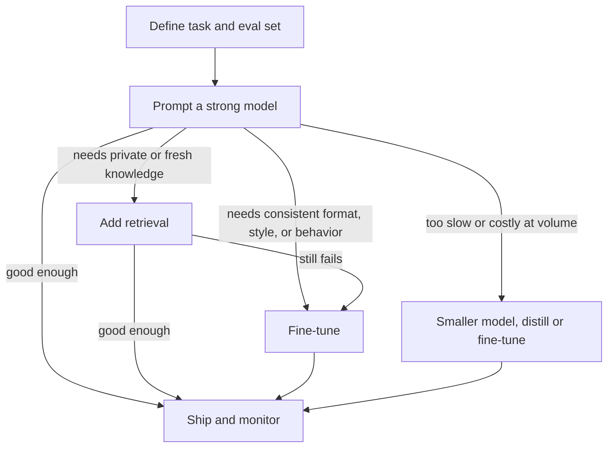

**Contents** [1. How to answer](#how) [2. Core concepts](#core) [3. Model design](#design) [4. Training pipeline](#training) [5. Adaptation ladder](#adapt) [6. By data type](#data) [7. RAG decisions](#rag) [8. Continuous learning](#continual) [9. Inference and serving](#serving) [10. Evaluation](#eval) [11. Trade-offs and risks](#tradeoffs) [12. Diagnosing problems](#debug) [13. Worked cases](#cases) [14. Rapid-fire Q and A](#rapid) [15. Common traps](#traps) [16. Cheat sheet](#cheat) [17. Practice plan](#practice)

# LLM Fundamentals: Interview Preparation

Core concepts, model design, training, evaluation, and trade-offs, with decision reasoning across data types (tabular, unstructured, multimodal), data sizes, model sizes, and continuous learning.

**The idea behind this guide.** In an LLM interview the winning answer is rarely “fine-tune a model.” It is a reasoned choice among prompting, retrieval, fine-tuning, and not using an LLM at all, grounded in data, cost, latency, and risk. Green “Because” lines are the reasoning to say out loud. Numbers given are rules of thumb to calibrate your intuition, not guarantees.

## 1. How to answer an LLM decision question

### The skeleton

1. **Clarify the task and the cost of errors.** Generation, extraction, classification, or reasoning? What happens when the model is confidently wrong?
2. **Characterize the data.** Modality (text, tabular, images, code), volume, label availability, how often it changes, whether it is private.
3. **State constraints.** Latency, cost per request, throughput, privacy and hosting limits, context needs, team skills.
4. **Start with the cheapest thing that could work** and define the evaluation that will tell you if it does.
5. **Climb the ladder only on evidence:** prompting, then retrieval, then fine-tuning, then (rarely) pretraining.
6. **Name the risk** (hallucination, drift, injection, cost blowup) and how you would monitor it.
7. **Say what would make you switch.**

### The most important decision: should this even be an LLM?

“Would you use an LLM here?” (the question hiding behind many questions)

**Answer**Only if the task needs language understanding, flexible generation, or reasoning over unstructured input that a cheaper model cannot handle. Otherwise a classical model, rules, or a small specialized model.

**Because**An LLM costs orders of magnitude more per prediction than a gradient-boosted model or a small encoder, is slower, non-deterministic, and harder to test. If a fixed-schema tabular problem has labels, boosted trees are usually more accurate, cheaper, and easier to monitor. The LLM earns its place where inputs are free-form, the label set is open or changes, or labeled data is scarce.

**Switch if**Error analysis shows the cheaper model fails on language nuance, or the label set keeps changing faster than you can retrain.

### Phrases that signal judgment

- “I would establish an eval set before choosing anything, otherwise I cannot tell whether a change helped.”
- “Is this a knowledge problem or a behavior problem?” (Knowledge goes to retrieval; behavior and format go to fine-tuning.)
- “I would start with a strong hosted model to find the ceiling, then see whether a smaller model can match it for this narrow task.”

## 2. Core concepts you must explain fluently

### Tokens and tokenization

Text is split into subword **tokens** (byte-pair encoding or similar), each mapped to an ID and then an embedding vector. Subwords balance vocabulary size against sequence length: characters give long sequences, whole words give huge vocabularies and out-of-vocabulary problems.

Why does tokenization matter for decisions?

**Answer**It drives cost, latency, context usage, and some failure modes.

**Because**You pay and wait per token, and languages, code, numbers, and unusual formats can tokenize into many more tokens than plain English, shrinking effective context and raising cost. Models also see tokens, not characters, which explains weaknesses at spelling, character counting, and arithmetic on long numbers. For a new language or domain with poor token efficiency, a vocabulary extension or a model with a better tokenizer can matter.

### The transformer in the essentials

- **Self-attention:** each token forms a query, key, and value; attention weights are softmax(QKᵀ/√d) and the output is a weighted sum of values. It lets every token draw on every other token, in parallel during training.
- **Cost:** attention is quadratic in sequence length for compute and, naively, memory. This is the root of context-length trade-offs.
- **Positional information:** attention is order-blind, so position is injected. Rotary embeddings (RoPE) and relative schemes are common and affect how well a model extrapolates to longer contexts.
- **Blocks:** attention, then a feed-forward network, each with residual connections and normalization. Most parameters live in the feed-forward layers and the embeddings.

### Architecture families

| Family | Examples of use | Choose when | Why |
| --- | --- | --- | --- |
| Decoder-only (causal) | Chat, generation, code, general assistants | Open-ended generation, in-context learning, one model for many tasks | Simple training objective (predict the next token) scales well and supports prompting |
| Encoder-only (bidirectional) | Classification, embeddings, retrieval, named-entity recognition | Understanding tasks at high volume and low latency | Sees full context in both directions; small encoders are cheap and strong when fine-tuned |
| Encoder-decoder | Translation, summarization, structured transduction | Input-to-output mapping where the input is fully known | Separates reading from writing; efficient for fixed-input tasks |

The market has largely consolidated on decoder-only models for general use; encoders remain the efficient choice for embeddings and classification at scale.

### Pretraining objective and what “knowing” means

Pretraining minimizes next-token cross-entropy on a huge corpus. The model compresses statistical structure of language, facts, and code, which gives broad capability but no built-in notion of truth. This is why fluent text can still be false.

### Scaling laws and the compute-optimal question

Loss falls predictably as a power law with model parameters N, data tokens D, and compute C. Training compute is roughly `6·N·D` FLOPs. The compute-optimal result commonly attributed to the Chinchilla work is on the order of **\~20 training tokens per parameter** for a fixed training budget.

Should you train a bigger model on fewer tokens, or a smaller model on more tokens?

**Answer**If inference volume is high, train a smaller model on more data than the compute-optimal point (“over-training”).

**Because**The compute-optimal rule minimizes loss for a fixed *training* budget. But a model is trained once and served many times, so lifetime cost is dominated by inference. A smaller model trained longer costs more to train but far less to serve for the same quality. If the model will be served rarely, the compute-optimal point is the right target.

### Sampling and decoding

- **Greedy / temperature 0:** most deterministic; good for extraction, classification, and code where there is one right answer.
- **Temperature, top-p, top-k:** raise diversity; use for creative tasks and when sampling several candidates to vote or rank.
- **Beam search:** more common in translation-style tasks than in chat.
- **Constrained decoding** (grammar or schema-guided) guarantees valid structure such as JSON.

**Because** randomness helps exploration but hurts reproducibility and correctness on deterministic tasks, set it by task, not by habit. Note that even temperature zero is not always perfectly reproducible across hardware and batching.

### Context window and the KV cache

During generation, the keys and values of previous tokens are cached so they are not recomputed. This makes generation fast but memory-hungry: the cache grows linearly with context length and batch size, and often becomes the serving bottleneck before the weights do.

**Key points**

- Cost and latency scale with tokens; know your token budget.
- Decoder-only for generation; small encoders for cheap, high-volume understanding.
- Scaling laws guide the training budget; inference volume changes what “optimal” means.
- Fluency is not truth; the objective never rewarded factuality directly.

## 3. Model design decisions

### Model size: how to choose

| Size class (rough) | Strengths | Choose when | Limits |
| --- | --- | --- | --- |
| Small, under \~3B parameters | Runs on a laptop or phone, very low latency and cost, easy to fine-tune | Narrow well-defined task, on-device or strict privacy, very high volume | Weak at broad reasoning and long-tail knowledge; needs task-specific tuning |
| Mid, \~7B to 30B | Good balance; fits one or few GPUs; strong after fine-tuning | Domain-specific assistant or extraction with moderate quality bar and self-hosting | Still behind frontier models on hard reasoning |
| Large open models, \~70B and above | Strong general capability, self-hostable with multi-GPU | Need quality near frontier plus control over data and deployment | Serving cost and complexity |
| Frontier hosted via API | Highest capability, no infrastructure, fastest to start | Prototype, low-to-moderate volume, hard reasoning, fast iteration | Per-token cost, data-governance constraints, vendor dependency, limited control |

Which size would you pick?

**Answer**Prototype with the strongest available model to find the quality ceiling, then try progressively smaller models (or a distilled/fine-tuned one) on the same eval set and pick the smallest that meets the bar.

**Because**It separates “can this task be done?” from “can it be done cheaply?”. Starting small risks blaming the task for what is a capacity limit; starting large risks shipping a costly model when a small tuned one would suffice. The eval set makes the cost-quality curve visible.

**Switch if**Volume is so high that even the first prototype’s cost is untenable, in which case I would test small models earlier.

### Dense versus mixture-of-experts (MoE)

Why would a team build a mixture-of-experts model?

**Answer**To get the capacity of a large model at the per-token compute of a smaller one.

**Because**A router activates only a few experts per token, so total parameters are large but active parameters are small. The trade-offs are that all expert weights still must fit in memory, training and load balancing are harder, and serving is more complex. It pays off at large scale with high throughput; for small deployments a dense model is simpler.

### Attention variants and long context

- **Multi-query / grouped-query attention** shares key-value heads across query heads, shrinking the KV cache and speeding decoding with small quality loss. **Because** serving memory, not training, is the constraint they target.
- **FlashAttention-style kernels** compute exact attention with less memory traffic; they change speed and memory, not results.
- **Sliding-window or sparse attention** trades full global context for linear-ish cost.
- **Context extension** (position interpolation, continued training on long documents) is possible but quality at the far end of long contexts often degrades; always test with your own long-context tasks.

### Long context versus retrieval

Put everything in the long context window, or use retrieval?

**Answer**Long context for a bounded, known set of documents where the whole thing matters; retrieval for large or changing corpora and when cost and latency matter.

**Because**Stuffing the context makes every request pay for all those tokens, increases latency, and models can lose details in the middle of very long inputs. Retrieval sends only relevant pieces, scales to corpora far beyond any window, and allows citations and access control, but it can miss relevant material if retrieval fails. Prompt caching can make repeated long contexts much cheaper, which shifts the balance for static corpora.

## 4. The training pipeline and its decisions

### Stages

1. **Pretraining** on trillions of tokens: broad knowledge and language ability.
2. **Continued / domain pretraining** (optional): further next-token training on domain text.
3. **Supervised fine-tuning (SFT)** on instruction-response pairs: teaches format, style, and following instructions.
4. **Preference optimization**: align outputs to human or automated preferences (RLHF with a reward model, or direct methods such as DPO).
5. **Reinforcement learning with verifiable rewards** for tasks with checkable answers (math, code): improves reasoning where correctness can be computed.
6. **Distillation** into a smaller model.

### Data decisions in pretraining

- **Quality over raw quantity:** filtering, deduplication, and curation often beat adding more noisy data. **Because** duplicates cause memorization and waste compute; low-quality text teaches low-quality behavior.
- **Data mixture:** proportions of web, books, code, math, multilingual text shape capabilities. Code and math data tend to help reasoning broadly.
- **Decontamination:** remove benchmark and test data from training or evaluation numbers become meaningless.
- **Synthetic data:** useful for reasoning traces, instruction diversity, and rare cases, but it can narrow diversity and amplify the generator’s errors if overused (“model collapse” risk). Mix with real data and verify.
- **Privacy and licensing:** remove personal data, respect licenses and opt-outs.

### SFT, RLHF, DPO: choosing among them

| Method | What it needs | Choose when | Why and the catch |
| --- | --- | --- | --- |
| SFT | High-quality demonstrations | Teach format, tone, tool use, domain style | Simple and stable. Quality of examples matters far more than count; poor examples teach poor habits. |
| RLHF (reward model + RL) | Preference comparisons, reward model, RL infrastructure | Fine-grained alignment at large scale | Powerful, but complex and prone to reward hacking and instability. |
| DPO and relatives | Pairs of preferred and rejected responses | Preference tuning without an RL loop | Simpler and stable; depends heavily on preference-data quality and distribution. |
| RL with verifiable rewards | A programmatic checker (tests, exact-answer match) | Reasoning, code, math, tasks with ground truth | Rewards cannot be easily gamed when verification is robust; weak verifiers get exploited. |

### Compute and memory facts for decisions

- **Inference weights memory** ≈ parameters × bytes per parameter (about 2 bytes in 16-bit, 1 in 8-bit, 0.5 in 4-bit). A 7B model is roughly 14 GB in 16-bit.
- **Full training memory** with Adam in mixed precision is on the order of \~16 bytes per parameter before activations, so a 7B model needs on the order of \~110 GB, which is why fine-tuning memory-efficiently matters.
- **Parallelism:** data parallel (replicate model, split batches), tensor and pipeline parallel (split the model), and sharded optimizers (ZeRO, FSDP) to fit models that exceed one GPU.
- **Precision:** bf16 is the common training default because its wide exponent range avoids the loss-scaling problems of fp16.

**Do not pretrain unless you must.** Pretraining costs millions of dollars at scale and needs rare expertise. In interviews, the senior answer for almost any company-specific need is adaptation of an existing model, with pretraining reserved for new languages, new modalities, or truly distinct domains with massive data and strong strategic reasons.

## 5. The adaptation ladder: prompt, retrieve, fine-tune



### Knowledge versus behavior

Fine-tune or use retrieval to teach the model our company’s information?

**Answer**Retrieval for knowledge; fine-tuning for behavior.

**Because**Facts learned through fine-tuning are stored diffusely, are hard to update or delete, can be hallucinated with confidence, and cannot cite sources. Retrieval puts facts in context where they can be updated instantly, cited, and access-controlled. Fine-tuning shines at things retrieval cannot do: consistent tone, output schema, domain-specific reasoning patterns, tool-calling reliability, and reducing prompt length.

**Combine**Fine-tune for format and style, retrieve for facts. They are complementary, not competing.

### Fine-tuning methods

- **Full fine-tuning** updates every weight: highest capacity and cost, needs lots of memory, and a separate full copy per task. **Because** it is warranted only with large, high-quality data and a need for deep change.
- **LoRA** freezes the base model and trains small low-rank update matrices (W + (α/r)·BA). It trains well under 1% of parameters, cuts memory sharply, produces small swappable adapters, and often approaches full fine-tuning quality on typical tasks.
- **QLoRA** does LoRA on a 4-bit-quantized base model so a model that would not fit can be tuned on a single GPU, at the cost of some extra complexity and a small quality hit.
- **Prompt or prefix tuning** learns soft prompts: lightest, usually weaker on hard tasks.

### Decision matrix by data size

| Labeled examples | Default approach | Why |
| --- | --- | --- |
| None | Zero-shot prompting with a strong model; write clear instructions and a rubric | No data to learn from; use the model’s priors; the eval set you build becomes your first labeled data |
| Tens | Few-shot prompting with carefully chosen examples; maybe dynamic example selection | Too few to fine-tune reliably, enough to steer in context |
| Hundreds to \~1,000 | Strong prompting plus retrieval; consider LoRA on a small or mid model if prompts are long, costly, or inconsistent | Small high-quality sets can teach format and style (quality over quantity); verify against the prompted baseline |
| Thousands to tens of thousands | LoRA or full fine-tuning of a small or mid model; often matches or beats a prompted large model on the narrow task at far lower cost | Enough signal to specialize; cost savings at volume justify it |
| Hundreds of thousands or more | Full fine-tuning, continued pretraining if the domain is distinct, or train a purpose-built model | Data supports deeper changes; consider classical or small-encoder models too if the task is classification |

### Decision matrix by model size

| Base model | Adaptation guidance | Why |
| --- | --- | --- |
| Small (\<3B) | Fine-tune; rely less on prompting; keep tasks narrow; consider distilling from a larger teacher | Little in-context ability or broad knowledge, so tuning supplies the competence |
| Mid (7B to 30B) | LoRA or QLoRA; combine with retrieval | Strong enough base that small adapters suffice |
| Large open (70B+) | Prompt and retrieve first; LoRA only when needed | High in-context ability; tuning cost and serving cost are high |
| Hosted frontier | Prompting, retrieval, tool use, structured outputs; use vendor fine-tuning only if available and justified | You cannot change weights freely; the cheapest levers are context and tools |

### Distillation

When would you distill a large model into a small one?

**Answer**When a large model meets the quality bar on a narrow task but is too slow or expensive for production volume.

**Because**You can use the large model to generate high-quality labels or reasoning traces (checked by filters or humans), then train the small model on them. The small model inherits much of the narrow-task skill at a fraction of the serving cost. The catch: it will not match the teacher outside the distribution you distilled, and you must check the teacher’s license terms for permitted uses of its outputs.

### Fine-tuning pitfalls

- **Catastrophic forgetting:** specializing can erode general abilities. Use lower learning rates, LoRA, mixing in general data, and evaluate on a general benchmark as well as your task.
- **Overfitting small sets:** keep epochs few (often 1 to 3), monitor validation loss and task metrics, and hold out a real test set.
- **Data quality:** inconsistent or wrong labels are learned faithfully. Audit and clean first.
- **Chat-template mismatch:** training with a different prompt format than inference silently hurts results.
- **Loss masking:** compute loss only on the response tokens for SFT unless there is a reason otherwise.

## 6. Decisions by type of data

This is where interviewers test judgment. The same model family behaves very differently across data types.

| Data type | Typical task | First choice | Why |
| --- | --- | --- | --- |
| Free text, documents | Q&A, summarization, drafting | Prompted LLM, plus retrieval for private or large corpora | Language understanding is the LLM’s core strength |
| Free text, high volume labels | Classification, routing, sentiment, tagging | Embeddings plus a linear classifier, or fine-tune a small encoder; use an LLM to bootstrap labels | Orders of magnitude cheaper and faster per item, and often as accurate once labeled data exists |
| Semi-structured (invoices, forms, emails, logs) | Field extraction | LLM with a JSON schema or constrained decoding; vision-capable model for scans | Layout and wording vary too much for rigid rules; schema enforcement guarantees valid output |
| Tabular (numeric and categorical) | Prediction, scoring | Gradient-boosted trees | Usually higher accuracy, cheaper, faster, and more interpretable than an LLM on structured features |
| Tabular with text columns | Prediction using notes, descriptions | Embed or extract features from text with an LLM or encoder, feed them into boosted trees with the other columns | Uses each tool where it is strongest |
| Tabular, very small data or cold start | Prediction with few rows | Regularized linear models or tree ensembles; LLM or tabular foundation models with in-context rows as an experiment | Pretrained priors can help when data is scarce, but verify against a simple baseline |
| Databases | Natural-language questions over data | LLM generates SQL with schema context, run under read-only permissions, then explain results | Let the database compute; do not ask the LLM to do arithmetic over rows in its context |
| Code | Generation, review, repair | Code-specialized or strong general model with tool access to run tests | Execution gives a verifiable signal that text alone lacks |
| Images, audio, video | Understanding, extraction, captioning | Multimodal model, or a specialized encoder or speech model feeding an LLM | Cross-modal reasoning needs joint representations; specialized models are cheaper for single-modality tasks |
| Time series, sensor data | Forecasting, anomaly detection | Statistical or gradient-boosted forecasting; LLM only to explain results or interpret logs | LLMs are not generally better at numeric forecasting than purpose-built methods |

### Tabular data: the question to prepare for

“We have a customer table with 200 numeric and categorical columns. Should we use an LLM?”

**Answer**Not as the predictor. I would use gradient-boosted trees, and use LLMs only for the unstructured pieces, such as turning free-text support notes into features, or for the natural-language interface and explanations.

**Because**Tabular data has heterogeneous scales, missing values, and non-smooth feature interactions that trees handle well; serializing rows into text wastes tokens, loses numeric precision, and costs far more per prediction. Boosted trees are fast, calibrated with simple post-processing, and easy to monitor.

**Switch if**There are very few labeled rows (an LLM’s priors may help), the columns include rich text, or the schema changes constantly.

If asked how you would feed tabular data to an LLM anyway: serialize rows with clear column names and units, round numbers sensibly, give few-shot examples, keep the context short, and make the model call tools (SQL, Python) for calculation rather than computing in its head.

### Unstructured text at scale

Classify 5 million support tickets into 40 categories. What do you do?

**Answer**Use an LLM to label a few thousand tickets (with human review of a sample), then train a small encoder or an embedding-plus-logistic-regression classifier on those labels and run that on all five million.

**Because**Running a large model on every ticket is slow and expensive for a closed label set; the LLM’s value is creating labels cheaply and handling the long tail. A small model trained on those labels reaches similar accuracy at a tiny fraction of the cost and latency, and its behavior is stable and testable.

**Add**Route low-confidence tickets to the LLM or a human, and re-label periodically to catch drift or new categories.

### Multimodal decisions

- **Documents with layout (invoices, forms):** a vision-language model reading the page image often beats OCR followed by text-only extraction because layout carries meaning. **But** at high volume or tight latency, a layout-aware OCR pipeline with a small extraction model may be cheaper.
- **Speech:** a dedicated speech-recognition model feeding an LLM is usually cheaper and easier to debug than an end-to-end speech model, unless prosody and interruption handling matter.
- **Images:** high-resolution inputs cost many tokens; downscale or crop to the region of interest when detail is not needed.

## 7. Retrieval-augmented generation: the design choices

| Decision | Options | Guidance and why |
| --- | --- | --- |
| Chunking | Fixed size, by structure (headings, paragraphs), semantic, with overlap | Chunk by document structure so each chunk is self-contained. Too small loses context; too large dilutes relevance and wastes tokens. Tune size on retrieval metrics, not intuition. |
| Embedding model | General vs domain-tuned; dimension size | Start with a strong general model; fine-tune only if domain vocabulary hurts retrieval recall. Larger dimensions cost more storage and search time. |
| Search method | Dense vectors, keyword (BM25), hybrid | Hybrid is a strong default because dense search handles meaning while keyword search handles exact terms, IDs, and rare words. |
| Reranking | Cross-encoder reranker on top-k results | Retrieve broadly (high recall), then rerank to precision. A reranker is often the cheapest big quality gain. |
| Query handling | Rewrite, decompose, multi-query, HyDE | User questions are often vague or multi-part; rewriting improves recall at an added call. |
| Metadata and filters | Date, source, permissions | Filtering enforces access control and freshness; never rely on the prompt alone for permissions. |
| Agentic retrieval | Model decides when and what to search, iterates | Better for multi-hop questions; costs more calls and latency. |

Your RAG answers are wrong. Where do you look first?

**Answer**Separate retrieval from generation. Check whether the right passage was in the retrieved set at all.

**Because**The fix is completely different. If the passage was missing, work on chunking, embeddings, hybrid search, or reranking. If it was present but the answer was still wrong, work on the prompt, context ordering and size, or model choice, and ask the model to quote evidence or say when the context does not contain the answer.

### RAG evaluation

- **Retrieval:** recall@k, precision@k, MRR, NDCG on a labeled set of question-to-passage pairs.
- **Generation:** faithfulness or groundedness (is every claim supported by retrieved text?), answer correctness, completeness, and citation accuracy.
- **End to end:** a golden question set that includes unanswerable questions, so you measure whether the system correctly abstains.

## 8. Continuous learning and keeping a model current

The base weights are frozen at a point in time, so models go stale and the world changes. Decide what kind of change you are dealing with.

### First, classify the change

| What is changing? | Best lever | Why |
| --- | --- | --- |
| Facts, documents, prices, policies (changes daily or weekly) | Retrieval over an updated index; tool calls to live systems | Updating an index is instant, cheap, auditable, and reversible; retraining is none of those |
| Style, format, tool-use habits, domain reasoning | Periodic fine-tuning (LoRA adapters), versioned | These are behaviors, which weights learn well |
| Vocabulary and language of a new domain (new jargon, new language) | Continued pretraining on domain text, then SFT | Needed when the base model genuinely lacks the underlying knowledge or tokens |
| User preferences and satisfaction | Collect feedback, then preference tuning on a schedule | Turns production signal into improvement while keeping a gated release process |
| Individual user context | Memory store retrieved into context | Per-user weight updates do not scale and raise privacy risk |

How would you keep an LLM system up to date as knowledge changes?

**Answer**Keep knowledge outside the weights: maintain a retrieval index with ingestion pipelines, timestamps, and deletion support. Reserve fine-tuning for behavior, on a scheduled and evaluated cadence.

**Because**Continually updating weights invites catastrophic forgetting, makes it hard to remove outdated or sensitive facts, complicates audits, and each update requires re-validating the whole system. An index update has none of those costs and takes effect immediately.

**Switch if**Retrieval cannot express the change, for example a shift in how the model should reason across a domain, or latency demands rule out retrieval.

### If you must update weights: reduce forgetting

- **Replay:** mix a sample of earlier data (general and prior-task) into each new training run. **Because** the model keeps seeing what you do not want it to lose.
- **Parameter-efficient adapters:** keep the base frozen and train per-task or per-period LoRA adapters; swap or merge them. **Because** the base is untouched, rollback is trivial, and interference is limited.
- **Low learning rates and short runs:** smaller updates drift less from the original solution.
- **Continued pretraining recipe:** re-warm the learning rate modestly, blend the new domain data with a portion of the original-style data, and watch general benchmarks.
- **Regularization toward the original weights** (for example penalizing distance or weight averaging with the earlier checkpoint) keeps changes conservative.
- **Model merging:** combine specialized models by weight arithmetic; useful but needs validation since merges can interact unexpectedly.
- **Knowledge editing** of individual facts exists but is fragile at scale; treat as research, not a production plan.

### A production continual-improvement loop

1. **Log** inputs, outputs, retrieved context, and user feedback (with privacy controls and consent).
2. **Mine failures:** thumbs-down, escalations, low-confidence cases, judge-flagged outputs.
3. **Curate:** human-review and correct a sample into new eval cases and training data. Add every real failure to the regression set.
4. **Train candidates** (adapter or prompt or retrieval change) on a schedule or when metrics trigger it.
5. **Gate the release:** the candidate must pass the regression suite, the general-capability checks, and safety evals, then ship via shadow mode or a canary with rollback.
6. **Monitor drift:** input topics, retrieval hit rates, refusal rates, cost, and quality scores over time.

Why not just fine-tune on production data automatically every night?

**Answer**Because unattended online learning is risky; I would use gated, batch updates.

**Because**Production data can contain errors, adversarial inputs, and feedback loops where the model learns from its own outputs. Without evaluation gates, quality can quietly regress, and a poisoned or biased batch propagates straight into the model. Human-reviewed or verified data plus regression tests keeps improvement real.

**Also mention model versioning.** When the provider updates a hosted model or you swap base models, behavior can shift. Pin versions, keep a regression suite, and re-run it before every upgrade, because prompts tuned for one model can degrade on another.

## 9. Inference and serving decisions

### Cost and latency levers

| Lever | What it does | Trade-off |
| --- | --- | --- |
| Quantization (8-bit, 4-bit) | Shrinks weights and speeds up memory-bound decoding | Small quality loss that grows at lower precision; test on your task, especially for reasoning and long outputs |
| Batching (continuous batching) | Raises throughput by serving many requests together | Can raise per-request latency; tune for your traffic |
| KV cache management (paged, shared prefixes) | Reduces memory waste, enables more concurrent requests | Engineering complexity |
| Prompt or prefix caching | Reuses computation for repeated prompt prefixes | Needs stable prefixes; put static content first |
| Speculative decoding | A small draft model proposes tokens a large model verifies | Speeds decoding without changing output quality, but adds a second model and works best when drafts are accepted often |
| Model routing / cascades | Send easy requests to a small model, hard ones to a large model | Needs a good router and fallback; saves most when traffic is mostly easy |
| Shorter outputs and prompts | Fewer tokens in and out | Direct and almost free; output tokens are usually the most expensive and slowest |
| Response caching | Reuse answers to repeated or similar queries | Staleness and personalization risk |

Self-host an open model or use a hosted API?

**Answer**Start with a hosted API; self-host when volume, data control, latency, or customization justify the operations burden.

**Because**APIs remove infrastructure work and give the strongest models immediately, and at low or spiky volume they are cheaper than idle GPUs. Self-hosting pays off with steady high volume (GPU utilization is high), strict data residency, a need for custom fine-tuned weights, or tight latency control. Count the hidden costs: GPU capacity, on-call, upgrades, and the engineering to match managed reliability.

**Hybrid**Hosted frontier model for hard cases, self-hosted small model for high-volume simple cases.

### Latency anatomy

Time to first token depends on prompt length (the “prefill” stage, compute-bound). Subsequent tokens come one at a time (the “decode” stage, memory-bandwidth-bound). So: long prompts hurt time to first token; long outputs dominate total latency. Streaming output improves perceived latency.

## 10. Evaluation

### Levels of evaluation

- **Pretraining:** perplexity or loss on held-out text, plus broad capability benchmarks. Perplexity is not comparable across different tokenizers.
- **General benchmarks** (knowledge, reasoning, code, math) give orientation but suffer from **contamination** (test data leaked into training), saturation, and weak relation to your task.
- **Task-specific evals** on your own data are what drive decisions. Build them first.
- **Online evaluation:** user outcomes, task completion, escalation rate, cost, latency, with A/B tests where possible.

### Building a task eval

1. Collect 50 to 200 real, diverse inputs, including hard, ambiguous, and adversarial ones and cases where the right answer is “I do not know.”
2. Define success concretely: exact match or code-checkable where possible; a rubric where not.
3. Version it, add every production failure to it, and never tune prompts on the sealed final test portion.
4. Run each case multiple times if sampling is on; report variance.

### Choosing the evaluation method

| Task | Method | Why |
| --- | --- | --- |
| Classification, extraction with ground truth | Standard metrics (accuracy, precision/recall, F1, field-level match) | Objective and cheap |
| Code | Execute unit tests (pass@k) | Verifiable correctness |
| Summarization, open generation | Rubric-based LLM judge plus human spot checks; pairwise comparison | No single right answer; overlap metrics like ROUGE correlate weakly with quality |
| RAG | Retrieval metrics plus faithfulness and correctness judging | Isolates the failing component |
| Safety | Red-team sets, refusal and over-refusal measures, injection tests | Both too-harmful and too-restrictive outputs are failures |

### LLM-as-judge: use with eyes open

- **Known biases:** preference for longer answers, for the judge’s own style or model family, for the first-presented option, and sensitivity to wording of the rubric.
- **Mitigate:** randomize or swap answer order, use clear rubrics with examples, use a stronger judge than the model being judged, and calibrate against human labels on a sample.
- **Because** a judge that disagrees with humans gives precise-looking but wrong signal; always measure judge-human agreement before trusting it for decisions.

### Hallucination measurement

Evaluate whether claims are supported by provided sources (groundedness), whether the model abstains appropriately, and factuality against a trusted reference. Reduce with retrieval, citations, instructions to abstain, lower temperature, verification passes, and tools for anything computable.

## 11. Trade-offs and risks

| Trade-off | How to reason about it |
| --- | --- |
| Quality vs cost vs latency | Pick the point on the curve your product needs; use routing so only hard requests pay for the big model. |
| Prompting vs fine-tuning | Prompting iterates in minutes with no training; fine-tuning shortens prompts, locks in behavior, and cuts per-call cost at volume, but adds data, training, and maintenance burden. |
| Open vs closed models | Open: control, privacy, customization, cost at scale. Closed: top capability, no infrastructure, quick start. Check license terms for open weights. |
| Long context vs retrieval | See section 3: bounded corpora favor long context; large or changing ones favor retrieval. |
| Capability vs safety and control | Guardrails, refusals, and filters cost some helpfulness; measure both over-refusal and harmful output. |
| Determinism vs creativity | Low temperature and schemas for pipelines; higher temperature for ideation. |
| Generalist vs specialist | A small specialist can beat a large generalist on a narrow task at much lower cost, but is brittle outside it. |
| Freshness vs stability | Frequent updates keep knowledge current but risk regressions; version and gate. |

### Risks to name in any design answer

- **Hallucination:** mitigate with grounding, citations, abstention, verification, and human review where stakes are high.
- **Prompt injection:** untrusted text (web pages, emails, documents) can carry instructions. Treat retrieved and tool content as data, restrict tools by least privilege, and enforce permissions in code, not in the prompt.
- **Privacy and leakage:** avoid sending sensitive data to third parties without agreements; remove personal data from training sets; models can memorize and regurgitate training text; enforce document-level access in retrieval.
- **Bias and fairness:** evaluate by subgroup; do not assume a general model is neutral for your population.
- **Cost blowups:** unbounded context growth, agent loops, and retries. Set token budgets and rate limits.
- **Vendor and model drift:** pin versions and keep regression tests.

## 12. Diagnosing problems: symptom to action

### Default order of investigation

1. Look at **actual failing examples**, not aggregate metrics.
2. Check the **prompt actually sent** (templates, truncation, missing context).
3. Check **retrieval** if there is any.
4. Check **decoding settings** and output parsing.
5. Only then change the **model or training**.

| Symptom | Likely cause | What I would try, and why |
| --- | --- | --- |
| Confident wrong facts | Knowledge gap or unsupported generation | Add retrieval and require citations and abstention; fine-tuning will not reliably fix missing knowledge. |
| Answer ignores provided context | Context too long or noisy, weak instruction, conflicting prior knowledge | Shorten and rerank context, put key passages where the model attends, instruct to answer only from context. |
| Inconsistent output format | Weak specification, high temperature | Use schema-constrained decoding, examples, lower temperature; fine-tune if still unreliable at scale. |
| Good on tests, bad in production | Eval not representative, contamination, drift | Rebuild the eval from real traffic and add production failures to it. |
| Fine-tuned model worse on general tasks | Catastrophic forgetting | Lower learning rate, use LoRA, mix in general data, evaluate on general benchmarks. |
| Fine-tuned model not better than prompting | Low-quality or too little data, wrong problem for tuning | Audit data quality, check that the gap is behavioral rather than knowledge-related, compare against a strong few-shot baseline. |
| Training loss falls, validation task metric does not | Overfitting or loss not aligned with the task metric | Fewer epochs, more diverse data, evaluate on task metrics, check loss masking and chat template. |
| Repetitive or degenerate text | Greedy decoding, poor sampling settings | Adjust temperature and repetition penalties; check for training-data repetition. |
| Latency too high | Long prompt or long output, large model, no batching | Trim prompt, cap output, cache prefixes, quantize, smaller or routed model. |
| Quality regressed after provider update | Hosted model version change | Pin versions; run regression suite; adjust prompts per version. |
| Arithmetic or counting errors | Token-based processing is poor at precise computation | Give the model a calculator or code tool. |

## 13. Worked cases: practice thinking aloud

Answer each in about two minutes before opening it. Watch for the pattern: task and error cost, data, constraints, baseline, choice, because, risk.

Case A. Customer-support assistant over 20,000 internal help articles that change weekly

**Framing.** A knowledge problem with changing content; a wrong answer erodes trust or causes bad advice, so grounded answers and citations matter.

**Choice.** RAG with hybrid search, a reranker, structure-aware chunking, and a strong hosted model prompted to answer only from retrieved context and to say when it does not know. Escalate to a human when confidence is low.

**Because** content changes weekly, so facts belong in an index updated by an ingestion pipeline, not in weights. Citations let agents verify answers.

**Eval.** Question-to-passage labeled set for retrieval; groundedness and correctness for answers; unanswerable questions for abstention.

**Later.** If tone and escalation behavior are inconsistent, add a small LoRA fine-tune for style; if volume makes cost high, route easy questions to a smaller model.

Case B. Classify 1 million legal clauses into 25 types; 3,000 are labeled

**Choice.** Fine-tune a small encoder (or train an embedding plus classifier) on the 3,000 labels, using an LLM to label additional examples and check disagreements, with human review on a sample.

**Because** a closed label set at high volume rewards a cheap, fast, stable model, and 3,000 labels plus LLM-assisted labels are enough to specialize an encoder. A large LLM per clause would cost far more with no accuracy advantage once the small model is trained.

**Risks.** Rare clause types and ambiguous boundaries; route low-confidence clauses to the LLM or a lawyer. Re-evaluate when new clause types appear.

Case C. Predict customer churn from a table of usage metrics plus free-text support notes

**Choice.** Gradient-boosted trees as the predictor. Convert the support notes into features: embeddings reduced in dimension, or LLM-extracted structured fields (complaint category, sentiment, mentions of competitors). Feed these in with the numeric columns.

**Because** trees are best on the structured part, and the LLM only does what trees cannot, which is to read text. This keeps cost per prediction low and the model monitorable. Evaluate the text features by ablation: if they do not improve a time-based validation, drop them.

**Note.** Extract text features once per note, not per prediction, to control cost.

Case D. A hospital wants a model that drafts clinical summaries; data cannot leave its network

**Constraint-driven choice.** Self-host a mid-size or large open model inside the hospital’s environment; fine-tune with LoRA on de-identified, clinician-approved summaries for format and style; use retrieval of the patient’s own record to ground content.

**Because** privacy rules rule out external APIs; grounding in the record reduces hallucination; fine-tuning on approved examples teaches the institution’s format. Quantization may be needed to fit hardware, so test quality after quantizing.

**Safeguards.** Clinician review before anything enters the record, per-claim source links, evaluation by specialty and demographic subgroup, and a process for reporting errors.

Case E. A mobile app needs on-device text rewriting with no network

**Choice.** A small model (roughly 1B to 3B parameters), quantized to 4-bit, fine-tuned (LoRA, merged) for the narrow rewriting task, possibly distilled from a larger teacher.

**Because** memory and battery budgets exclude large models; narrowing the task lets a small model reach acceptable quality. Distillation transfers the teacher’s skill on exactly this task.

**Check.** Quality after quantization, latency on target devices, thermal and battery behavior, and graceful fallback for inputs outside the supported scope.

Case F. A news-summarization product must reflect events from the last few hours

**Choice.** Retrieval over a continuously updated index with freshness-aware ranking, and a general model for summarization. No weight updates for facts.

**Because** the model’s training cutoff makes it blind to recent events; retraining cannot keep up with hourly changes. Timestamps and sources in the prompt let the model attribute and avoid mixing old and new information.

**Risks.** Prompt injection from scraped pages, conflicting reports, and misinformation; use source allow-lists, ask the model to surface disagreement, and avoid presenting unverified claims as fact.

Case G. Extract fields from 100,000 scanned invoices in many layouts

**Choice.** Prototype with a vision-capable model and a JSON schema, compare against OCR plus a text model, and measure field-level accuracy on a labeled sample. If volume makes cost high, fine-tune a smaller model or use a layout-aware pipeline for common templates, escalating odd layouts.

**Because** layout carries meaning, and varied formats defeat rigid rules; constrained decoding guarantees valid structure. Cascades keep cost down by reserving the large model for hard documents.

**Validation.** Business-rule checks (line items sum to the total, dates valid) catch errors without human review of everything.

Case H. Your fine-tuned assistant’s quality is slipping six months after launch

**Diagnose first.** Compare current traffic to the eval set: has the topic mix shifted, did the provider update a base model, are documents stale, or did a prompt change slip in? Check retrieval hit rates and refusal rates over time.

**Then act.** Refresh the index if facts are stale; add recent failures to the eval set; retrain the adapter with replay on a reviewed batch if behavior drifted; pin versions and gate the release with regression tests.

**Because** degradation has several different causes with different fixes; retraining blindly can make things worse.

## 14. Rapid-fire questions with crisp answers

Why is attention quadratic, and how is it mitigated?

Every token attends to every other, so compute and naive memory scale with sequence length squared. Mitigations: FlashAttention-style kernels (less memory traffic, same result), sparse or sliding-window attention, grouped-query attention for the KV cache, and retrieval to avoid long inputs.

What is the KV cache and why does it matter?

It stores each past token’s keys and values so they are not recomputed during generation. It speeds decoding but its memory grows with context length and batch size, often limiting concurrency. Approximate size per token is 2 × layers × KV heads × head dimension × bytes per value.

Prefill versus decode?

Prefill processes the whole prompt in parallel and is compute-bound; it drives time to first token. Decode generates one token at a time and is memory-bandwidth-bound; it drives per-token speed. Different optimizations apply to each.

How does LoRA work and why does it save memory?

It freezes the pretrained weight W and learns a low-rank update ΔW = (α/r)·B·A with rank r much smaller than the layer dimensions. Only A and B receive gradients and optimizer states, so trainable parameters and optimizer memory drop dramatically, and adapters are small enough to store per task and swap at serving time.

What is QLoRA?

LoRA training on a base model whose weights are held in 4-bit quantized form, with higher-precision adapters. It lets large models be fine-tuned on a single GPU, with some added complexity and a small quality trade-off.

RLHF versus DPO?

RLHF trains a reward model from preferences and optimizes the policy with reinforcement learning under a penalty for straying from the reference model. DPO optimizes directly on preference pairs with a classification-style loss, avoiding the reward model and RL loop, which is simpler and more stable but depends on preference data quality.

What is temperature?

A scaling of logits before softmax. Lower values sharpen the distribution toward the most likely tokens; higher values flatten it for more diversity. At zero it becomes greedy decoding.

Why do LLMs hallucinate?

The training objective rewards plausible continuations, not truth; knowledge is compressed and incomplete; and the model has no built-in mechanism to say “I do not know” unless trained for it. Mitigate with grounding, citations, abstention training and prompts, verification, and tools.

What is in-context learning and what are its limits?

The model adapts to a task from examples or instructions in the prompt without weight updates. Limits: it consumes context and tokens each call, is sensitive to example choice and order, and typically underperforms fine-tuning on narrow tasks given enough labeled data.

What is catastrophic forgetting and how do you limit it?

Fine-tuning on new data overwrites parameters important to earlier capabilities. Limit with lower learning rates, parameter-efficient methods like LoRA, replay of earlier data, regularization toward original weights, and evaluating general capabilities after every update.

Why is perplexity not enough to judge a chat model?

It measures how well the model predicts held-out text, not whether answers are helpful, correct, safe, or well formatted. It also is not comparable across tokenizers. Use task-specific and preference-based evaluation.

What is benchmark contamination?

Test questions or answers appearing in the training data, inflating scores. Detect with n-gram overlap checks and held-out private evals; prefer fresh or private test sets for decisions.

How do embeddings support semantic search, and what are their limits?

Texts are mapped to vectors where similar meaning is close; nearest-neighbor search finds relevant passages. Limits: weak on exact identifiers and rare terms (hence hybrid search), sensitivity to domain vocabulary, and the fact that similarity is not the same as relevance to a specific question (hence reranking).

What is quantization and what are its risks?

Representing weights (and sometimes activations) in fewer bits to reduce memory and speed up inference. Risks are accuracy loss, especially for smaller models, outlier-sensitive layers, and tasks needing precise reasoning; always re-evaluate on your task.

What does “emergent abilities” mean, and the caveat?

Capabilities that appear to arise abruptly as scale grows. Caveat: some apparent abruptness comes from discontinuous metrics; with smoother metrics many abilities improve gradually. Do not plan around emergence you have not measured.

When would you choose an encoder like BERT over a decoder LLM?

For high-volume classification, embedding, or extraction tasks with a fixed label set and latency or cost limits, when you have or can generate labeled data. Because a small bidirectional encoder is far cheaper and faster per prediction and fine-tunes well.

How would you reduce LLM cost by half without losing quality?

Measure where tokens go first. Then: trim prompts and cap outputs, cache static prefixes and repeated responses, route easy requests to a smaller model, batch offline work, and distill or fine-tune a small model for the dominant narrow task. Verify with the eval set after each change.

## 15. Common traps interviewers probe

- **Reaching for fine-tuning to add knowledge.** Retrieval is usually the right tool; fine-tuning is for behavior.
- **Using an LLM for tabular prediction** without trying boosted trees.
- **No evaluation set,** so “it seems better” is the only evidence.
- **Trusting public benchmarks** for a product decision, ignoring contamination and task mismatch.
- **Trusting an LLM judge** without checking its agreement with humans.
- **Ignoring token economics:** cost and latency per request at real volume.
- **Enforcing permissions or safety only in the prompt.** Enforce in code and infrastructure.
- **Auto-updating weights from production data** without gates.
- **Chat-template mismatches** between training and inference.
- **Assuming a bigger model fixes everything.** Often better data, retrieval, or a tool is the fix.
- **Forgetting versioning.** Hosted models change; pin and regression-test.
- **Not considering the human in the loop** for high-stakes decisions.

**Turn a trap into a strength.** Mention the ones you actively avoid (“I would measure retrieval separately from generation so I know which part to fix”). It signals real production experience.

## 16. Cheat sheet

### Formulas and rules of thumb

```
Attention:           softmax(Q K^T / sqrt(d_k)) V
Transformer params:  ~ 12 * n_layers * d_model^2   (+ embeddings)
Training FLOPs:      ~ 6 * N_params * D_tokens
Compute-optimal:     ~ 20 tokens per parameter (training-budget optimal)

Inference weight memory:  params * bytes   (16-bit: 2, 8-bit: 1, 4-bit: 0.5)
   e.g. 7B params at 16-bit ~ 14 GB
Training memory (Adam, mixed precision): ~ 16 bytes/param + activations
KV cache per token:  2 * n_layers * n_kv_heads * head_dim * bytes
KV cache total:      per-token size * context_length * batch_size

LoRA:  W' = W + (alpha / r) * B A     trainable params = r * (d_in + d_out)
Cross-entropy loss:  -(1/T) sum log p(token_t | tokens_<t)
Perplexity:          exp(cross-entropy)
Cost:                (input_tokens * in_price + output_tokens * out_price) * requests
```

### Which adaptation, in one line

- No data, general task: prompt a strong model.
- Private or changing knowledge: retrieval.
- Consistent format, tone, or behavior; shorter prompts; lower cost at volume: fine-tune (LoRA first).
- Narrow task at high volume: distill or fine-tune a small model.
- New language or domain the base lacks: continued pretraining, then SFT.
- Facts changing hourly: retrieval and tools, never retraining.

### Which model for which data, in one line

- Free-form text, reasoning, generation: LLM.
- High-volume text classification: small encoder or embeddings plus classifier.
- Structured numeric and categorical: gradient-boosted trees.
- Tabular plus text: trees, with text features from an LLM or encoder.
- Documents and images: multimodal model, with a cheaper pipeline at volume.
- Numbers and databases: tools (SQL, Python), not mental arithmetic.

## 17. Practice plan

| Step | What to do | Why it helps |
| --- | --- | --- |
| 1 | Build a 100-example eval set for a task you care about and score a prompted model, then a few-shot version, then a RAG version. | You feel the ladder in section 5 and learn that the eval, not the model, is the foundation. |
| 2 | Fine-tune a small open model with LoRA on a few thousand examples and compare it to the prompted baseline on quality, cost, and latency. | Gives you a concrete numbers-backed story about when fine-tuning pays off. |
| 3 | Take a tabular dataset, compare boosted trees against an LLM-serialization approach, then add LLM-extracted text features to the trees. | Builds an evidence-based answer to a favorite interview question. |
| 4 | Build a small RAG system and measure retrieval and generation separately; try hybrid search and a reranker. | Teaches component-level diagnosis. |
| 5 | Simulate drift: update your document set, add a fine-tuned adapter, and watch what a regression suite catches. | Makes continuous-learning decisions tangible. |
| 6 | Answer ten questions from sections 13 and 14 aloud in under two minutes each, using the section 1 skeleton, and record yourself. | Decision reasoning is a speaking skill. |

### Questions to ask yourself before the interview

- For any task, can I say why I would or would not use an LLM at all?
- Can I explain, with numbers, how data size and model size change my adaptation choice?
- Can I describe a safe way to keep a system current without retraining on every change?
- Can I name the failure modes of my evaluation method?
- Do I have two concrete stories about measuring, debugging, or changing an LLM system based on evidence?

### Questions you can ask the interviewer

- How do you evaluate model changes before they reach users, and who signs off?
- How do you decide between prompting, retrieval, and fine-tuning for a new use case?
- How do you manage cost and latency as usage grows?
- What was a recent surprising failure in production, and what changed afterward?

Prepared November 2026. Model names, prices, and tooling change quickly, and the numbers here are rules of thumb. The reasoning patterns are the durable part; verify specifics against current documentation. Concepts such as scaling laws (Chinchilla), LoRA/QLoRA, DPO, and RAG are named from memory without source lookup, so confirm details in the original papers before quoting them.