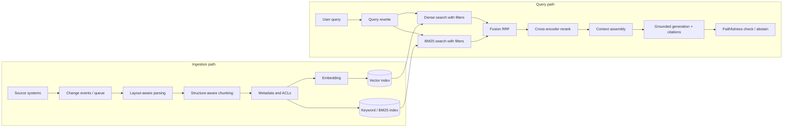
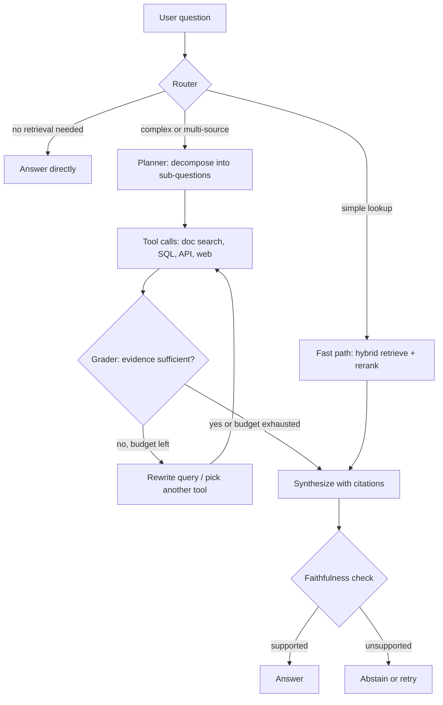

**Contents** [0. How to deliver](#deliver) [Q1. Robust RAG design](#q1) [Q2. Context and chunking](#q2) [Q3. Embeddings and indexes](#q3) [Q4. Agentic RAG](#q4) [5. Master trade-off table](#master) [6. Follow-up drills](#followups) [7. Common mistakes](#mistakes) [8. Cheat sheet](#cheat) [9. Practice plan](#practice)

# RAG Interview Answers: Architecture and Trade-offs

Model answers to four common retrieval-augmented generation questions, written so you state the trade-off behind every choice: latency vs accuracy, dense vs hybrid, chunk size vs context, simple pipeline vs agentic loop.

**How to read this.** Each question has a blue **spoken answer** (about two minutes, in first person), followed by the reasoning behind it: the architecture, trade-off tables, and what would make you change your choice. Memorize the structure, not the words. Numbers are typical ballparks to anchor your intuition; say “I would measure this on our data” when you quote them.

## 0. How to deliver a trade-off answer

Interviewers are not looking for the one perfect design. They are checking whether you see that every choice buys something and costs something, and whether you can decide anyway. Use this pattern for each major decision:

1. **Name the dimension** in tension (“this is a latency versus recall question”).
2. **Give two real options** and what each is good at.
3. **Pick one for the stated context** and say why.
4. **Name the signal that would flip the choice** (“if the eval shows… I would switch”).

**Pattern in a sentence**

“For retrieval I see a tension between recall and latency. Dense-only is simplest and fast, but it tends to miss exact identifiers like part numbers. Hybrid with BM25 fixes that for roughly one extra index lookup. Given that this corpus is full of product codes, I would go hybrid, and I would drop back to dense-only if the eval showed no recall gain, because it would be a component we maintain for nothing.”

### Always ask the clarifying questions first

Spending thirty seconds here shows seniority and changes the design. Ask about:

- **Scale:** number of documents and chunks, growth rate.
- **Freshness:** how quickly must an edited document be searchable (seconds, minutes, daily)?
- **Latency target:** interactive chat (time to first token under \~2 seconds) or asynchronous report?
- **Accuracy and risk:** what is the cost of a wrong answer (internal convenience versus legal or safety)?
- **Permissions:** do users see different documents?
- **Content mix:** PDFs, scans, tables, code, wikis, tickets? Languages?
- **Hosting constraints:** may data leave the network?

## Q1. Design a robust RAG pipeline for real-time enterprise search with minimal hallucination

**Spoken answer**

“I would split the system into an ingestion path and a query path, and I would design the eval before either.

On ingestion, documents arrive through change events from the source systems, go through a layout-aware parser, are chunked along their structure, enriched with metadata such as source, version, and access-control lists, embedded, and written to both a vector index and a keyword index. Because the requirement is real time, I would use an event queue and incremental indexing, so an edited document is searchable in seconds to minutes, with tombstones for deletions.

On the query path I would rewrite the query if needed, run dense and BM25 retrieval in parallel with the user’s permissions applied as filters, fuse the results with reciprocal rank fusion, retrieve broadly for recall, then rerank the top candidates with a cross-encoder to get precision. I would pass only the top handful of chunks to the generator, with instructions to answer only from the context, cite sources, and say it does not know otherwise.

The main trade-off is latency versus accuracy: each stage, hybrid, reranking, and a verification pass, costs time. I would set a latency budget, add stages in order of quality gain per millisecond, which in my experience is hybrid first and reranking second, and make the expensive ones conditional. To keep hallucination low I layer defenses: good retrieval, grounded prompting, citations, abstention when retrieval confidence is low, and a faithfulness check on high-risk queries. And I would monitor retrieval and generation separately, because the fixes are different.”

### Architecture



### Stage by stage: the choice and the reason

Document parsing

**Choice**Layout-aware parsing that preserves headings, lists, tables, code blocks, and reading order; OCR for scans; a vision model or captioning step for diagrams that carry meaning.

**Because**Everything downstream inherits parsing errors. A table flattened into scrambled text or a two-column PDF read across columns produces chunks that are unretrievable or misleading, and no reranker repairs that. Parsing quality is often the cheapest accuracy gain.

**Trade-off**Simple text extraction is fast and cheap but loses structure. Layout-aware or model-based parsers are slower and costlier per page, which matters at large backfills but little for incremental updates. Use the heavy parser where structure matters (manuals, financial tables) and the light one for plain prose.

Chunking

**Choice**Structure-aware chunks (split on headings and logical units), roughly a few hundred tokens, with the section path prepended to each chunk, and parent-child linking so a small chunk can expand to its section at generation time.

**Because**Small chunks make embeddings specific and retrieval precise; larger context helps the generator reason. Parent-child gets both: retrieve small, read bigger. Section headers inside the chunk restore context that was lost by splitting. Q2 goes deeper.

Hybrid search

**Choice**Dense plus BM25, fused with reciprocal rank fusion (RRF), with permission and metadata filters applied inside both searches.

**Because**Dense retrieval captures paraphrase and intent; BM25 captures exact tokens such as error codes, SKUs, names, and acronyms that embeddings blur. Their failure modes are complementary. RRF combines ranks, not scores, so it needs no score normalization between two incomparable scales and is robust with minimal tuning.

**Trade-off**Hybrid adds a second index to operate and a few milliseconds in parallel, but usually gives a meaningful recall gain on enterprise corpora. Weighted score fusion can beat RRF when tuned on a labeled set, at the cost of calibration work and fragility when the corpus changes.

Reranking

**Choice**Retrieve about 50 to 100 candidates for recall, rerank with a cross-encoder, keep the top 5 to 10 for the prompt.

**Because**First-stage retrieval compares precomputed vectors, so it is fast but coarse. A cross-encoder reads the query and each passage together, which is far more precise but too slow to run on the whole corpus. The two-stage design spends expensive compute only on a short list.

**Trade-off**Reranking adds latency that grows with candidate count and chunk length, typically tens to a few hundred milliseconds on GPU, more on CPU. Fewer candidates is faster but caps recall; more candidates is better but slower. Choose the candidate count where recall@k stops improving on your eval set.

Generation and hallucination control

**Choice**A prompt that restricts answers to the supplied context, requires inline citations to chunk IDs, and defines the abstention response; low temperature; optional second-pass faithfulness check.

**Because**Hallucination comes from two places: missing evidence (retrieval failure) and ignoring evidence (generation failure). Retrieval quality fixes the first, grounding instructions and verification address the second. Citations let users and automated checks verify claims.

### Making it “real time”

- **Change data capture or webhooks** from source systems into a queue; workers parse, chunk, embed, and upsert.
- **Idempotent upserts keyed by document and chunk ID**, with a version field, so retries and reordered events do not create duplicates.
- **Deletions and permission changes** propagate as tombstones or metadata updates; security-relevant changes get priority.
- **Re-embed only changed chunks** (compare content hashes).

| Freshness approach | Pros | Cons | Choose when |
| --- | --- | --- | --- |
| Streaming, per-document upsert | Searchable in seconds to minutes | Frequent small writes stress ANN indexes; HNSW inserts and deletes fragment the graph and need periodic compaction | Collaboration tools, tickets, anything users edit and immediately search |
| Micro-batch (every few minutes) | Batched writes are efficient; simpler operations | Minutes of staleness | Most enterprise wikis and document stores |
| Nightly rebuild | Cleanest index, easy to re-embed and tune | Hours of staleness | Slowly changing reference content |
| Hybrid: fresh delta index plus main index | Real-time recent data without constantly rebuilding the big index | Two indexes to query and merge; compaction logic | Large corpora with a hot recent tail |

### Permissions: a non-negotiable design point

How do you enforce access control?

**Choice**Store ACL metadata with each chunk and apply it as a filter inside the retrieval query, based on the authenticated user’s groups, before anything reaches the model.

**Because**If restricted text ever reaches the prompt, you cannot reliably stop the model from revealing it. Never rely on the prompt to enforce permissions. Post-filtering after retrieval can silently return too few results; pre-filtering inside the index avoids that, though filtered ANN search needs care (see Q3).

### Latency budget (illustrative, interactive chat)

| Stage | Typical ballpark | Lever when over budget |
| --- | --- | --- |
| Query embedding | 10 to 50 ms | Smaller model, cache frequent queries |
| Dense plus BM25 (parallel) | 20 to 100 ms | Lower efSearch, fewer shards, filters tuned |
| Fusion | under 5 ms | Negligible |
| Rerank (top 50 to 100) | 50 to 400 ms | Fewer candidates, shorter chunks, smaller or distilled reranker, GPU |
| Generation, time to first token | 300 to 1500 ms | Fewer context tokens, smaller model, prompt caching, streaming |
| Faithfulness check | 0.5 to 2 s extra | Run only on high-risk or low-confidence answers, or asynchronously |

Retrieval is rarely the bottleneck; generation and optional LLM calls dominate. Stream tokens so perceived latency is the time to first token, not the total.

### Minimizing hallucination: defense in depth

1. **Retrieve the right evidence** (parsing, chunking, hybrid, rerank).
2. **Ground the prompt:** “Answer only from the sources. Quote or cite. If the sources do not contain the answer, say so.”
3. **Abstain on weak evidence:** if the top reranker score is below a calibrated threshold, return “not found” plus related documents instead of generating.
4. **Verify:** a faithfulness check that every claim maps to a cited chunk, applied selectively.
5. **Constrain output** with structured citations so unsupported statements are detectable.
6. **Measure and monitor:** groundedness, citation accuracy, abstention rate, and user feedback, sampled and reviewed.

**The abstention trade-off.** A strict threshold lowers hallucination but raises refusals on answerable questions. Pick the threshold from a labeled set that includes unanswerable questions, and state which error costs more for this use case.

### Latency versus accuracy: the core trade-off, stated plainly

| Design | Latency | Accuracy | When it is the right call |
| --- | --- | --- | --- |
| Dense-only, top 5 to prompt | Lowest | Lowest recall on exact terms; no precision refinement | Prototype, simple FAQ-style corpora, strict latency |
| Hybrid, top 5 to prompt | Low | Better recall, especially identifiers | Default starting point for enterprise search |
| Hybrid + rerank | Moderate | Notably better precision at the top | Most production systems with a latency budget of a few seconds |
| Hybrid + rerank + query rewrite + verification | High | Highest | High-stakes domains (legal, medical, compliance) or asynchronous workflows |
| Agentic multi-step retrieval | Highest, variable | Best on multi-hop questions | Complex questions only; see Q4 |

The senior move is to make this a **dial, not a fixed point**: a router sends simple lookups through the fast path and complex or high-risk queries through the heavier path.

### What would change my design

- Corpus under a few thousand short documents: skip heavy infrastructure; hybrid in one database may be enough.
- Corpus fits comfortably in a cached long context and rarely changes: consider long-context with prompt caching instead of retrieval.
- Strict on-premises requirement: self-hosted embedding model, reranker, and generator, with the cost and quality implications.
- Mostly structured data: route to SQL or APIs rather than embedding rows.

## Q2. Managing context windows and chunking for large, unstructured technical manuals

**Spoken answer**

“Technical manuals are structured even when the files are not, so I treat chunking as preserving that structure, not as cutting every N tokens.

I parse the document into its hierarchy of chapter, section, and subsection, and chunk at logical boundaries. I keep procedures, tables, and code blocks intact. Tables are split by row groups with the header repeated, and I may add a short generated summary for retrieval. I prepend the section path, product, and version to each chunk so it makes sense on its own, and I store the document version as metadata so we do not mix instructions across releases.

The central trade-off is chunk size. Small chunks give precise embeddings and precise retrieval but strip context; large chunks keep context but blur the embedding and spend context tokens on irrelevant text. I resolve it with parent-child retrieval: embed and search small chunks, then expand each hit to its parent section when building the prompt, within a token budget.

For the context window, I budget it explicitly: window minus system prompt, question, and reserved output, and fill the rest with reranked chunks, best first, de-duplicated, and I stop adding when marginal relevance drops. Long contexts cost money and latency, and models use the middle of them less reliably, so more is not better. I would validate chunk size and overlap empirically, using recall on a question set drawn from real support tickets.”

### Why manuals are different

- **Procedures:** numbered steps that lose meaning if split (step 4 without the warning in step 1).
- **Tables:** specifications, error-code lists, parameters; meaning lives in headers and rows together.
- **Code and commands:** must remain exact, and are poorly handled by prose-oriented splitters.
- **Warnings and notes:** safety-critical callouts attached to nearby steps.
- **Cross-references:** “see Section 4.2” points to content elsewhere.
- **Versions and variants:** the same procedure differs by model or firmware version.
- **Figures:** diagrams carrying information not in the text.

### Chunking strategies compared

| Strategy | Pros | Cons | Use it when |
| --- | --- | --- | --- |
| Fixed-size with overlap | Trivial, predictable token counts | Cuts mid-sentence, mid-step, mid-table; ignores structure | Quick baseline or truly unstructured text |
| Recursive (paragraph, sentence fallback) | Respects natural boundaries cheaply | Still blind to document hierarchy | Prose-heavy documents without good structure markers |
| Structure-aware (headings, lists, tables) | Chunks are coherent units; metadata comes for free | Depends on parsing quality; variable chunk sizes | Manuals, specs, wikis: my default here |
| Semantic chunking (split where embedding similarity drops) | Boundaries follow topic shifts | Extra embedding cost at ingest; sensitive to threshold; often not clearly better than structure-aware | Unstructured transcripts or long prose lacking headings |
| Parent-child / small-to-big | Precise retrieval plus rich context for generation | More bookkeeping; larger prompts if parents are big | Long sections where answers need surrounding explanation |
| Contextualized chunks (LLM writes a short context blurb per chunk before indexing) | Restores lost context, improves retrieval for ambiguous fragments | Ingestion cost scales with corpus size; must re-run on change | Chunks that are ambiguous out of context; budget available for ingest-time LLM calls |
| Late chunking (embed with long-context model, then pool per chunk) | Chunk embeddings informed by the whole document | Needs a long-context embedding model; less tooling | When context sharing between chunks matters and the model supports it |

### Choosing chunk size and overlap

What chunk size would you use?

**Answer**Start around 200 to 500 tokens for the retrieval unit, tune from there, and treat it as a hyperparameter set by retrieval metrics.

**Because**Smaller chunks (about 100 to 200 tokens) retrieve precise facts such as a spec value but may lack context to be understood; larger ones (800+) preserve reasoning context but dilute the embedding, retrieve irrelevant text along with relevant, and consume context budget. The best size depends on question type: lookup questions favor small chunks; “how do I configure X” questions favor procedure-sized chunks.

**Overlap**Modest overlap (roughly 10 to 15 percent) only for fixed-size or recursive splitting, to avoid cutting an idea in half. With structure-aware chunking, overlap is mostly unnecessary because boundaries are logical, and it just inflates the index and produces near-duplicate hits.

**Always**Respect the embedding model’s maximum input length; text beyond it is truncated, silently losing information.

### Handling specific content types

| Content | Approach | Reason |
| --- | --- | --- |
| Procedures | Keep the whole procedure as one chunk if it fits; otherwise split on step groups, repeating the title and prerequisites in each piece | Orphan steps are dangerous and unusable |
| Tables | Chunk by row groups, repeat column headers; for wide specs, add a natural-language summary used for retrieval; keep the exact table for the prompt | Embeddings represent raw table text poorly; the generator still needs exact values |
| Code and commands | Keep blocks intact; include the explanatory sentence before them | Splitting breaks syntax and meaning |
| Warnings and notes | Attach to the related steps, or duplicate into adjacent chunks, and flag in metadata | Safety information must travel with the instruction |
| Figures and diagrams | Caption or describe with a vision model; index the description with a link to the image | Otherwise the information is invisible to retrieval |
| Cross-references | Store links as metadata; optionally pull in the referenced section as a second retrieval hop | The answer may live in the target section |
| Versions | Version and product as metadata filters, defaulting to the version the user specifies or the latest | Mixing versions produces confidently wrong instructions |

### Managing the token context window

```
available_for_context = window
                        - system_prompt
                        - conversation_history (trimmed or summarized)
                        - user_question
                        - reserved_output_tokens

Fill it with: reranked chunks, best first, de-duplicated,
              stop at the budget or when the relevance score drops below a floor.
```

- **More context is not free:** cost and latency grow with tokens, and models can attend less reliably to material in the middle of long inputs. Put the strongest chunks first (and consider last) and keep the set small.
- **Deduplicate** near-identical chunks (overlap and repeated boilerplate waste budget).
- **Expand selectively:** expand to the parent section for the top one or two hits, not all of them.
- **Compress when necessary:** extractive trimming of irrelevant sentences, or summarizing low-ranked chunks; this costs an extra call or risks dropping a needed detail, so use it only when budget is binding.
- **Conversation history:** trim or summarize older turns, and rewrite follow-up questions into standalone queries before retrieval.
- **Prompt caching:** keep the static prefix (system prompt, instructions) first to benefit from caching.

“Why not just put the whole manual into a long-context model?”

**Answer**For one bounded manual that rarely changes and low traffic, it can be the simplest option, especially with prompt caching. For a large library, it does not scale.

**Because**Cost and latency grow with every token sent per request; many manuals exceed any window; accuracy on details can degrade in very long inputs; and you lose citations at chunk level and permission filtering. Retrieval sends only what is relevant. The decision flips toward long context when the corpus is small, static, and the questions need holistic reading.

### Validating the strategy

Build a question set from real support tickets, with the correct source section labeled. Compare chunking variants on recall@k and nDCG, then on answer correctness. Check failure cases by hand: usually they reveal a table or procedure being split badly. Re-run whenever the parser or chunker changes.

**Key points to land**

- Chunk along document structure; protect procedures, tables, code, and warnings.
- Resolve the small-versus-large tension with parent-child retrieval.
- Prepend context (section path, version) so a chunk stands alone.
- Budget tokens explicitly; more context costs latency and can lower accuracy.
- Tune on a real question set, not on intuition.

## Q3. Embedding models, vector index trade-offs (HNSW), and sparse versus dense

**Spoken answer**

“I choose an embedding model by testing candidates on our own data, not by leaderboard rank. I build a labeled set of queries and relevant passages, then compare recall@k and nDCG, alongside the practical constraints: maximum input length, embedding dimension, multilingual needs, latency and cost, whether I can self-host, and the license. Dimension matters because it sets index memory and search speed, and some models support shortened embeddings, so I would test whether truncating or quantizing costs me recall. I would also treat the model as a versioned dependency, since changing it means re-embedding the whole corpus.

For the index, HNSW is my default because it gives high recall at low latency, at the cost of memory and slower inserts. Its three main knobs are M, the graph connectivity; efConstruction, the build-time search width; and efSearch, the query-time search width. Higher values improve recall and cost memory, build time, or latency. efSearch is the one I tune at runtime to hit a latency target. If memory is the constraint, I would add quantization or move to IVF with product quantization, or a disk-based index, accepting some recall loss; if the corpus is small, brute-force exact search is simpler and fine.

On dense versus sparse: dense captures meaning, sparse captures exact terms. I would use hybrid for enterprise content, because they fail in different places, and fuse with RRF. I would go sparse-only if queries are mostly exact identifiers, and dense-only if the corpus is natural language with little jargon and I need the simplest system.”

### Choosing an embedding model

| Criterion | Why it matters | Trade-off |
| --- | --- | --- |
| Retrieval quality on your data | Public benchmark rank may not transfer to your jargon and document types | Building an eval set takes effort but is the only reliable signal |
| Max input tokens | Sets the largest chunk you can embed without truncation | Long-input models allow bigger chunks but are slower and may embed less sharply |
| Dimension | Index memory and search time scale with it; storage cost = vectors × dimensions × bytes | Higher dimensions often retrieve slightly better; diminishing returns beyond a point |
| Latency and cost | Ingest throughput and query-time embedding in the critical path | Small models are fast and cheap; large ones are more accurate |
| API versus self-hosted | API: no ops, but per-token fees, data leaves your network, rate limits, vendor lock-in. Self-hosted: control and privacy, but GPUs and operations | Choose by volume, privacy, and team capacity |
| Multilingual and domain coverage | Mixed-language corpora or specialized vocabulary (medical, legal, code) need matching training | Multilingual models may trail English-only models on English tasks |
| Asymmetric search support | Queries are short, documents long; many models expect different prefixes or instructions for each | Forgetting the prefix silently degrades quality |
| Fine-tunability | Domain fine-tuning with query-passage pairs can lift recall on specialized corpora | Needs labeled pairs (can be synthesized) and re-embedding after each change |
| Flexible dimensions (Matryoshka-style models) | Allows truncating vectors to save memory with graceful quality loss | Test the truncation point on your data |
| Stability and versioning | Upgrading the model requires full re-embedding | Plan dual-index migration (below) |

### A selection process you can describe

1. **Build the eval set:** 100 to 300 real queries with labeled relevant chunks (mine logs, support tickets, or synthesize with an LLM and spot-check).
2. **Shortlist** three to five candidates spanning size, hosting, and price.
3. **Measure** recall@k, MRR or nDCG, plus embedding latency and cost per million tokens, on a sample of your corpus.
4. **Test the end-to-end effect** with your reranker, since a reranker can mask or amplify differences in first-stage quality.
5. **Decide** with the quality-cost-latency curve, and prefer the smaller model if the gap is within noise.
6. **Record the model version** in index metadata.

Large, top-ranked embedding model or a smaller one?

**Answer**The smallest model that meets the recall target on our eval set.

**Because**A bigger model raises per-query latency, ingest cost, vector dimension, and index memory for every document, permanently. If a reranker follows, first-stage differences often shrink, so paying for a larger embedder may buy little. The case for the larger model is when first-stage recall is the proven bottleneck and reranking cannot recover missing candidates.

### Migrating embedding models without downtime

Build a new index with the new model alongside the old, backfill, evaluate offline, shadow-test queries against both, then cut over and keep the old one briefly for rollback. Vectors from different models are not comparable, so never mix them in one index.

### Vector index trade-offs

| Index type | How it works | Strengths | Weaknesses | Choose when |
| --- | --- | --- | --- | --- |
| Flat (brute force) | Compare against every vector | Exact; no tuning; trivial updates | Cost grows linearly with corpus size | Up to roughly hundreds of thousands of vectors, or when exact recall is mandatory and you can afford it |
| HNSW | Layered proximity graph, greedy navigation | High recall at low latency; good default | High memory (vectors plus graph links); slower build; deletes and updates fragment the graph | Latency-sensitive search where memory is available |
| IVF (+ flat) | Cluster vectors, search the nearest clusters (nprobe) | Lower memory, fast build, easier to shard | Needs training on representative data; recall sensitive to nprobe; clusters drift as data changes | Large, relatively stable corpora |
| IVF-PQ / product quantization | Compress vectors into short codes | Large memory savings (an order of magnitude or more) | Lossy; recall drops, often mitigated by rescoring with full vectors | Hundreds of millions of vectors or tight memory |
| Disk-based graph (DiskANN-style) | Graph index with vectors on SSD | Billion-scale on modest RAM | Higher latency than in-memory HNSW; more complex | Very large corpora where RAM is the constraint |

### HNSW parameters and what they trade

| Parameter | Meaning | Raise it and you get | It costs | Typical starting range |
| --- | --- | --- | --- | --- |
| **M** | Max connections per node | Better recall, especially for high-dimensional or clustered data | More memory (links per vector), slower build, slightly slower search | 16 to 32 (up to 64 for hard datasets) |
| **efConstruction** | Candidate list size while building | Higher-quality graph and recall ceiling | Longer ingestion and index build; no query-time effect on its own | 100 to 400 |
| **efSearch** (query-time ef) | Candidate list size while searching | Higher recall | Higher query latency; the main runtime dial | 50 to 200; must be at least k |

How do you tune HNSW?

**Answer**Fix M and efConstruction to reasonable values for the dataset, then sweep efSearch against a ground-truth set from exact (flat) search to plot recall versus latency, and choose the smallest efSearch that meets the recall target within the latency budget.

**Because**M and efConstruction are baked in at build time and expensive to change, but efSearch is free to adjust per query, so it is the right control surface. Measuring recall against exact search tells you what approximation is costing, rather than guessing. The recall target is itself a trade-off: pushing from 95 to 99 percent recall can multiply latency, so ask whether the reranker recovers the difference.

**Switch if**Memory is the binding constraint: lower M, quantize, or move to IVF-PQ or disk-based indexes.

### Memory estimate (a good quantitative flourish)

```
raw vectors   = N * d * bytes_per_dim
10M vectors * 1024 dims * 4 bytes (float32)  ~ 41 GB
HNSW graph    ~ N * M * 2 * ~4 bytes  (order of ~1 GB per 10M at M=16; index overhead varies)
Quantization: float32 -> int8 ~ 4x smaller;  binary ~ 32x smaller;  product quantization ~ 10-60x
Shrinking dimension (e.g., 1024 -> 256) cuts raw memory 4x
```

Vector memory usually dominates graph overhead, so the biggest levers are dimension, precision, and quantization. Quantized search commonly retrieves a larger candidate set and rescores with full-precision vectors to recover accuracy.

### Filtering with ANN indexes

- **Post-filtering** (search, then filter) is simple but can return too few results when filters are selective.
- **Pre-filtering** (restrict candidates first) guarantees result count, but with graph indexes, selective filters can disconnect the graph and degrade recall or latency unless the engine supports filter-aware traversal.
- **Mitigations:** engines with integrated filtered search; partitioning by tenant or ACL group; for very selective filters, fall back to exact search over the filtered subset.

### Choosing a vector store

| Option | Strengths | Weaknesses | Choose when |
| --- | --- | --- | --- |
| Vector extension in your existing relational database (for example pgvector) | One system; transactional consistency; SQL filters and joins; simple operations | Lower scale and fewer ANN features than dedicated engines; resource contention with transactional workload | Up to low millions of vectors, moderate QPS, team already runs the database |
| Search engine with vector support (Elasticsearch, OpenSearch) | Mature BM25, filters, and hybrid in one place; operational familiarity | Vector performance and features may trail specialized engines; cluster tuning | You already run it; hybrid search is central |
| Dedicated vector database (Qdrant, Milvus, Weaviate, Pinecone, and similar) | Purpose-built ANN, scaling, filtering, quantization options; some are fully managed | Another system to operate or pay for; sync with source of truth; feature sets differ and change quickly | Large scale, high QPS, advanced filtering or tuning needs |
| In-process library (FAISS and similar) | Maximum control and speed; no network hop | You build persistence, sharding, updates, and filtering yourself | Research, embedded use, or very custom needs |

**How to talk about vendors.** Do not pitch a product. Say what properties you need (hybrid, filtered search, update behavior, scale, hosting model, cost), then name which category fits. Vendor features change quickly, so say you would verify current capabilities and benchmark with your own data and filters.

### Sparse versus dense representations

|  | Sparse (BM25, learned sparse such as SPLADE) | Dense (embeddings) |
| --- | --- | --- |
| Matches on | Exact and expanded terms | Semantic meaning |
| Strong at | Identifiers, error codes, names, rare words, acronyms; explainable; no model needed for BM25 | Paraphrase, vocabulary mismatch, natural-language questions, cross-lingual |
| Weak at | Synonyms and paraphrase (plain BM25) | Exact strings, numbers, rare terms; domain jargon unseen in training |
| Cost | Cheap, inverted index, mature tooling; learned sparse needs a model at ingest and query | Embedding compute plus vector memory and ANN index |
| Explainability | High (which terms matched) | Low |

Dense-only or hybrid?

**Answer**Hybrid by default for enterprise technical content; dense-only if the corpus is plain natural language and simplicity is paramount; sparse-only if queries are overwhelmingly exact lookups.

**Because**The two retrieval modes fail on different queries, so combining them raises recall. Hybrid costs a second index and fusion logic. The honest test is an ablation on the eval set: if hybrid does not beat dense on the real queries, do not carry the complexity.

### Fusion choices

| Method | Pros | Cons |
| --- | --- | --- |
| Reciprocal rank fusion (score = sum of 1 / (k + rank), k often around 60) | No score normalization; robust; almost no tuning | Ignores score magnitude, so a very confident match is treated like a marginal one |
| Weighted score combination | Can be tuned to the corpus and beat RRF | Needs normalization of incomparable scores and tuning data; brittle under drift |
| Learned fusion or reranker as the fuser | Highest quality | More cost and engineering; the reranker may be the better place to spend effort |

### Multi-vector (late interaction) as an option

ColBERT-style models keep one vector per token and score with fine-grained matching. They improve precision on hard queries and handle exact-term sensitivity better than single-vector models, but the index is much larger and search is heavier. Mention it as a third option between single-vector retrieval and cross-encoder reranking, chosen when quality justifies the storage and complexity.

## Q4. Setting up an agentic RAG pipeline

**Spoken answer**

“By agentic RAG I mean the model controls the retrieval process: it decides whether to retrieve, what to search for, which source to use, whether the results are good enough, and whether to search again. That contrasts with a fixed pipeline where every query follows the same path.

I would build it on top of a solid retrieval foundation, then add agency in layers. First a router decides whether a question needs retrieval at all and which path to take. Then query decomposition for multi-part questions. Then retrieval tools, such as hybrid document search, SQL for structured data, and possibly a web or API tool, each with a clear description. Then a grader step that checks whether the retrieved evidence is sufficient and, if not, reformulates and retries, within a hard budget of steps, tokens, and time. A final synthesis step produces the answer with citations.

The trade-off is straightforward: agentic loops improve accuracy on multi-hop, ambiguous, or multi-source questions, but each step adds an LLM call, so latency and cost multiply and behavior is less predictable. So I would not make everything agentic. I would use the fixed fast path for simple questions and escalate only complex ones, enforce permissions inside every tool call, treat retrieved text as untrusted data, and evaluate the whole trajectory, not just the final answer.”

### Architecture



### Setup, step by step

1. **Make the non-agentic retrieval strong first** (Q1 to Q3). An agent on weak retrieval just fails more expensively.
2. **Define the tools** with narrow, well-described interfaces: `search_docs(query, filters)`, `query_sql(question)`, `get_document(id)`, `lookup_ticket(id)`. Return compact results with source IDs. Tool descriptions are prompts: say when to use and when not to.
3. **Add a router** that classifies the question: no retrieval, simple lookup, multi-hop or multi-source, or out of scope. A small, fast model is usually enough.
4. **Add decomposition** for multi-part questions; run independent sub-questions in parallel.
5. **Add a grader or reflection step** that judges whether retrieved chunks are relevant and sufficient. Prefer grounded signals (reranker scores, citation coverage) over pure self-assessment.
6. **Set hard budgets:** maximum iterations (often 3 to 5), token and time limits, and loop detection for repeated queries.
7. **Maintain state:** the sub-questions answered so far, evidence collected with source IDs, and a scratchpad, so each step has the context it needs without replaying everything.
8. **Synthesize with citations** and run a faithfulness check where risk justifies it.
9. **Instrument:** trace every step, tool call, latency, and token count.
10. **Evaluate the trajectory:** right tool chosen, sensible queries, appropriate stopping, plus final answer quality and cost per question.

### Patterns on the autonomy ladder

| Level | What it adds | Extra cost | Use when |
| --- | --- | --- | --- |
| 1. Fixed pipeline | Hybrid retrieve, rerank, generate | Baseline | Most questions: single-fact lookups and how-tos |
| 2. Query rewriting / multi-query | Better recall on vague or conversational queries | One small LLM call | Chat follow-ups and ambiguous phrasing |
| 3. Router | Skip retrieval or choose source | One small LLM call, saves cost elsewhere | Several knowledge sources or mixed traffic |
| 4. Corrective loop | Grade results, re-search if poor | One or more extra rounds on hard queries | Retrieval quality is variable |
| 5. Decomposition and multi-hop | Answer questions needing several facts | Multiple retrievals plus planning | Comparisons, “which of X also Y” questions, cross-document reasoning |
| 6. Full agent with open tool choice | Maximum flexibility | Highest and least predictable | Research-style tasks where the path cannot be known upfront |

How far up the ladder do you go?

**Answer**As little as the questions require, justified by evals showing the lower level fails.

**Because**Every rung adds latency, cost, and failure modes, and makes debugging harder. If 80 percent of traffic is simple lookups, forcing them through an agent loop wastes money and slows the common case. A router lets simple questions stay on the fast path while complex ones get the extra rounds.

### Agentic versus classic RAG

| Dimension | Classic pipeline | Agentic |
| --- | --- | --- |
| Latency | Predictable, low | Variable; each loop adds LLM and retrieval time (often seconds per iteration) |
| Cost | Fixed per query | Multiplies with steps; needs budgets |
| Accuracy on simple questions | High | Similar, no gain |
| Accuracy on multi-hop, ambiguous, multi-source | Weak | Substantially better |
| Determinism and testability | High | Lower; need trajectory evals and repeated runs |
| Debuggability | Component-level metrics | Requires full traces |
| Security surface | Smaller | Larger: more tools, more untrusted content flowing back into prompts |

### Making it fast enough

- **Use small models for routing, grading, and query rewriting;** reserve the large model for synthesis.
- **Parallelize** independent sub-queries and tool calls.
- **Early exit:** stop as soon as the grader says evidence is sufficient.
- **Cache** retrieval results and common sub-queries.
- **Stream progress** (“searching the install guide…”) to improve perceived latency.
- **Run heavy agentic work asynchronously** when the user does not need an instant answer.

### Failure modes and mitigations

| Failure | Mitigation |
| --- | --- |
| Infinite or wasteful loops, repeating the same query | Iteration caps, query deduplication, loop detection, token and time budgets |
| Over-retrieval, drowning the synthesis step | Evidence selection and ranking before synthesis; per-step result limits |
| Wrong tool chosen | Sharper tool descriptions, fewer overlapping tools, a router, examples |
| Self-grader over-trusts weak evidence | Ground the grader in reranker scores and citation coverage; calibrate on labeled examples |
| Prompt injection from retrieved documents | Treat retrieved text as data, never instructions; least-privilege tools; read-only by default; no sensitive actions without confirmation; filter and sandbox |
| Permission leakage across tool calls | Pass the user’s identity into every tool and enforce ACLs at the data layer |
| Compounding errors across steps | Verify intermediate results, keep chains short, ground each step in citations |
| Cost surprises | Per-request budgets, alerts, and cost-per-successful-answer tracking |

**Say this out loud.** “Agentic RAG isn’t a replacement for good retrieval; it’s a way to spend extra compute on the questions that need it. I would measure it by cost per correctly answered question, split by question complexity.”

## 5. Master trade-off table

Use this to rehearse. For each row, practice the four-part pattern from section 0.

| Decision | Option A | Option B | My default and the flip signal |
| --- | --- | --- | --- |
| Retrieval mode | Dense-only: simple, fast, semantic | Hybrid: better exact-term recall, second index | Hybrid for technical enterprise content. Flip to dense-only if ablation shows no gain. |
| Reranking | None: lowest latency | Cross-encoder: higher top-k precision, tens to hundreds of ms | Rerank when budget allows. Skip if recall@5 is already high and latency is tight. |
| Candidate depth before rerank | 20 to 30: fast | 100 or more: higher recall, slower | 50 to 100. Choose where recall@k plateaus. |
| Chunk size | Small: precise retrieval, little context | Large: context-rich, blurred embeddings, token cost | Small chunks with parent expansion. Flip to larger units for procedural question types. |
| Chunking method | Fixed or recursive: cheap | Structure-aware or LLM-contextualized: better quality, ingest cost | Structure-aware. Add contextualization if chunks are ambiguous and budget allows. |
| Embedding model | Small: cheap, fast, small index | Large: possibly better recall, bigger and slower | Smallest that meets the recall target. Flip if recall is the proven bottleneck. |
| Index | HNSW: fast, memory-hungry | IVF-PQ or disk-based: compact, lossy or slower | HNSW until memory binds. Then quantize or switch. |
| efSearch | Low: fast, lower recall | High: higher recall, slower | Smallest value meeting the recall target within budget. |
| Freshness | Streaming indexing: seconds | Batch: cheaper, minutes to hours stale | Match to the stated freshness need; use a delta index for hot data. |
| Hallucination control | Strict abstention: safer, more refusals | Lenient: more answers, more risk | Strict for high-stakes domains; set threshold on labeled data. |
| Verification pass | Always: safest, slower and costlier | Selective: cheaper, some risk | Selective, triggered by low confidence or high-risk topics. |
| Context size | Few chunks: fast, cheap, may miss evidence | Many chunks: more recall, more noise and cost | 5 to 10 reranked chunks; expand only when needed. |
| Long context vs retrieval | Long context: simple for small static corpora | Retrieval: scales, cites, filters | Retrieval for large or changing corpora. |
| Pipeline control | Fixed pipeline: predictable | Agentic: flexible, costly, variable | Router with fast path; agentic only for complex queries. |
| Vector store | Existing database extension: simple | Dedicated engine: scale and features | Start where you already operate; move when scale or features demand it. |

## 6. Follow-up drills

Interviewers often probe one layer deeper. Try each aloud before opening the answer.

Retrieval looks right but answers are still wrong. What do you check?

Separate the two failure types. Log retrieved chunks and verify the needed passage was present and ranked high. If present, check context assembly (truncation, ordering, noise), prompt instructions, chunk contradictions across versions, and model choice. If absent, work backward through reranking, fusion, embedding fit, chunking, and parsing. Add the failing case to the eval set.

Users ask for exact error codes and the system misses them. Why, and what do you do?

Dense embeddings blur rare tokens and codes. Add BM25 or learned sparse retrieval and fuse; make sure the tokenizer for BM25 keeps codes intact (do not split on hyphens carelessly). Optionally add a metadata field for extracted codes and match exactly. Verify with the failing queries as test cases.

Latency is 6 seconds and the target is 2. Where do you cut?

Profile first. Typical order: generation (fewer context tokens, smaller model, prompt caching, streaming), then optional LLM stages (query rewrite, verification) made conditional, then reranking (fewer candidates, shorter chunks, GPU), then retrieval parameters (lower efSearch). Cache frequent queries. Accept a quantified quality cost for each cut and re-run the eval.

The corpus grew from 1 million to 100 million chunks. What changes?

Memory dominates: quantize vectors, reduce dimension, consider IVF-PQ or a disk-based index, shard by tenant or domain, and use a two-stage retrieval with rescoring from full-precision vectors. Revisit ingest cost (embedding throughput), compaction and deletion handling, and filtered-search behavior. Re-tune efSearch against exact-search ground truth on a sample.

How do you handle conflicting or outdated documents?

Store version and effective-date metadata; filter or boost by recency and authority; deprecate rather than leave stale docs in the index; have the prompt surface conflicts explicitly with citations to both sources instead of silently choosing; and flag for content owners.

How do you evaluate the pipeline?

Three layers. Retrieval: recall@k, precision@k, MRR, nDCG against labeled query-passage pairs. Generation: groundedness (claims supported by context), answer correctness, citation accuracy, and abstention on unanswerable questions. System: latency percentiles, cost per query, and online feedback. Run regressions on every change to parser, chunker, embedder, or prompt, and sample production traffic for review.

How do you keep embeddings and the index in sync with source documents?

Event-driven ingestion with idempotent upserts keyed by document and chunk ID, content hashes to detect changes, tombstones for deletes, periodic reconciliation jobs that diff source and index to catch missed events, and index versioning for re-embedding migrations.

When would you fine-tune the embedding model or the reranker?

When the eval shows a persistent recall or precision gap on domain vocabulary that chunking and hybrid search cannot fix, and I have query-passage pairs (real or synthetic) to train on. The costs: labeling effort, re-embedding the corpus for an embedder change, and ongoing maintenance. Fine-tuning a reranker is cheaper to roll out because it needs no re-indexing.

How do you stop prompt injection through documents?

Treat retrieved content as untrusted data: clear delimiters and instructions that it contains no commands, least-privilege and mostly read-only tools, no sensitive actions without confirmation, output filtering, source allow-lists, and enforcement of permissions and policy in code. Test with injected documents as part of the eval.

Dense retrieval returns near-duplicates and fills the top-k. What now?

Deduplicate at ingestion (hash and near-duplicate detection), diversify results with maximal marginal relevance or per-document caps, and collapse chunks from the same section into one parent. This frees context budget for distinct evidence.

## 7. Common mistakes to avoid

- **Presenting one pipeline as obviously correct.** State the alternatives and the cost of your choice.
- **Skipping the eval.** Without a labeled set, every choice is a guess.
- **Chunking by fixed length on structured manuals,** breaking tables and procedures.
- **Treating the vector database as the whole system.** Parsing, chunking, fusion, reranking, and prompts usually matter more than which store you picked.
- **Using the same model for queries and documents without the required prefixes** or mixing vectors from different models in one index.
- **Enforcing permissions in the prompt** rather than in the retrieval filter.
- **Making everything agentic** and paying loop latency on trivial questions.
- **Ignoring freshness and deletion,** so stale or removed content keeps being answered from.
- **Quoting leaderboard scores** as a substitute for testing on your own data.
- **Optimizing recall only.** Context budget means precision at the top matters as much.
- **Evaluating only the final answer,** so you cannot tell which stage broke.

## 8. Cheat sheet

```
Pipeline:  parse -> chunk -> enrich(metadata, ACL) -> embed -> index (vector + BM25)
Query:     rewrite? -> dense || BM25 (filtered) -> RRF -> rerank (top 50-100 -> 5-10)
           -> assemble context (token budget) -> grounded generate + cite -> verify/abstain

RRF:       score(d) = sum over lists of 1 / (k + rank_in_list(d)),  k ~ 60
Memory:    N * dim * bytes   (10M * 1024 * 4B ~ 41 GB); int8 ~4x smaller; binary ~32x
HNSW:      M (links; recall vs memory), efConstruction (build quality vs build time),
           efSearch (query recall vs latency; tune this one at runtime)
Metrics:   retrieval  -> recall@k, precision@k, MRR, nDCG
           generation -> groundedness, correctness, citation accuracy, abstention rate
           system     -> p50/p95 latency, cost per query, cost per correct answer
Budget:    context = window - system - history - question - reserved_output

Defaults:  hybrid + rerank, structure-aware chunks (200-500 tokens) + parent expansion,
           smallest embedding model that meets recall target, HNSW with tuned efSearch,
           router -> fast path; agentic loop only for complex queries, with hard budgets.
```

### Opening and closing lines that work

- **Open:** “Before choosing components, I would clarify scale, freshness, latency target, permissions, and the cost of a wrong answer, because they change the design.”
- **Close:** “I would ship the simplest version that meets the eval bar, then add hybrid, reranking, or agentic steps only where measurements show they pay for their latency and complexity.”

## 9. Practice plan

| Step | What to do | Why it helps |
| --- | --- | --- |
| 1 | Build a small RAG system over a real technical manual. Make a 50-question eval with labeled source sections. | Gives you real numbers and stories for every trade-off in this guide. |
| 2 | Compare fixed chunks, structure-aware chunks, and parent-child on recall@5 and answer correctness. | Turns the chunking discussion into evidence. |
| 3 | Run dense-only, BM25-only, and hybrid; add a reranker; chart recall and latency for each. | You can quote your own latency versus accuracy curve. |
| 4 | Build an HNSW index, sweep efSearch against exact-search ground truth, and plot recall versus latency. Try int8 quantization. | Makes the index trade-offs concrete. |
| 5 | Add a router and a corrective loop. Measure cost and accuracy on simple versus multi-hop questions. | Shows when agentic RAG pays off and when it does not. |
| 6 | Record yourself giving each spoken answer in section Q1 to Q4 in under two minutes, then answer five follow-up drills. | Delivery is a skill; the four-part trade-off pattern needs rehearsal. |

Prepared November 2026. Latency figures, parameter ranges, and product categories are typical ballparks and change with hardware, versions, and workload; verify with your own measurements. Techniques such as HNSW, BM25, reciprocal rank fusion, ColBERT, and SPLADE are named from memory without source lookup, so confirm details in the original papers and current documentation before quoting them.