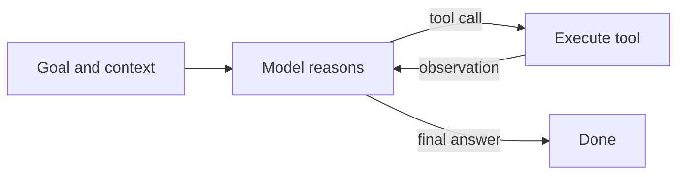

**Contents** [1. Foundations](#foundations) [2. Architecture patterns](#patterns) [3. Multi-agent systems](#multi) [4. Tool use and MCP](#tools) [5. Memory and context](#context) [6. Frameworks](#frameworks) [7. Build a loop](#build) [8. Evaluation](#eval) [9. Safety and control](#safety) [10. Production concerns](#production) [11. Study plan](#plan) [12. Self-test](#quiz) [13. Glossary](#glossary)

# Agentic Engineering

Architectures, agent frameworks, tool use, and building autonomous systems. A self-paced study guide with a build exercise, a self-test, and a glossary.

**How to use this guide.** Read sections 1 to 6 for the concepts, build the loop in section 7 yourself, then use sections 8 to 10 to learn what separates a demo from a system you can trust. Section 11 gives a four-week plan; section 12 is a self-test with hidden answers.

## 1. Foundations

### What is an agent?

An **agent** is a system in which a language model dynamically decides what to do next: which tools to call, in what order, and when to stop. The model is in control of the process. This contrasts with a **workflow**, where code defines the sequence of steps and the model fills in individual steps.

|  | Workflow | Agent |
| --- | --- | --- |
| Control flow | Fixed in code | Chosen by the model at runtime |
| Predictability | High | Lower |
| Cost and latency | Bounded and known | Variable, can grow |
| Best for | Well-understood, repeatable tasks | Open-ended tasks where steps cannot be predicted |
| Failure mode | Brittle on unexpected input | Drift, loops, compounding errors |

### The core loop

Nearly every agent is the same loop: the model sees the goal and history, emits either a final answer or tool calls, the harness executes the tools, and results are appended to the context. Everything else (frameworks, memory, multi-agent setups) is elaboration on this loop.



### Autonomy is a dial

1. **Single LLM call** with a good prompt (often enough).
2. **Augmented call**: retrieval, tools, memory.
3. **Workflow**: predefined multi-step pipeline.
4. **Agent**: model-directed loop.
5. **Multi-agent**: several agents coordinating.

The engineering rule of thumb: **use the simplest rung that solves the problem**, and climb only when you can show with evaluations that the simpler design falls short.

**Key points**

- Agent = model chooses the control flow. Workflow = code chooses it.
- The loop (reason, act, observe) is the foundation of everything else.
- More autonomy buys flexibility and costs predictability, money, and debuggability.

## 2. Architecture patterns

These are the building blocks. Real systems combine several.

### Workflow patterns

Prompt chaining

Break a task into sequential steps, each model call consuming the previous output, with optional programmatic checks (“gates”) between steps. Use when the task decomposes cleanly, for example outline, then draft, then translate.

Routing

A classifier call sends input to a specialized handler (different prompt, model, or tool set). Use for distinct categories, such as support triage, or to send easy queries to a cheaper model.

Parallelization

Run subtasks simultaneously (*sectioning*) or run the same task several times and aggregate (*voting*). Use for speed, or for confidence on high-stakes judgments.

Orchestrator-workers

A central model decomposes a task dynamically and delegates to worker calls, then synthesizes. Unlike parallelization, the subtasks are not known in advance. Common in coding and research agents.

Evaluator-optimizer

One call generates, another critiques against criteria, and the loop repeats. Works when you have clear evaluation criteria and iteration measurably improves output.

### Agent patterns

ReAct (reason and act)

Interleave a short reasoning step with an action and its observation. The default pattern behind most tool-using agents. Strength: adaptive. Weakness: can wander without a plan.

Plan-and-execute

Produce an explicit plan first, then execute step by step, replanning when a step fails. Better for long tasks; the plan acts as a checkpoint you can inspect, edit, or approve.

Reflection / self-critique

The agent reviews its own output or trajectory and revises. Most effective when grounded in external signal (tests pass, linter output, a retrieved source) rather than pure self-judgment.

Tool-augmented code execution

The agent writes and runs code as its action space instead of calling many discrete tools. Compact and powerful, but needs a sandbox.

### Choosing a pattern

| If the task is… | Start with |
| --- | --- |
| Fixed steps, known order | Prompt chaining |
| Several input types needing different handling | Routing |
| Independent subtasks, or need high confidence | Parallelization |
| Subtasks unknown until runtime | Orchestrator-workers |
| Quality improves with iteration and has a clear metric | Evaluator-optimizer |
| Open-ended, needs live feedback from the environment | ReAct agent, with a step budget |
| Long-horizon with checkpoints or human approval | Plan-and-execute |

## 3. Multi-agent systems

Multi-agent designs split work across several model instances, each with its own prompt, tools, and context window.

| Topology | How it works | Trade-off |
| --- | --- | --- |
| Supervisor / subagents | A lead agent delegates to specialists and merges results. | Simple to reason about; the lead is a bottleneck and single point of failure. |
| Hierarchical | Supervisors of supervisors for large task trees. | Scales, but each layer loses information. |
| Handoff / swarm | An agent transfers the conversation to another agent that is better suited. | Natural for customer-facing flows; control flow harder to trace. |
| Debate / critic panels | Several agents argue or vote. | Can reduce errors; multiplies cost. |
| Blackboard / shared state | Agents read and write a shared workspace. | Flexible; needs conflict handling. |

### Why use multiple agents

- **Context isolation:** a subagent can burn through tens of thousands of tokens exploring and hand back a short summary.
- **Parallelism:** independent research threads run at the same time.
- **Specialization:** narrow prompts and small tool sets reduce tool-selection errors.

### Why not

- Total token cost is typically several times that of a single agent.
- Coordination failures: duplicated work, conflicting edits, lost context at handoffs.
- Harder to debug, since failures spread across traces.

**Guidance.** Multi-agent helps most on breadth-first, parallelizable work (research, wide search). It helps least when agents share a lot of state and decisions are tightly coupled, as in many coding tasks. Start with one agent, and split only when context limits or parallelism demand it.

## 4. Tool use and MCP

### How function calling works

1. You describe each tool to the model: a name, a description, and a JSON Schema for the arguments.
2. The model responds with a structured request to call a tool with arguments (it does not run anything).
3. Your code validates the arguments, executes the tool, and returns the result as a message.
4. The model continues, possibly calling more tools, until it answers.

Models may request several independent tool calls in one turn (**parallel tool calls**). Execute them concurrently and return all results.

### Tool design is interface design

Treat tools as an **agent-computer interface**: the model is a user with no memory of your codebase and limited patience. Guidelines that consistently pay off:

- **Write descriptions like docstrings for a new hire.** State what the tool does, when to use it, when not to, and give an example.
- **Prefer fewer, higher-level tools** over a thin wrapper per API endpoint. Overlapping tools cause misselection.
- **Make arguments hard to misuse.** Use enums, clear names, and required fields. Example: require absolute file paths if relative paths caused errors.
- **Return useful, compact output.** Human-readable names over opaque IDs; support pagination and truncation so one call cannot flood the context.
- **Return actionable errors.** “Date must be YYYY-MM-DD; got ‘next week’” lets the model self-correct. A stack trace does not.
- **Test tools with the model.** Run many example tasks, read the transcripts, and refine names and descriptions where it stumbles.

### Example schema

```
{
  "name": "search_orders",
  "description": "Find a customer's orders. Use when the user asks about an order's status or contents. Do not use for refunds (use create_refund).",
  "input_schema": {
    "type": "object",
    "properties": {
      "customer_email": {"type": "string", "description": "Exact email on the account"},
      "status": {"type": "string", "enum": ["pending", "shipped", "delivered", "cancelled"]},
      "limit": {"type": "integer", "default": 5, "maximum": 20}
    },
    "required": ["customer_email"]
  }
}
```

### Model Context Protocol (MCP)

**MCP** is an open protocol that standardizes how applications expose tools, data (resources), and prompt templates to models. An **MCP server** wraps a service; an **MCP client** inside the agent host discovers and calls its capabilities. The benefit is write-once integration: one server works across any compatible host. The cost is that every connected server expands the tool list the model must choose from, and each server is a trust boundary (see section 9).

### Other action spaces

- **Code execution:** the model writes code in a sandbox; intermediate data stays out of the context window.
- **Computer use / browser use:** the model sees screenshots or the DOM and issues clicks and keystrokes. Flexible where no API exists, but slower and more error-prone than APIs.
- **Agent-to-agent protocols:** emerging standards (for example A2A) aim to let separately built agents discover and delegate to each other.

**Key points**

- The model proposes calls; your code validates and executes them.
- Tool descriptions and error messages are prompt engineering.
- Fewer, clearer, non-overlapping tools beat many thin ones.

## 5. Memory and context engineering

The context window is the agent’s working memory, and it is finite and noisy. **Context engineering** is the discipline of deciding what goes into it at each step.

| Kind | What it is | Typical implementation |
| --- | --- | --- |
| Working (short-term) | The current conversation and tool results | The message list |
| Episodic | Records of past runs | Logged trajectories, summaries, retrieved by similarity |
| Semantic | Facts and knowledge | Vector or keyword search over documents (RAG) |
| Procedural | How to do things | System prompts, skills, instruction files |

### Techniques

- **Just-in-time retrieval:** keep lightweight references (file paths, URLs, IDs) in context and let the agent load details on demand, rather than preloading everything.
- **Compaction:** as history nears the limit, summarize it (decisions, open issues, key facts) and continue with the summary.
- **Tool-result clearing:** drop stale, bulky tool outputs once they have been used.
- **Structured notes / scratchpad:** the agent writes progress to an external file or store and rereads it, surviving context resets.
- **Subagent delegation:** offload exploration to an isolated context and return only a distilled result.
- **Prompt caching:** keep the stable prefix (system prompt, tool definitions) identical across calls to cut cost and latency.

**Failure modes to know:** *context poisoning* (a wrong fact enters and keeps being reused), *distraction* (irrelevant content pulls attention), *confusion* (too many tools or documents), and *clash* (contradictory instructions or evidence).

## 6. Agent frameworks

A framework gives you the loop, tool plumbing, state handling, tracing, and sometimes multi-agent orchestration. Choose based on the control you need, not popularity.

| Framework | Style | Notable strengths |
| --- | --- | --- |
| LangGraph | Agents as explicit state graphs (nodes, edges, conditional routing) | Fine-grained control, checkpointing, human-in-the-loop interrupts, durable execution |
| Claude Agent SDK | Agent harness with built-in tools, subagents, hooks, permissions, MCP | Production-grade loop and context management you do not have to write |
| OpenAI Agents SDK | Small set of primitives: agents, handoffs, guardrails, tracing | Minimal abstractions, built-in tracing and handoffs |
| CrewAI | Role-based “crews” of agents with tasks | Quick to prototype team-style workflows |
| AutoGen / AG2 and Microsoft Agent Framework | Conversational multi-agent patterns | Multi-agent conversation research lineage; enterprise integration |
| LlamaIndex | Data-centric agents and workflows | Strong retrieval and document tooling |
| Pydantic AI | Type-safe agents with validated outputs | Python ergonomics, structured output, testability |
| smolagents | Small library; agents that act by writing code | Simplicity, code-as-action |
| Google ADK, Semantic Kernel | Vendor-ecosystem toolkits | Integration with their cloud and enterprise stacks |

**This landscape changes quickly.** Names, APIs, and maintenance status shift every few months, and this table reflects knowledge up to mid-2026. Check each project’s current docs before committing.

### Selection heuristics

- **Learn the raw loop first** (section 7). It makes every framework easier to evaluate and debug.
- **Need explicit, auditable control flow or durable long-running state?** Graph-style frameworks fit.
- **Need a capable general agent quickly?** Use a harness SDK that already handles tools, permissions, and context.
- **Frameworks add abstraction layers.** If you cannot see the actual prompts and tool calls, you cannot debug them. Prefer frameworks that expose traces.
- **Avoid lock-in** by keeping tools behind MCP or your own thin interface.

## 7. Build the loop yourself

This is the single most useful exercise in the guide. The pseudocode below is provider-neutral; map it onto any model API that supports tool calling.

```
def run_agent(goal, tools, llm, max_steps=10):
    messages = [{"role": "user", "content": goal}]

    for step in range(max_steps):
        reply = llm(messages, tools=tool_schemas(tools))
        messages.append(reply.as_message())

        if not reply.tool_calls:          # model chose to answer
            return reply.text

        for call in reply.tool_calls:     # run (ideally concurrently)
            try:
                args = validate(tools[call.name].schema, call.args)
                result = tools[call.name].run(**args)
            except Exception as e:
                result = f"Error: {e}"    # let the model recover
            messages.append({
                "role": "tool",
                "tool_call_id": call.id,
                "content": truncate(result, limit=4000),
            })

    raise TimeoutError("step budget exceeded")
```

### Exercises, in order

1. Implement the loop with two tools: a calculator and a file reader.
2. Add a **step budget**, a **token budget**, and loop detection (same call with same args three times).
3. Add a **permission check**: write or delete tools require a human “yes”.
4. Add **tracing**: log every model call and tool call with timing and cost to a JSONL file.
5. Add **compaction** when the message list passes a size threshold.
6. Add a **plan step** that the user can approve before execution.
7. Split one capability into a **subagent** that returns only a summary.

## 8. Evaluation and observability

You cannot improve what you cannot measure, and agents are non-deterministic. Build evaluations before you build features.

### What to evaluate

- **Outcome:** did the task get done correctly? Check the end state (the file changed, the record exists, the tests pass), not just the final message.
- **Trajectory:** were the steps sensible, efficient, and safe? Were the right tools used with valid arguments?
- **Cost and latency:** tokens, tool calls, wall-clock time per task.
- **Reliability:** run each task several times. A task solved 1 of 5 attempts is not a solved task. Track consistency (pass^k), not just best-of-k.

### Methods

- **Task suite:** start with 20 to 50 realistic tasks drawn from real usage, including hard and ambiguous ones.
- **Code-based graders** for anything checkable; **LLM-as-judge** with a clear rubric for the rest (validate the judge against human labels).
- **Human review** of sampled transcripts. Reading traces is the highest-value debugging activity.
- **Regression gates:** rerun the suite on every prompt, tool, or model change.
- **Production monitoring:** trace everything, sample for review, alert on cost spikes and error rates.

Public benchmarks (software-engineering, web-navigation, tool-use suites) are useful for orientation but rarely substitute for evaluations built on your own tasks.

## 9. Safety and control

An agent that can act can act wrongly. Security and safety are design requirements, not afterthoughts.

### Principal risks

- **Prompt injection:** instructions hidden in web pages, emails, documents, or tool output that hijack the agent. Any untrusted content the agent reads is a potential attack channel.
- **Excessive agency:** broader tools or permissions than the task needs.
- **Data exfiltration:** the “lethal trifecta” of access to private data, exposure to untrusted content, and an outbound channel in the same agent.
- **Unintended destructive actions:** deleting, overwriting, spending, or sending irreversibly.
- **Malicious or compromised tool servers** and poisoned tool descriptions.

### Defenses (layer them)

1. **Least privilege:** scope credentials and tools to the task; read-only by default.
2. **Sandboxing:** run code and browsers in isolated environments with restricted network and filesystem access.
3. **Human-in-the-loop** for irreversible, costly, or external-facing actions.
4. **Separate trust levels:** treat tool output and retrieved content as data, never as instructions. Break the lethal trifecta by removing at least one leg.
5. **Input and output guardrails:** classifiers and validators for injection attempts, sensitive data, and policy violations. Useful, but not sufficient alone.
6. **Hard limits:** step, time, spend, and rate budgets enforced in code, not in the prompt.
7. **Audit logs** for every action, and reversible operations (soft delete, dry-run modes, version control) wherever possible.

**Principle.** Never rely on the prompt alone to enforce a security boundary. Enforce it in code, permissions, and infrastructure.

## 10. Production concerns

Error compounding

If each step is 95% reliable, a 20-step run succeeds about 36% of the time. Shorten trajectories, add verification steps, and make steps retryable.

Durability

Long runs crash. Checkpoint state so a run can resume. Make tool calls idempotent, or use idempotency keys so a retry does not double-charge or double-send.

Cost control

Route easy work to smaller models, cache stable prefixes, cap steps and tokens, and clear stale context. Track cost per successful task, not per call.

Latency

Parallelize tool calls, stream output, and run long tasks in the background with notifications.

Determinism where possible

Use structured outputs, validated schemas, and code for anything code can do. Reserve the model for judgment and language.

Versioning

Treat prompts, tool definitions, and model choice as versioned artifacts. Pin model versions and rerun evaluations before upgrading.

Graceful failure

Define what the agent does when stuck: ask a clarifying question, hand off to a human, or stop with a clear report of what was done and what was not.

## 11. Four-week study plan

| Week | Focus | Deliverable |
| --- | --- | --- |
| 1 | Foundations, function calling, the raw loop (sections 1, 4, 7) | A working tool-using agent with budgets and tracing, no framework |
| 2 | Patterns and context (sections 2, 3, 5) | Rebuild the same task as a prompt chain, a router, and an orchestrator-workers system; compare cost and accuracy |
| 3 | Frameworks and MCP (sections 4, 6) | Port your agent to one framework; expose one tool through an MCP server |
| 4 | Evaluation, safety, production (sections 8 to 10) | A 30-task eval suite, a permission layer, and a short write-up of failures found |

### Project ideas

- A research agent that answers questions with cited sources and a verification pass.
- A codebase assistant that reads files, proposes a patch, and runs tests to check it.
- A support triage agent with routing, a knowledge base, and human approval for refunds.
- A data-analysis agent that writes and runs code in a sandbox and reports findings.

### Reading list

These are sources worth seeking out. I cannot search or verify them from here, so confirm titles, authors, and details yourself before relying on them.

- Anthropic’s engineering write-ups on building effective agents, writing tools for agents, and context engineering.
- The ReAct paper (Yao et al., 2022) and the Reflexion paper (Shinn et al., 2023).
- The Model Context Protocol specification and documentation.
- Documentation for whichever framework you choose in week 3.
- Simon Willison’s writing on prompt injection and the “lethal trifecta”.

## 12. Self-test

Answer in your head or on paper first, then open the answer.

1\. What distinguishes an agent from a workflow?

In a workflow, code defines the control flow and the model fills in steps. In an agent, the model dynamically decides which tools to call, in what order, and when to stop.

2\. When should you not build an agent?

When a single prompt, an augmented call, or a fixed workflow meets your quality bar. Agents add cost, latency, and unpredictability, so use them only for open-ended tasks where steps cannot be predetermined and where evals show simpler designs fall short.

3\. Describe the sequence of events in one tool call.

You declare tools with schemas. The model returns a structured request naming a tool and arguments. Your code validates and executes it, then returns the result to the model as a message. The model then continues or answers. The model never executes anything itself.

4\. Name three properties of a well-designed tool.

Any three of: a clear description with when to use and when not to; non-overlapping scope with other tools; arguments constrained by types and enums; compact output with pagination or truncation; actionable error messages; validated by testing with the model on real tasks.

5\. Which pattern fits “subtasks are unknown until runtime”?

Orchestrator-workers. A central model decomposes the task dynamically and delegates to workers. Plain parallelization assumes the subtasks are known ahead of time.

6\. Give two benefits and two costs of multi-agent systems.

Benefits: context isolation, parallelism, specialization. Costs: much higher total token use, coordination failures (duplicated work, lost context at handoffs), harder debugging.

7\. What is compaction, and when do you use it?

Summarizing conversation history (decisions, open issues, key facts) and continuing with the summary when the context window nears its limit. It is used for long-running tasks. Pair it with structured notes stored outside the context for critical facts.

8\. What is the “lethal trifecta”?

An agent that has access to private data, is exposed to untrusted content, and can communicate externally. Together these enable prompt-injection-driven data exfiltration. Remove at least one leg.

9\. A 20-step agent has 95% per-step reliability. What is its approximate success rate, and what does that imply?

0.95^20 is about 36%. Errors compound, so shorten trajectories, add verification and retries, and checkpoint progress.

10\. Why run each eval task multiple times?

Agents are non-deterministic. A single pass can hide flakiness. Measuring the rate of success over repeated runs (consistency) tells you whether the agent is dependable, not just capable on a lucky run.

11\. Why is “tell the model never to do X in the system prompt” insufficient as a security control?

Prompts can be overridden by injected content or simply ignored. Enforce boundaries with permissions, sandboxing, scoped credentials, and hard limits in code.

12\. What does MCP standardize, and what risk does it add?

It standardizes how tools, resources, and prompts are exposed to models, so one server works across many hosts. Risks: larger tool lists that confuse selection, and each server being a trust boundary that could be malicious or compromised.

## 13. Glossary

Agent harness

The code around the model: the loop, tool execution, permissions, context management, and logging.

Agent-computer interface (ACI)

The design of tools and their descriptions from the model’s point of view.

Checkpointing

Persisting agent state so a run can pause, resume, or replay.

Context engineering

Curating what information is in the model’s context at each step.

Function calling / tool use

A model emitting structured requests for external operations.

Guardrail

A check on inputs or outputs that blocks, flags, or modifies unsafe or invalid content.

Handoff

Transferring control of a conversation from one agent to another.

Human-in-the-loop (HITL)

Requiring human approval or input at defined points.

LLM-as-judge

Using a model to grade outputs against a rubric.

MCP

Model Context Protocol, an open standard for connecting models to tools and data.

ReAct

A pattern interleaving reasoning with actions and observations.

RAG

Retrieval-augmented generation: fetching relevant documents into context before or during generation.

Prompt injection

Malicious instructions embedded in content the model processes.

Sandbox

An isolated environment limiting what executed code can access.

Subagent

An agent spawned by another agent, usually with its own isolated context.

Trajectory

The full sequence of model outputs, tool calls, and observations in a run.

Prepared November 2026. Framework details and product names evolve quickly; verify against current documentation.